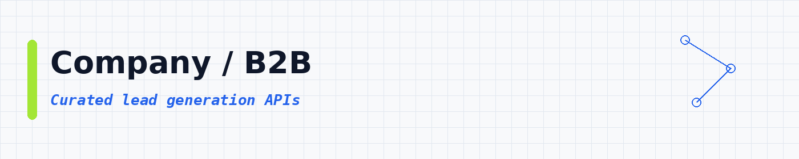
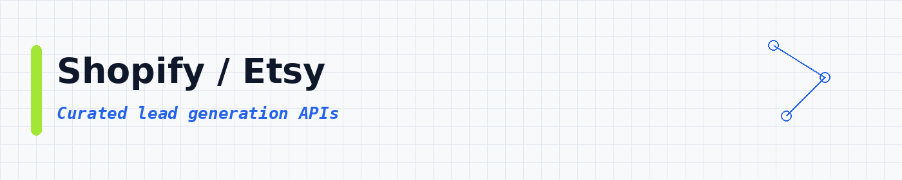
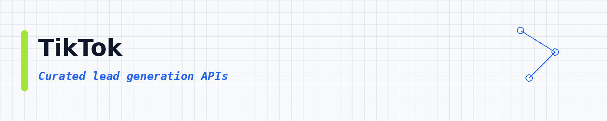
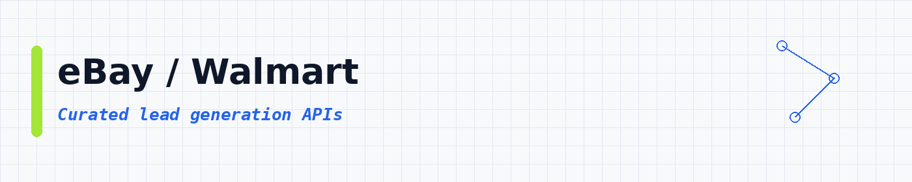

# Lead Generation APIs: Find People Who Want to Buy From You

 

 
 
 

 <a href="#top-10-most-popular">Top 10</a> ·
 <a href="#table-of-contents">Categories</a>

Looking for new customers? Tell one of these APIs what kind of business you want, and it builds a list with names, emails and phone numbers. **13,606 ready-to-use APIs**, sorted by real users so the best ones come first.

These lead generation APIs help you build B2B prospect lists from Google Maps, LinkedIn, directories and marketplaces. Use them as a lead scraper, email finder, local business scraper and CRM enrichment tool for sales outreach, cold email and agency prospecting. Each API runs in the cloud and exports JSON, CSV or Excel, ready for your outbound tools.

---

## Collection statistics

| Metric | Count |
|--------|-------|
| **Lead Generation APIs** | **13,606** |
| **Categories** | **18** |
| **Last updated** | 2026-11-02 |

---

## What is a lead generation API?

A lead generation API is a tool you call to find people or businesses you might sell to. Things like name, email, phone, company and LinkedIn URL. You give it a search, map area or company list. It gives you clean rows you can save as CSV or JSON.

People also call this a lead scraper, an email finder or a B2B leads API. Same idea: get leads without copying them by hand.

---

## What can you build?

These **13,606 ready-to-use lead generation APIs** help you pull prospects into your own apps. You can:

- Find local business leads from maps and directories
- Pull B2B emails and phone numbers that are public on the web
- Enrich CRM rows with company and person fields
- Build lists from LinkedIn-style public profiles
- Collect seller contacts from marketplaces
- Verify emails before you import them
- Export clean CSV or JSON for outbound tools

Pick an API below, open it, try a small run, then export the results.

<b>Who uses lead generation APIs? (click to open)</b>

- **Sales reps:** build a fresh list of businesses that fit your ideal customer.
- **Agencies:** find local companies that need a website, ads or SEO.
- **Startup founders:** get your first customers without paying for expensive lead tools.
- **Recruiters:** source people and companies by role, location and industry.
- **Marketers:** enrich your CRM with emails, phones and company details.

---

## ⭐ Star This Repository

If this API list helped you, please give it a star! ⭐

Your support helps other people discover this resource and keeps the list updated and growing.

---

## Table of contents

- [Email / Phone](#email-phone) : **4,323**
- [Google / Maps](#google-maps) : **1,946**
- [Other / General](#other-general) : **1,673**
- [Jobs / Recruiting](#jobs-recruiting) : **881**
- [LinkedIn](#linkedin) : **781**
- [Company / B2B](#company-b2b) : **766**
- [Real Estate](#real-estate) : **701**
- [SEO / SERP](#seo-serp) : **626**
- [AI / Agents / MCP](#ai-agents-mcp) : **538**
- [Reviews / Brand](#reviews-brand) : **445**
- [Shopify / Etsy](#shopify-etsy) : **214**
- [Instagram](#instagram) : **213**
- [Facebook / Meta](#facebook-meta) : **121**
- [News / Content](#news-content) : **113**
- [TikTok](#tiktok) : **105**
- [X / Twitter](#x-twitter) : **84**
- [Amazon](#amazon) : **51**
- [eBay / Walmart](#ebay-walmart) : **25**

---

## Top 10 most popular

| API | What it does | Users | Rating | Price |
|-----|-------------|-------|--------|-------|
| [Google Maps Scraper](https://apify.com/compass/crawler-google-places?fpr=data) | Extract data from thousands of Google Maps locations and businesses, including reviews, reviewer details, images, contact info, including f… | 678.3K | 4.71 | Pay per event |
| [Google Maps Extractor](https://apify.com/compass/google-maps-extractor?fpr=data) | Extract data from hundreds of places fast. Scrape Google Maps by keyword, category, location, URLs & other filters. Get addresses, contact… | 105.4K | 4.86 | Pay per event |
| [📩📍 Google Maps Email Extractor](https://apify.com/lukaskrivka/google-maps-with-contact-details?fpr=data) | Extract Google Maps contact details. Scrape websites of Google Maps places for contact details and get email addresses, website, location,… | 93.9K | 4.64 | Pay per event |
| [Google Maps Reviews Scraper](https://apify.com/compass/Google-Maps-Reviews-Scraper?fpr=data) | Extract all reviews of Google Maps places using place URLs. Get review text, published date, response from owner, review URL, and reviewer'… | 66.9K | 4.86 | Pay per event |
| [Contact Details Scraper](https://apify.com/vdrmota/contact-info-scraper?fpr=data) | Email extractor and lead scraper to extract and download emails, phone numbers, Facebook, Twitter, LinkedIn, Instagram, Threads, Snapchat,… | 66.4K | 4.23 | Pay per event |
| [✨Leads Finder - $1.5/1k leads with Emails [Apollo Alternative]](https://apify.com/code_crafter/leads-finder?fpr=data) | ✅ Affordable alternative to ZoomInfo, Lusha & Apollo. ✅ Get Business email, 📞Mobile Number, Personal email, LinkedIn profiles, company deta… | 49.7K | 3.44 | Pay per event |
| [Facebook Search Scraper](https://apify.com/silentflow/facebook-search-scraper?fpr=data) | Search Facebook by keyword and export posts, pages, places, events and people as clean structured data. Get text, author, reactions breakdo… | 23.7K | n/a | Pay per event |
| [🍏 Leads Finder: Email 📧 + Mobile Number 📞​](https://apify.com/microworlds/leads-finder?fpr=data) | ✅ Cheap alternative to Apollo, ZoomInfo & Lusha. ✅ Get business emails, LinkedIn profiles, company details etc.. With verified email 📧 and… | 23.2K | 2.85 | Pay per event |
| [Naukri Job Scraper \| India & Gulf Jobs](https://apify.com/muhammetakkurtt/naukri-job-scraper?fpr=data) | Naukri Job Scraper extracts job postings from Naukri.com (India) and NaukriGulf.com (Gulf). Scrape job title, company, salary, experience,… | 21.8K | 4.42 | Pay per event |
| [Skip Trace](https://apify.com/one-api/skip-trace?fpr=data) | Locate hard-to-find individuals with our powerful skip trace/tracing API. TruePeopleSearch, Fastpeoplesearch, Lead Finder, Truthfinder, Spo… | 21.0K | 4.32 | Pay per event |

---

## Email / Phone

**4,323 APIs in this category** | [View all →](lists/email-phone.md)

| API | What it does | Users | Rating | Price |
|-----|-------------|-------|--------|-------|
| [Skip Trace](https://apify.com/one-api/skip-trace?fpr=data) | Locate hard-to-find individuals with our powerful skip trace/tracing API. TruePeopleSearch, Fastpeoplesearch, Lead Finder, Truthfinder, Spo… | 21.0K | 4.32 | Pay per event |
| [Email Verifier by Million Verifier - $1/1k emails](https://apify.com/account56/email-verifier?fpr=data) | ✅ #1 Email Verification Service ✅ Only pay for valid and invalid emails ✅ No charge for catch all emails ✅ Easily verify emails from apollo… | 18.4K | 4.46 | Pay per event |
| [Deep Email, Phone, & Social Media Scraper Search](https://apify.com/peterasorensen/snacci?fpr=data) | A powerful tool that searches emails, phone numbers, and social media profiles from any website. It intelligently navigates, prioritizing p… | 5.3K | 4.86 | Pay per event |
| [Telegram Phone Number Lookup](https://apify.com/akula.marketing/Telegram-Get-Phone-Info?fpr=data) | Look up Telegram accounts by phone number. Get username, profile photo, premium status, and account details for lead verification and OSINT. | 4.6K | 4.94 | Pay per event |
| [ThatsThem Scraper \| Skip Trace by Name, Phone, Address & Email](https://apify.com/memo23/skip-trace-people-finder?fpr=data) | Look up a US name, phone, address or email on ThatsThem: one public-records row per match with address history, relatives and aliases. Phon… | 4.1K | n/a | Pay per event |
| [Decision makers Email finder📧 $1/1K Emails, Super cheap.](https://apify.com/snipercoder/decision-maker-email-finder?fpr=data) | \|Input: Domain\| \|Output: Name, Email, Title, Company, etc of Decision makers.\| Perfect for Lead Generation, Email campaigns, Data Enric… | 3.2K | 3.96 | Pay per event |
| [Apollo People Leads Scraper](https://apify.com/coladeu/apollo-people-leads-scraper?fpr=data) | This API can scrape structured people data from Apollo.io. This scraper do NOT provide email addresses or telephone numbers. It does not re… | 2.9K | n/a | Pay per event |
| [Email Finder & Verifier: B2B Email Lookup API](https://apify.com/clearpath/email-finder-api?fpr=data) | Find verified business emails using first name, last name, and company domain. Tests common patterns and validates with SMTP checks. Upload… | 2.7K | 3.84 | Pay per event |
| [Extract Emails, Socials and Contacts from Any Website](https://apify.com/logical_scrapers/extract-email-from-any-website?fpr=data) | Extract emails from websites in bulk. Website email scraper and email extractor: extract email from website pages, plus social links and ph… | 2.5K | 5.00 | Pay per event |
| [Website Email & Phone Finder](https://apify.com/caprolok/website-email-phone-finder?fpr=data) | Accelerate your outreach by using our Contact Details Scraper to quickly gather emails from any domain, enhancing your marketing strategies… | 2.4K | 4.18 | Pay per event |
| [Email Finder (100% accurate)](https://apify.com/overpowered/email-finder?fpr=data) | Find 100% valid prospect email by inputing name, surname and domain | 2.1K | 4.66 | Pay per event |
| [Email Domain Scraper: Extract Emails From Websites by Domain](https://apify.com/s-r/free-email-domain-scraper?fpr=data) | Enter up to 10 company domains or website URLs and get the email addresses published for each one: one row per address with its domain, rea… | 1.9K | 5.00 | Pay per event |
| [Leads Scraper - ✅ Up to 10k with EMAILS ✅ similar to Apollo](https://apify.com/unlimitedleadtestinbox/unlimited-leads-scraper---up-to-10k-with-emails?fpr=data) | Scrape Up to 10K leads per run with emails. Similar to Apollo. Using Unlimited leads database | 1.9K | 3.38 | Free |
| [Whatsapp Number Validator (Pay Per Result)](https://apify.com/vtrdev/whatsapp-number-validator?fpr=data) | Quickly verify WhatsApp presence for phone numbers. Enjoy accurate, bulk validation with pay-per-result pricing. Validate up to 19.200 numb… | 1.4K | 4.18 | Pay per event |
| [Snapchat Email Scraper](https://apify.com/easyapi/snapchat-email-scraper?fpr=data) | 🚀 Effortlessly scrape email addresses from Snapchat profiles! 👻 Find Snapchat users matching your keywords and specific email domains. Perf… | 1.3K | 1.00 | Pay per event |
| [Apollo Companies Leads Scraper](https://apify.com/coladeu/apollo-organizations-scraper?fpr=data) | This API can scrape structured companies data from Apollo.io, including emails and phone numbers. It does not require Apollo account cookie… | 1.3K | 1.00 | Pay per event |
| [WhatsApp Number Validator (Single and Bulk)](https://apify.com/api_factory/whatsapp-number-validator-single-and-bulk?fpr=data) | 📞 WhatsApp: +447984004914 📧 E-mail: contact@apifactory.pro Instantly check and validate WhatsApp phone numbers programmatically. Verify act… | 1.3K | 3.27 | Pay per event |
| [Email Verifier & Deliverability Checker](https://apify.com/yasir-on-apify/email-verifier-deliverability-checker?fpr=data) | Verify single emails or bulk email lists with deliverability checks, quality scores, and disposable, catch-all and role account detection.… | 1.3K | 5.00 | Pay per event |
| [Avvo Scraper with Mails \| US Lawyer Directory](https://apify.com/fatihtahta/avvo-scraper?fpr=data) | Get verified US attorney profiles from Avvo.com including names, contacts, firms, ratings, practice areas, and locations. Build legal direc… | 1.3K | 5.00 | Pay per event |
| [Yandex Maps Scraper \| Парсер Яндекс Карт: Leads & Reviews](https://apify.com/zen-studio/yandex-maps-scraper?fpr=data) | Unofficial Yandex Maps API. Scrape business data, phone numbers, emails, reviews, photos, and posts from Russia, Turkey, and CIS. Export 80… | 1.3K | 3.59 | Pay per event |
| [Clutch.co Scraper: Agencies, Reviews, Emails + AI Insights](https://apify.com/memo23/apify-clutch-cheerio?fpr=data) | Clutch.co scraper for B2B lead gen: agency profiles with 30+ fields, reviews, hourly rates, employee counts, contact emails and buyer leads… | 1.2K | 4.60 | Pay per event |
| [Website Contact Scraper: Email, Phone & Social](https://apify.com/logiover/website-contact-scraper?fpr=data) | Bulk email and contact extractor for any website. Scrape emails, phones and social links with no API and export leads to CSV or JSON. | 1.1K | n/a | Pay per event |
| [Bulk Decision makers Email finder📧 💲$0.8/1K Emails, cheap.](https://apify.com/snipercoder/bulk-decision-makers-email-finder?fpr=data) | \|Input: Domain\| \|Output: Name, Email, Title, Company, etc of Decision makers In Bulk.\| Perfect for Lead Generation, Email campaigns, an… | 1.1K | 1.56 | Pay per event |
| [Email Finder by Name and Domain📧 $1/1K Emails, Super Cheap.](https://apify.com/snipercoder/email-finder-by-name-and-domain?fpr=data) | Input: Name and Domain. Output: Email. Quickly find verified email addresses with 97%+ Accuracy. Perfect for Lead Generation, Email campaig… | 1.1K | 5.00 | Pay per event |
| [Find Mobile Phones of Decision Makers](https://apify.com/parvenu/mobile-phone-enrichment?fpr=data) | Find mobile phones for decision makers for $.20 / cell phone | 1.1K | 5.00 | Pay per event |
| [Advanced Website Email, Phone and Social Media Scraper](https://apify.com/perfectscrape/actor?fpr=data) | This advanced contact scraper is an ALL-IN-ONE scraper that navigates pages likely to contain contact data, extracting emails, phone number… | 1.1K | 1.64 | Free |
| [Telegram Number Validator: Bulk Check](https://apify.com/clearpath/telegram-phone-number-validator?fpr=data) | Bulk verify phone numbers for active Telegram accounts. Check 1,000-10,000 numbers per run. Upload CSV or Excel files, get instant yes/no r… | 1.1K | 5.00 | Pay per event |
| [Sales Navigator Search Scraper ⚡ No Cookies ✅](https://apify.com/pratikdani/sales-navigator-search-scraper-no-cookies?fpr=data) | This tool efficiently scrapes contact and company data from Sales Navigator search results without needing cookies. It extracts individual… | 1.0K | n/a | Pay per event |
| [Contact Info Scraper](https://apify.com/delicious_zebu/contact-info-scraper?fpr=data) | Crawl any website and get one deduplicated row per company: emails with deliverability checks (MX, role mailbox), validated phone numbers,… | 1.0K | 5.00 | Pay per event |
| [Business Address Finder: Company HQ Address From Any Domain](https://apify.com/s-r/free-addresses-scraper---find-hq-addresses-from-any-domain?fpr=data) | Turn a list of company domains into structured business addresses: company name, street with number, city, state or province, postal code a… | 983 | 5.00 | Pay per event |
| [G2 Scraper: Reviews by Product Name · AI Insights + Emails](https://apify.com/memo23/g2-scraper?fpr=data) | Scrape G2.com software reviews: search by product name (Slack, HubSpot) or by category, no G2 URL needed. Get ratings, pros and cons, verif… | 957 | 4.33 | Pay per event |
| [Email Verify & Validate: Fastest Cheapest](https://apify.com/devil_port369-owner/email-verifier?fpr=data) | Bulk email verifier: SMTP probing, DNS/MX lookup, catch-all & disposable detection. Safe-to-send recommendations for every address. Perfect… | 913 | 4.96 | Pay per event |
| [Website Lead Intelligence: Find the Right Person, Verified](https://apify.com/ryanclinton/website-contact-scraper?fpr=data) | Turn company websites into ready-to-email decision-makers. Verified emails, named contacts ranked by seniority, buying-committee classifica… | 883 | 4.38 | Pay per event |
| [Phone Number Lookup & Enrichment: Reverse Phone & Carrier](https://apify.com/logical_vivacity/phone-number-enrichment?fpr=data) | Turn phone numbers into people. Validates any number worldwide (E.164, carrier, line type, location) and, for US numbers, identifies the ow… | 813 | n/a | Pay per event |
| [SKOOL \| Members/Groups \| Discovery Search \| Scraper (PPE)](https://apify.com/memo23/skool-members-scraper?fpr=data) | No login needed for public Skool communities: export members: name, bio, location, social links, join date. Roster, admins and member searc… | 791 | 3.98 | Pay per event |
| [Email Pattern Finder: Discover Company Email Formats](https://apify.com/ryanclinton/email-pattern-finder?fpr=data) | Detect the email naming convention any company uses (first.last, flast, first_last, etc.) from public sources: website, GitHub, WHOIS, and… | 761 | 1.00 | Pay per event |
| [Lead Extractor: JustDial](https://apify.com/happitap/lead-extractor---justdial?fpr=data) | Lead Extractor is an automation tool that extracts business leads and contact details from Justdial. Instantly collect company names, phone… | 759 | 5.00 | Pay per event |
| [Yelp Scraper: Business Leads, Phones & Websites](https://apify.com/delicious_zebu/yelp-advanced-business-scraper-pay-per-result?fpr=data) | Scrape Yelp business data & leads at scale: names, ratings, reviews, contact info, hours, amenities, popular dishes, health scores, Q&A & m… | 735 | 4.96 | Pay per event |
| [ThomasNet Suppliers Real-Time Scraper (2026)](https://apify.com/zen-studio/thomasnet-suppliers-scraper?fpr=data) | Extract 70+ ThomasNet supplier fields: phone numbers, company data, products, locations and certifications, plus the emails suppliers publi… | 717 | 4.54 | Pay per event |
| [Yellow-Pages-Scraper-withEmail](https://apify.com/krish_patel/yellow-pages-scraper-withEmail?fpr=data) | Allows you to gather leads from yellow pages along with their corresponding email if any. | 678 | n/a | Free |

[View all 4,323 in this section →](lists/email-phone.md)

## Google / Maps

**1,946 APIs in this category** | [View all →](lists/google-maps.md)

| API | What it does | Users | Rating | Price |
|-----|-------------|-------|--------|-------|
| [Google Maps Scraper](https://apify.com/compass/crawler-google-places?fpr=data) | Extract data from thousands of Google Maps locations and businesses, including reviews, reviewer details, images, contact info, including f… | 678.3K | 4.71 | Pay per event |
| [Google Maps Extractor](https://apify.com/compass/google-maps-extractor?fpr=data) | Extract data from hundreds of places fast. Scrape Google Maps by keyword, category, location, URLs & other filters. Get addresses, contact… | 105.4K | 4.86 | Pay per event |
| [📩📍 Google Maps Email Extractor](https://apify.com/lukaskrivka/google-maps-with-contact-details?fpr=data) | Extract Google Maps contact details. Scrape websites of Google Maps places for contact details and get email addresses, website, location,… | 93.9K | 4.64 | Pay per event |
| [Google Maps Reviews Scraper](https://apify.com/compass/Google-Maps-Reviews-Scraper?fpr=data) | Extract all reviews of Google Maps places using place URLs. Get review text, published date, response from owner, review URL, and reviewer'… | 66.9K | 4.86 | Pay per event |
| [Google Maps Scraper $1/1k places 📍 with emails 📧](https://apify.com/microworlds/crawler-google-places?fpr=data) | Extract data from thousands of Google Maps locations and businesses, including reviews, reviewer details, images, contact info, including f… | 17.8K | 4.26 | Pay per event |
| [Leads Scraper ✅ $1/1k with EMAILS ✅ Apollo \| LinkedIn Profile](https://apify.com/peakydev/leads-scraper-ppe?fpr=data) | ✅ - Cheap ways to Extract leads with verified ☎️ Mobile ✅ Work & Personal Emails. Similar to Apollo, ZoomInfo, Lusha, LinkedIn \| Google Ma… | 17.8K | 3.98 | Pay per event |
| [Google Maps Scraper \| $0.25/1K Results 💰](https://apify.com/scraperlink/google-maps-scraper?fpr=data) | 🔥 $0.25/1K results🔥 **CHEAPEST** Google Maps Scraper on: 10× cheaper than competitors. Proxies & platform costs included. Results in second… | 5.5K | 4.97 | Pay per event |
| [Google Maps Scraper](https://apify.com/vortex_data/google-maps?fpr=data) | Stop wasting your budget on slow, resource-heavy browser-based scrapers. This is the fastest, most cost-effective, and data-rich Google Map… | 4.5K | 4.77 | Pay per event |
| [20+ Million Business Leads With Emails (From Google Maps)](https://apify.com/xmiso_scrapers/millions-us-businesses-leads-with-emails-from-google-maps?fpr=data) | Don't have time to scrape google maps? Looking for affordable B2B data apollo.io alternative? Get recent leads from continuously updated da… | 3.3K | 4.75 | Pay per event |
| [Google Maps Scraper](https://apify.com/poidata/google-maps-scraper?fpr=data) | 🔥 $0.40/1K results 🔥 Get 📧 emails, 📞 phones, 🌐 websites, 📱 social profiles, addresses, ratings, reviews, hours & more. Find businesses by k… | 3.1K | 4.34 | Pay per event |
| [Google Maps Scraper](https://apify.com/boztek-ltd/google-maps-scraper?fpr=data) | Extract data from thousands of Google Maps locations and businesses, including reviews, reviewer details, images, contact info, including f… | 2.9K | 4.39 | Pay per event |
| [Google Maps Scraper](https://apify.com/epctex/google-maps-scraper?fpr=data) | Effortlessly gather places data from Google Maps using our advanced scraper. Search by keyword or location, retrieve reviews, and analyze i… | 2.6K | 4.02 | Free |
| [📩 Google Maps Email Extractor](https://apify.com/poidata/google-maps-email-extractor?fpr=data) | Quickly collect all business details, including emails, phone numbers, and social media links from Google Maps listings and their websites.… | 2.5K | 1.89 | Pay per event |
| [Google Maps Reviews Scraper](https://apify.com/web_wanderer/google-reviews-scraper?fpr=data) | Scrape all Google Maps reviews using keywords, place URLs, or IDs. Filter by date, rating, or keyword, and capture reviewer details, transl… | 2.3K | 4.69 | Pay per event |
| [Google Maps Business Leads Scraper (Email, Phone...)](https://apify.com/lurkapi/google-maps-business-leads-scraper?fpr=data) | Scrape business listings from Google Maps and enrich with emails, phones, and social profiles from each company website. Lead generation in… | 2.1K | 4.85 | Pay per event |
| [Google Maps Reviews Scraper: Most Comprehensive](https://apify.com/kaix/google-maps-reviews-scraper?fpr=data) | 🔥 ~$0.04/1K reviews + FREE review photos 🔥 Extract all reviews with ratings, text, translations, photos, author details, owner responses, s… | 2.0K | 4.89 | Pay per event |
| [Enrich Google Maps Dataset with Contacts](https://apify.com/compass/enrich-google-maps-dataset-with-contacts?fpr=data) | Enrich Google Maps Dataset with Contacts. Scrape websites of Google Maps places for contact details and get email addresses, website, locat… | 1.9K | 3.13 | Free |
| [Google Maps Scraper: Most Comprehensive](https://apify.com/kaix/google-maps-places-scraper?fpr=data) | 🔥 ~$0.06/1K places + FREE contact details (email, phone, and more..) 🔥 Scrape businesses and locations with 76+ fields per place including… | 1.8K | 4.34 | Pay per event |
| [Businesses Without Websites Leads Scraper (Google Maps)](https://apify.com/xmiso_scrapers/businesses-without-websites-leads-scraper-google-maps?fpr=data) | Get unique leads of various businesses which don't seem to have their own website yet. Offer them web related services, SEO, design etc. Th… | 1.8K | 4.97 | Pay per event |
| [Google Maps Scraper: Business Leads, Emails & Reviews](https://apify.com/andrew_babo/google-maps-scraper?fpr=data) | Scrape Google Maps business data at scale: names, addresses, phones, websites, emails, opening hours, ratings and reviews. HTTP-first engin… | 1.7K | n/a | Free |
| [Easy Bulk Email Validator: Verify Emails From $1/1000 Rows](https://apify.com/xmiso_scrapers/easy-bulk-email-validator---verify-emails-from-1-7-1000-rows?fpr=data) | Super easy real time email validator using MillionVerifier api. Check if your emails scraped from apollo.io or google maps are worth your e… | 1.7K | 3.00 | Pay per event |
| [Google Maps Email Extractor](https://apify.com/leadsbrary/google-maps-email-extractor?fpr=data) | Search Google Maps by keyword and instantly collect email addresses for each business. Get name, address, phone, website, rating, reviews,… | 1.6K | 4.04 | Pay per event |
| [Google Maps Places Extractor](https://apify.com/enckay/google-maps-places-extractor?fpr=data) | Extract Places and businesses from Google Maps. Scrap phone numbers, emails, website, business hours, address and gps, Google Place ID. Use… | 1.6K | n/a | Pay per event |
| [Google Maps Business Scraper & Lead Generator](https://apify.com/ittechinnovators/google-maps-business-scraper-lead-generator?fpr=data) | Extract targeted business listings from Google Maps by keyword and location. Collect phone numbers, addresses, ratings, reviews, claimed st… | 1.4K | 5.00 | Pay per event |
| [Website Contact Finder: Emails, Phones & Socials for Leads](https://apify.com/automation-lab/website-contact-finder?fpr=data) | Turn company websites from Google Maps, directories, CRMs, or spreadsheets into outreach-ready contact signals. Extract public emails, phon… | 1.3K | n/a | Pay per event |
| [Google Maps Email Scraper](https://apify.com/perfectscrape/google-maps-scraper-with-email?fpr=data) | A powerful and efficient tool that scrapes business information and emails from Google Maps. It allows users to search for businesses by ke… | 1.3K | 1.68 | Free |
| [Google Maps Scraper: Find Businesses Without Websites](https://apify.com/code-node-tools/google-maps-businesses-without-websites?fpr=data) | Find local businesses without websites on Google Maps. Perfect for lead generation, web agencies, and digital marketing. Extract contact in… | 1.2K | 1.88 | Pay per event |
| [Google Maps Scraper \| 💰$2.5 per 1,000 results](https://apify.com/solidcode/google-maps-scraper-2-5-per-1-000-results?fpr=data) | [💰 $2.5 / 1K] Scrape Google Maps search results at scale. Extract business names, addresses, phone numbers, websites, ratings, reviews coun… | 1.2K | 4.82 | Pay per event |
| [Crunchbase Scraper: Unlimited Data No API Pricing 100% Success](https://apify.com/davidsharadbhatt/crunchbase-company-scraper?fpr=data) | Extract unlimited Crunchbase data without expensive API pricing. Get funding rounds, investors, revenue, employees & contact info. 130+ fie… | 1.1K | 4.82 | Pay per event |
| [Google Maps No-Website Leads Scraper: Prospects by Radius](https://apify.com/blackfalcondata/google-maps-no-website-leads-scraper?fpr=data) | Find local businesses with NO website on Google Maps (google.com/maps): name · category · address · phone · rating · reviews & a 0: 100 lea… | 1.1K | 3.72 | Pay per event |
| [YouTube Email Extractor 📩📍 - Fast & cheap 💬⭐](https://apify.com/scrapestorm/youtube-email-extractor---fast-cheap?fpr=data) | 🔍 Extract emails from YouTube quickly! 🚀✨ Search by keywords, email domains, and scrape unlimited emails 📧💻. Filter by domains like Gmail,… | 1.0K | 2.54 | Pay per event |
| [Google Maps Scraper: Leads, Emails, Phones & Reviews](https://apify.com/santamaria-automations/google-maps-scraper?fpr=data) | Scrape Google Maps places with 30+ fields: name, address, phone, website, rating, reviews, hours, GPS. Optional add-ons find emails, social… | 981 | 5.00 | Pay per event |
| [Google search Parser google maps / my business](https://apify.com/saswave/google-search-parser-google-maps-my-business?fpr=data) | Extract company infos from google search results, right side box (website, phone number, reviews, social accounts, address..) Allows you to… | 886 | 1.00 | Pay per event |
| [Google Maps Scraper: Places, Leads, Emails & Contacts](https://apify.com/scrapesage/google-maps-scraper?fpr=data) | Scrape Google Maps places by keyword + location in any country: name, category, full address with city and postal code, phone, website, rat… | 881 | n/a | Pay per event |
| [Google Maps Extractor: Fast Business Data & Leads](https://apify.com/andrew_babo/google-maps-extractor?fpr=data) | Extract Google Maps business data at scale: names, categories, addresses, coordinates, phones, websites, opening hours, ratings and review… | 850 | n/a | Free |
| [Youtube Email Scraper](https://apify.com/easyapi/youtube-email-scraper?fpr=data) | 🚀 Effortlessly scrape email addresses from YouTube channel descriptions! 🎥 Find content creators matching your keywords and specific email… | 840 | 1.02 | Pay per event |
| [Fast Google Maps Search Scraper API \| Business Listings & Leads](https://apify.com/theagents/google-maps-search?fpr=data) | Find high-value leads fast with our low-cost Google Maps scraper. Instantly extract business names, contact details, emails, phone numbers,… | 805 | 5.00 | Pay per event |
| [Google Maps Emails Scraper](https://apify.com/datarava/google-maps-emails-scraper?fpr=data) | Scrape thousands of businesses from Google Maps with their emails and social media profiles. Search by keywords and locations, then automat… | 761 | 5.00 | Pay per event |
| [Google Maps Business with Emails Extractor](https://apify.com/logical_scrapers/google-maps-email-extractor?fpr=data) | Google Maps email extractor for lead generation. Get business emails from Google Maps listings with ratings, opening hours, phones, website… | 743 | 2.02 | Pay per event |
| [Google Maps Reviews Scraper: Text, Ratings & Exact Dates](https://apify.com/delicious_zebu/google-maps-store-review-scraper?fpr=data) | Scrape Google Maps store reviews fast: API-based, no browser. Extract review text, exact dates, star ratings, reviewer profiles, Local Guid… | 743 | 4.96 | Pay per event |

[View all 1,946 in this section →](lists/google-maps.md)

## Other / General

**1,673 APIs in this category** | [View all →](lists/other-general.md)

| API | What it does | Users | Rating | Price |
|-----|-------------|-------|--------|-------|
| [Pinterest Scraper: Pins, Boards & Search Results](https://apify.com/automation-lab/pinterest-scraper?fpr=data) | Extract Pinterest pins from search queries, board URLs, or pin URLs. Get images, descriptions, saves, pinner and board metadata, hashtags,… | 1.9K | 5.00 | Pay per event |
| [Send HTTP requests](https://apify.com/riceman/send-http-requests?fpr=data) | Send HTTP requests (GET, POST, PUT, PATCH, DELETE) to any API endpoint with customizable headers, parameters, and body data. Perfect for Cl… | 1.0K | 5.00 | Pay per event |
| [Eventbrite Scraper: Event & Organizer Data](https://apify.com/aitorsm/eventbrite?fpr=data) | Efficiently scrape and extract Eventbrite event data for market research, lead generation, and event aggregation. This Eventbrite Scraper p… | 756 | 5.00 | Pay per event |
| [OLX Product Search Scraper (All Country Sites)](https://apify.com/ecomscrape/olx-product-search-scraper?fpr=data) | The OLX Product Search Scraper extracts detailed product data from OLX including name, price, location, etc., using search query URLs. It's… | 559 | 5.00 | Free |
| [Copart Public Search Scraper](https://apify.com/parseforge/copart-public-search-scraper?fpr=data) | Scrapes vehicle listings from Copart public search URLs and single lot pages. Returns each lot as a flat row with optional VIN enrichment f… | 515 | 5.00 | Pay per event |
| [Website Tech Stack Scanner \| Website Technology Detector](https://apify.com/misterkhan/website-tech-stack-scanner?fpr=data) | Scan any website to detect 7,000+ technologies, from CMSs, analytics, and marketing pixels to JS frameworks, CDNs, and hosting. Use it for… | 511 | 5.00 | Pay per event |
| [Avito.RU Scraper \| Fast & Reliable](https://apify.com/fatihtahta/avito-russia-scraper?fpr=data) | Scrape listings from Avito.ru, Russia’s top marketplace including real estate, cars, goods, services and more. Get structured data with pri… | 471 | 5.00 | Pay per event |
| [Discord Member Scraper](https://apify.com/louisdeconinck/discord-member-scraper?fpr=data) | Get a list of all members in a Discord server, with detailed profile information such as social media profiles, name, bio & avatar. Perfect… | 454 | 4.37 | Free |
| [Mercadolibre Product Scraper](https://apify.com/saswave/mercadolibre-product-scraper?fpr=data) | $0.8 / 1000 results, no proxies needed. Fast and reliable scraper for MercadoLibre product pages and search results. Support all domains. P… | 441 | 2.71 | Pay per event |
| [Yellow Pages Scraper 🦘 AUSTRALIA](https://apify.com/jupri/yellowpages-au?fpr=data) | 💫 Scrape YellowPages Australia | 439 | 5.00 | Free |
| [Tech Stack Detector](https://apify.com/automation-lab/tech-stack-detector?fpr=data) | Affordable BuiltWith and Wappalyzer alternative. Detect 45+ technologies on any website: JavaScript frameworks, CMS, analytics, CDN, and ho… | 410 | n/a | Pay per event |
| [Yelp Business Scraper](https://apify.com/beatanalytics/yelp-business-scraper?fpr=data) | Extract 25+ fields from any Yelp business: ratings, hours, photos, address, categories, and attributes. Search by query and location or loo… | 323 | n/a | Pay per event |
| [HTTP Request: Bulk & Proxied API Calls](https://apify.com/memo23/http-request?fpr=data) | Send HTTP requests (GET, POST, PUT, PATCH, DELETE) to any API with custom headers, params and body. Send a whole batch in one run instead o… | 276 | 5.00 | Pay per event |
| [Nextdoor Scraper](https://apify.com/alizarin_refrigerator-owner/nextdoor-scraper?fpr=data) | Scrape local business recommendations, neighborhood posts, and community data from Nextdoor. Get authentic local insights and recommendatio… | 239 | 1.00 | Pay per event |
| [Carfax.com Scraper](https://apify.com/lexis-solutions/carfax-com?fpr=data) | Scrape vehicle data by VIN or make and model from Carfax.com: including mileage, accident records, ownership history, and pricing. Ideal fo… | 235 | 5.00 | Pay per event |
| [Advanced Clay People Scraper Verified Leads](https://apify.com/solana/advanced-clay-people-scraper-verified-leads?fpr=data) | WORKS WITH FREE ACCOUNTS (without any credits). Extract accurate Clay People leads: full names, roles & companies. Blazing-fast, enhanced,… | 227 | 5.00 | Free |
| [OLX Brasil Imóveis Scraper Completo](https://apify.com/leadercorp/olx-imoveis-scraper?fpr=data) | Extraia anúncios de imóveis da OLX Brasil com dados completos e estruturados, incluindo fotos, preços, descrição detalhada e informações do… | 216 | n/a | Pay per event |
| [Doctoralia Data Extractor: scrape doctor data](https://apify.com/giovannibiancia/Doctoralia?fpr=data) | Doctoralia Data Extractor will extract detailed information on healthcare professionals from Doctoralia. Ideal for market research, lead ge… | 215 | 1.00 | Pay per event |
| [Practo Doctor Scraper 🏥](https://apify.com/easyapi/practo-doctor-scraper?fpr=data) | Scrape detailed doctor information from Practo.com, including doctor profiles, qualifications, practice details, fees, ratings, and service… | 210 | 5.00 | Pay per event |
| [HTTP Request](https://apify.com/parsebird/http-request-actor?fpr=data) | Send HTTP requests (GET, POST, PUT, PATCH, DELETE) to any API endpoint with customizable headers, parameters, and body data. Forward respon… | 207 | 5.00 | Pay per event |
| [Immobiliare.it Scraper: Real Estate Data for Italy](https://apify.com/igolaizola/immobiliare-it-scraper?fpr=data) | Extract comprehensive Italian real estate listings from Immobiliare.it for sale, rent and auction data, with customizable filters for provi… | 201 | 4.69 | Pay per event |
| [Discord Server Directory Scraper](https://apify.com/jungle_synthesizer/discord-server-directory-scraper?fpr=data) | Scrape public Discord server listings from discord.com/servers, discord.me, and top.gg with this Discord member scraper. Extract server nam… | 192 | n/a | Pay per event |
| [Bark Seller Details Scraper](https://apify.com/ecomscrape/bark-seller-details-page-scraper?fpr=data) | The Bark.com Seller Details Scraper extracts sellers, businesses data from Bark.com using seller details page URLs. The output includes bus… | 186 | n/a | Free |
| [Yellow Pages Scraper](https://apify.com/onidivo/yellow-pages-scraper?fpr=data) | Crawl the Yellow Pages site and extract data about businesses. Scrape business details with unlimited options like search terms, location,… | 185 | 1.00 | Free |
| [Leboncoin Scraper API: Annonces, Prix, Vendeurs & Tel](https://apify.com/scrapifier/leboncoin-scraper?fpr=data) | ⚡ Extract unlimited Leboncoin listings in seconds! Just drop your search URL and instantly get rich, structured data: ready for market insi… | 179 | 2.73 | Pay per event |
| [Coupang Scraper \| $4 / 1k \| Fast & Reliable](https://apify.com/fatihtahta/coupang-scraper?fpr=data) | Scrape live product listings data from Coupang.com, South Korea’s biggest online marketplace including titles, prices, ratings, sellers, an… | 177 | 5.00 | Pay per event |
| [Nextdoor Scraper](https://apify.com/eunit/nextdoor-scraper?fpr=data) | Extracts structured place-level data from public Nextdoor city pages such as city metadata, FAQs, neighborhood links, business directory li… | 177 | 5.00 | Pay per event |
| [Goofish 闲鱼 Xianyu Detail Scraper (Idlefish) - 150+ Fields](https://apify.com/zen-studio/goofish-xianyu-item-detail-scraper?fpr=data) | Extract Goofish 闲鱼 (Xianyu/Idlefish) item prices, images, descriptions, seller profiles, Zhima credit, stats, specs, categories, and C2C po… | 154 | n/a | Pay per event |
| [BORG Telegram channel scraper](https://apify.com/acid-base/borg-telegram-scraper?fpr=data) | Scrape public Telegram channel posts and profile metadata without login. Export messages, timestamps, views, media, links, and channel coun… | 153 | n/a | Pay per event |
| [Building Permits Scraper: Contractor & Construction Leads](https://apify.com/pink_comic/building-permits-construction-leads?fpr=data) | Search official building permits from 47+ US city/county sources plus Socrata discovery. Export contractor leads with addresses, dates, pro… | 152 | n/a | Pay per event |
| [Immowelt Scraper](https://apify.com/azzouzana/immowelt-scraper?fpr=data) | From $0.7/1K 💰Scrape Immowelt Germany and Austria real estate listings for apartments, houses, plots and commercial properties. Search by c… | 149 | 5.00 | Pay per event |
| [Skool Content Scraper & Skool API: Videos, Posts, Members](https://apify.com/crustapi/skool-content-scraper?fpr=data) | Scrape and download everything inside a Skool.com community: classroom videos, posts, nested comments, and members. Save an entire course o… | 142 | n/a | Pay per event |
| [Nextdoor Business Scraper](https://apify.com/scraped/nextdoor-business-scraper?fpr=data) | Scrape businesses from Nextdoor | 135 | n/a | Pay per event |
| [EAN & UPC GTIN Product Lookup Database](https://apify.com/s-r/ean-upc-gtin-product-lookup-database?fpr=data) | Instantly retrieve detailed info about manufacturer, title, descriptions and country using EAN, UPC, or GTIN codes. The ultimate database s… | 129 | n/a | Pay per event |
| [Website domain name validator](https://apify.com/saswave/website-domain-name-validator?fpr=data) | Verify if a website is still up and running or if it contains a redirection to a new domain name. Data enrichment at scale. | 126 | 5.00 | Pay per event |
| [Whop Scraper: Content Rewards, Clipping & UGC Campaigns](https://apify.com/fayoussef/whop-clipping-campaigns-scraper?fpr=data) | Scrape the Whop Content Rewards directory: reward per 1K views, budget left, burn rate, platforms, payout type and campaign URLs. Builds a… | 126 | n/a | Pay per event |
| [Bbb Business Details Scraper](https://apify.com/ecomscrape/bbb-business-details-page-scraper?fpr=data) | The BBB.org Business Details Scraper extracts business data from BBB.org using business details page URLs. The output includes business nam… | 124 | 5.00 | Free |
| [Otomoto.pl Scraper](https://apify.com/lexis-solutions/otomoto?fpr=data) | Scrape vehicle listings from Otomoto.pl: including makes, models, prices, mileage, seller info, and locations. Ideal for automotive market… | 124 | 5.00 | Pay per event |
| [Kayak Car Rental Scraper](https://apify.com/shahidirfan/Kayak-Car-Rental-Scraper?fpr=data) | Extract Kayak car rental listings, prices, vehicle details, rental companies, locations, ratings, and deals at scale. Get structured, relia… | 123 | 5.00 | Pay per event |
| [Website Tech Profiler](https://apify.com/lofomachines/website-tech-profiler?fpr=data) | Advanced technology stack scraper and Wappalyzer alternative. Detect frontend frameworks (React, Vue, Angular), backend technologies, CDN,… | 123 | 5.00 | Pay per event |

[View all 1,673 in this section →](lists/other-general.md)

## Jobs / Recruiting

**881 APIs in this category** | [View all →](lists/jobs-recruiting.md)

| API | What it does | Users | Rating | Price |
|-----|-------------|-------|--------|-------|
| [Naukri Job Scraper \| India & Gulf Jobs](https://apify.com/muhammetakkurtt/naukri-job-scraper?fpr=data) | Naukri Job Scraper extracts job postings from Naukri.com (India) and NaukriGulf.com (Gulf). Scrape job title, company, salary, experience,… | 21.8K | 4.42 | Pay per event |
| [Wellfound Startup Job Scraper: Equity Ranges & Job Alerts](https://apify.com/blackfalcondata/wellfound-scraper?fpr=data) | Scrape wellfound.com startup jobs with salary and equity ranges, location, remote status, experience level, and company name and size. Comp… | 2.5K | 5.00 | Pay per event |
| [Seek Job Scraper](https://apify.com/websift/seek-job-scraper?fpr=data) | Effortlessly extract detailed job listings from all Seek sites! This powerful tool scrapes information based on your custom parameters, pro… | 2.5K | 4.83 | Pay per event |
| [Upwork Job Scraper \| Scrape up to 10k Jobs ✨ (MCP)](https://apify.com/upwork-vibe/upwork-job-scraper?fpr=data) | Get ALL Upwork jobs instantly. Pre-indexed database delivers 10,000+ jobs at once. No cookies, no timeouts, filters that actually work. Per… | 2.0K | 4.50 | Pay per event |
| [Bulk Email Finder](https://apify.com/icypeas_official/bulk-email-finder?fpr=data) | Bulk email finder powered by Icypeas API. Upload a list of prospects (up to 5000) with their name and company domain to find their professi… | 1.8K | 1.00 | Pay per event |
| [🔥 Indeed Jobs Scraper API/Keyword or URL/No Login · Emails](https://apify.com/memo23/apify-indeed-cheerio-ppr?fpr=data) | Indeed jobs + company-leads scraper: search by keyword or URL. Returns salaries, GPS, full descriptions, the resolved external/ATS apply UR… | 1.3K | 4.51 | Pay per event |
| [Attorney Contact List & Lawyer Directory Data: Justia](https://apify.com/jungle_synthesizer/justia-scraper?fpr=data) | Build an attorney contact list or law firm database from Justia.com. Extract names, contact details, practice areas, education, bar admissi… | 1.1K | n/a | Pay per event |
| [Instahyre Jobs Scraper: India Tech Jobs & Hiring Monitor](https://apify.com/getascraper/instahyre-jobs-scraper?fpr=data) | Search and monitor Instahyre public India tech jobs by function, skill, location, company size, and job type. Optional enrichment adds desc… | 833 | n/a | Pay per event |
| [Leboncoin.fr Scraper \| $1 / 1k \| Fast & Reliable](https://apify.com/fatihtahta/leboncoin-fr-scraper?fpr=data) | Extract clean, structured data from France’s top classifieds site Leboncoin.fr. Get listings for real estate, cars, jobs, and more with ric… | 715 | 3.65 | Pay per event |
| [Email Lead Finder Pro](https://apify.com/bhansalisoft/email-and-contact-lead-finder-pro?fpr=data) | Email and Contact Lead Finder Pro - Find Emails and Contact Number with all detail from any Job Title and Location and Industrial Keyword. | 527 | 1.00 | Pay per event |
| [RocketReach Scraper](https://apify.com/lexis-solutions/rocketreach-pr-226?fpr=data) | Scrape professional contact data from RocketReach.com: including names, emails, phone numbers, company info, and social profiles. Ideal for… | 388 | 3.30 | Pay per event |
| [Foundit Jobs Scraper](https://apify.com/shahidirfan/Foundit-Jobs-Scraper?fpr=data) | Extract job listings from Foundit with structured data including job titles, companies, locations, descriptions, and listing details. Ideal… | 348 | 5.00 | Pay per event |
| [Decision Maker Name & Email Extractor](https://apify.com/dominic-quaiser/decision-maker-name-email-extractor?fpr=data) | An API that crawls a website to identify key decision‑maker names and job titles, then uses NER‑powered matching to extract and pair their… | 332 | 1.00 | Pay per event |
| [RozeePk Jobs Scraper](https://apify.com/shahidirfan/rozeepk-jobs-scraper?fpr=data) | Extract job listings from Rozee.pk with structured data including job titles, companies, locations, descriptions, categories, and other key… | 332 | 5.00 | Pay per event |
| [Zoominfo People Profile Scraper](https://apify.com/pratikdani/zoominfo-people-profile-scraper?fpr=data) | This API scrapes Zoominfo people profiles, extracting valuable contact information like email addresses, phone numbers, job titles, and com… | 313 | n/a | Pay per event |
| [Y Combinator Scraper with Founders & Emails](https://apify.com/fatihtahta/y-combinator-directory-scraper?fpr=data) | Scrape the Y Combinator directory and get rich company profiles with socials, founder details + emails, hiring status/job links, and news m… | 291 | 3.44 | Pay per event |
| [Craigslist Scraper](https://apify.com/zscrape/craigslist-scraper?fpr=data) | Scrapes Craigslist for new posts matching your search criteria and sends an email alert. Ideal for finding new leads, items for sale, housi… | 272 | n/a | Free |
| [Upwork Jobs [130K+ Instant Database, Budgets & Filters]](https://apify.com/memo23/upwork-jobs-scraper-ppe?fpr=data) | [From $0.59/1k] The only Upwork jobs scraper with its own 130,000+ job database: instant, uncapped, nothing to get blocked, refreshed every… | 261 | 5.00 | Pay per event |
| [Workday Jobs](https://apify.com/gooyer.co/myworkdayjobs?fpr=data) | Unlock the potential of the Workday Jobs landscape with our advanced scraper, designed to meticulously gather detailed job listings from Wo… | 258 | 4.81 | Free |
| [BuiltIn Jobs Scraper](https://apify.com/shahidirfan/BuiltIn-Jobs-Scraper?fpr=data) | Scrape Built In jobs at scale with structured, ready-to-use data. Extract job titles, companies, locations, salaries, descriptions, employm… | 243 | 5.00 | Pay per event |
| [Leads Finder ✅ B2B Emails, Apollo Alternative](https://apify.com/atomus/leads-finder?fpr=data) | Find B2B leads across 500M+ people with Apollo-style filters: title, seniority, location, company industry, size, tech, funding: plus 557 s… | 217 | 5.00 | Pay per event |
| [Reed Job Scraper](https://apify.com/shahidirfan/Reed-Job-Scraper?fpr=data) | Scrape Reed jobs fast and reliably. Extract job titles, companies, locations, salaries, descriptions, job URLs, and more from Reed.co.uk. I… | 197 | 5.00 | Pay per event |
| [Workopolis Job Scraper](https://apify.com/shahidirfan/Workopolis-Job-Scraper?fpr=data) | Extract job listings from Workopolis with structured, ready-to-use data. Collect job titles, companies, locations, descriptions, posting de… | 195 | 5.00 | Pay per event |
| [AI Scraper](https://apify.com/dz_omar/ai-lead-extractor?fpr=data) | Extract information from websites using intelligent AI 🤖from contact details to custom data fields, summaries, and creative content 🌐. Auto… | 187 | 4.24 | Pay per event |
| [Upwork Jobs Scraper](https://apify.com/easyapi/upwork-jobs-scraper?fpr=data) | 🔍 Effortlessly scrape Upwork job listings! Extract detailed job data, including titles, descriptions, budgets, and client info. Perfect for… | 173 | 1.00 | Pay per event |
| [Github Email Scraper](https://apify.com/louisdeconinck/github-email-scraper?fpr=data) | Instantly extract contributor emails and detailed profiles from any public GitHub repository or organization to supercharge your developer… | 172 | 1.00 | Pay per event |
| [HH.ru Jobs Scraper: Salaries, Skills & 50+ Fields](https://apify.com/abotapi/hh-ru-jobs-scraper?fpr=data) | From $1/1K. Scrape HH.ru job listings with 50+ structured fields. Search by filters or URLs and extract salary, experience, schedule, emplo… | 146 | 3.33 | Pay per event |
| [JobsDB Scraper [Just 💰$0.99]: Hong Kong & Thailand Jobs](https://apify.com/blackfalcondata/jobsdb-scraper?fpr=data) | 💰 $0.99 per 1,000 jobs. Scrape JobsDB Hong Kong & Thailand: salary parsing · employer profile enrichment · applicant-demand signals · conta… | 142 | 5.00 | Pay per event |
| [Freelancer.com Scraper](https://apify.com/shahidirfan/freelancer-com-scraper?fpr=data) | Extract structured Freelancer.com data including freelance jobs, projects, budgets, skills, employer details, bids, and project URLs. Ideal… | 134 | 5.00 | Pay per event |
| [Decision Makers Email Finder by Domain](https://apify.com/scalelist/domain-email-finder?fpr=data) | Input: domain name -> Get: decision makers associated with the domain. Includes business emails, first name, last name, department, job tit… | 133 | n/a | Pay per event |
| [APEC Jobs Scraper](https://apify.com/shahidirfan/APEC-Jobs-Scraper?fpr=data) | Extract APEC job listings at scale with structured data including job titles, companies, locations, descriptions, and job URLs. Built for r… | 130 | 5.00 | Pay per event |
| [Email Enrichment](https://apify.com/tomba-io/email-enrichment?fpr=data) | Enrichment lets you find the current job title, company,location and social profiles of the person behind the email. 💡 | 128 | n/a | Pay per event |
| [Gartner.com [$0.9💰] Reviews [Short URLs + Detail Enrichment]](https://apify.com/memo23/apify-gartner-scraper-ppr?fpr=data) | 💰$0.9 per 1,000 results. Extracts structured Gartner review data: ratings, company size, industry, job titles, detailed Q&A sections, vendo… | 125 | 5.00 | Pay per event |
| [Hiring Intent Leads: Greenhouse & Lever Job Boards](https://apify.com/samstorm/hiring-intent-lead-scraper?fpr=data) | Find target companies hiring on public Greenhouse and Lever job boards. Supply board URLs, filter roles and locations, and export company r… | 106 | n/a | Pay per event |
| [Jobs.cz Scraper](https://apify.com/shahidirfan/Jobs-cz-Scraper?fpr=data) | Extract job listings from Jobs.cz with structured data including job titles, companies, locations, descriptions, and job URLs. Ideal for Cz… | 105 | 5.00 | Pay per event |
| [Internshala Scraper: India Internships & Fresher Jobs](https://apify.com/unfenced-group/internshala-scraper?fpr=data) | Extract internships and fresher jobs from Internshala.com: India's #1 career platform. Filter by category, city, work-from-home, part-time,… | 102 | n/a | Pay per event |
| [Dice.com Jobs Scraper: Emails, Applicant Counts & Monitoring](https://apify.com/memo23/apify-dice-scraper?fpr=data) | Dice.com tech-jobs scraper: search by URL or filters. Deep job rows: pay rate, skills, visa sponsorship, applicant counts and full employer… | 101 | 5.00 | Pay per event |
| [Singapore Jobs Scraper for MyCareersFuture: Salaries & Leads](https://apify.com/scrapesage/mycareersfuture-scraper?fpr=data) | Scrape Singapore jobs from MyCareersFuture by keyword, filter or link: SGD salary ranges, skills, seniority, employer UEN and full descript… | 100 | n/a | Pay per event |
| [✨ Y Combinator Scraper](https://apify.com/damilo/y-combinator-scraper-apify?fpr=data) | ⚡ Scrape Y Combinator’s startup directory with rich data: company info, founders, job postings, batch, team size, social links, and more. F… | 100 | 1.00 | Pay per event |
| [Upwork Jobs & Freelancer Scraper: API & Data Export](https://apify.com/sian.agency/upwork-jobs-scraper?fpr=data) | Scrape Upwork jobs and freelancers into structured datasets. Pull job listings, full job detail with client spend and hire-rate intelligenc… | 97 | n/a | Pay per event |

[View all 881 in this section →](lists/jobs-recruiting.md)

## LinkedIn

**781 APIs in this category** | [View all →](lists/linkedin.md)

| API | What it does | Users | Rating | Price |
|-----|-------------|-------|--------|-------|
| [Contact Details Scraper](https://apify.com/vdrmota/contact-info-scraper?fpr=data) | Email extractor and lead scraper to extract and download emails, phone numbers, Facebook, Twitter, LinkedIn, Instagram, Threads, Snapchat,… | 66.4K | 4.23 | Pay per event |
| [✨Leads Finder - $1.5/1k leads with Emails [Apollo Alternative]](https://apify.com/code_crafter/leads-finder?fpr=data) | ✅ Affordable alternative to ZoomInfo, Lusha & Apollo. ✅ Get Business email, 📞Mobile Number, Personal email, LinkedIn profiles, company deta… | 49.7K | 3.44 | Pay per event |
| [🍏 Leads Finder: Email 📧 + Mobile Number 📞​](https://apify.com/microworlds/leads-finder?fpr=data) | ✅ Cheap alternative to Apollo, ZoomInfo & Lusha. ✅ Get business emails, LinkedIn profiles, company details etc.. With verified email 📧 and… | 23.2K | 2.85 | Pay per event |
| [🎉Leads Scraper ✅ $1/1k Leads ✅ 50K/Run With EMAILS✅Like Apollo](https://apify.com/pipelinelabs/lead-scraper-apollo-zoominfo-lusha-ppe?fpr=data) | $1/1k Leads: Scrape Up to 50K leads per run with Emails, LinkedIn URL, Phone Numbers, & More! Similar to Apollo, ZoomInfo, Lusha. 250+ Mill… | 17.9K | 2.82 | Pay per event |
| [Advanced LinkedIn Job Search API](https://apify.com/fantastic-jobs/advanced-linkedin-job-search-api?fpr=data) | Access our real-time LinkedIn Jobs database with over 10 million new jobs per month. With detailed company data, recruiter data, and AI enr… | 16.6K | 2.95 | Pay per event |
| [⚡️Rapid Linkedin Jobs Scraper](https://apify.com/worldunboxer/rapid-linkedin-scraper?fpr=data) | 🔥$0.10/1K jobs. Advanced filters, 23 data fields, JSON/CSV/Excel export, cron schedules, webhooks and MCP for AI agents. Scrape Linkedin jo… | 15.8K | 4.04 | Pay per event |
| [💎 Leads Scraper $1/1K With EMAILS \| 300M base \| Like Apollo](https://apify.com/x_guru/Leads-Scraper-apollo-zoominfo?fpr=data) | Extract up to 100K leads per run with Emails, LinkedIn URLs, Phone Numbers & More! Similar to Apollo, ZoomInfo, Lusha. 300M+ Verified Datab… | 13.6K | 1.98 | Pay per event |
| [🎉 Leads Scraper ✅ $0.8/1k Leads ✅ 250M+ Database ✅ Like Apollo](https://apify.com/pipelinelabs/lead-scraper-apollo-zoominfo-lusha?fpr=data) | Find Leads With Emails, LinkedIn URL, Phone Numbers, & More! Similar to Apollo, ZoomInfo, Lusha. 250+ Million Verified Database! | 10.3K | 3.74 | Pay per event |
| [LinkedIn Profile Scraper for cheap lead enrichment ✅](https://apify.com/anchor/linkedin-profile-enrichment?fpr=data) | Extract LIVE LinkedIn profile data from LinkedIn URLs. Works with people and companies. Upload a CSV of LinkedIn URLs or use the API. Autom… | 10.2K | 4.86 | Pay per event |
| [Email ✉️ & Phone ☎️ Extractor](https://apify.com/anchor/email-phone-extractor?fpr=data) | Extract emails, phone numbers, and other contact information like Twitter, LinkedIn, Instagram... from websites you provide. Best for lead… | 8.3K | 3.94 | Pay per event |
| [Bulk Email Verifier & Validator: BounceVerify $0.89/1k](https://apify.com/bounceverify/bounceverify-email-verifier?fpr=data) | Bulk email verifier & validator with SMTP validation, catch-all detection, and disposable filtering. The best ZeroBounce & NeverBounce alte… | 6.3K | 4.84 | Pay per event |
| [Company Detail Scraper for LinkedIn (No Cookies)](https://apify.com/apimaestro/linkedin-company-detail?fpr=data) | Extract detailed LinkedIn company data instantly. Get company overview, employee count, locations, funding info, and more. Perfect for mark… | 6.0K | 2.96 | Pay per event |
| [Linkedin Profile Scraper with Email & Company Data (No Cookie)](https://apify.com/datadoping/linkedin-profile-scraper?fpr=data) | For just $3 per 1,000 profiles, LinkedIn Profile with Email & Company Data and get complete lead information, including verified emails, us… | 5.6K | 3.45 | Pay per event |
| [Leads ✅ Finder \| Similar to Apollo LinkedIn Leads Generator](https://apify.com/braveleads/leads-finder-linkedin-apollo-leads-generator?fpr=data) | --Maximum Result issue fixed---. Get premium leads similar to apollo, linkedin, zoominfo. ✅ Work emails, Phone numbers and more | 5.3K | 4.47 | Pay per event |
| [🎉 Leads Finder ✅ $1.50/1k with Emails ✅ Apollo Alternative](https://apify.com/pipelinelabs/leads-finder-with-emails-apollo-lusha-zoominfo?fpr=data) | Find verified B2B leads with emails, LinkedIn URLs & phone numbers. 250M+ contact database with 100% email coverage. Apollo, Zoominfo & Lus… | 5.0K | 3.92 | Pay per event |
| [B2B 🟢 Leads Finder [NO COOKIES] - like apollo, linkedIn](https://apify.com/olympus/b2b-leads-finder?fpr=data) | ✅ Extract premium leads from your favorite b2b platform ✅ Work & Personal Emails ✅ 📞 Phone | 4.9K | 4.59 | Pay per event |
| [Bulk Linkedin Email Finder⚡ $0.8/1K Emails, Super Cheap.](https://apify.com/snipercoder/bulk-linkedin-email-finder?fpr=data) | \|Input: linkedIn\| \|Output: Name, Email, Title, Company, etc. In Bulk\| Perfect for Email campaigns, Data Enrichment, Linkedin/Linkedin s… | 4.7K | 4.79 | Pay per event |
| [Email & Phone Finder ✅ Apollo \| LinkedIn \| b2b \| leads](https://apify.com/peakydev/leads-scraper?fpr=data) | Upload a CSV or Excel file and get back the email address and phone number for every person we can match. Only matches are returned and cha… | 4.2K | 4.38 | Pay per event |
| [Linkedin Sales Navigator Scraper](https://apify.com/bestscrapers/linkedin-sales-navigator-scraper?fpr=data) | A powerful tool designed to extract detailed lead information from a Sales Navigator URL: without the need for cookies or login. | 3.1K | 3.46 | Pay per event |
| [Profile Search Scraper for LinkedIn + EMAIL (No Cookies)](https://apify.com/apimaestro/linkedin-profile-search-scraper?fpr=data) | Find and extract detailed LinkedIn profile data by name, location, and job title. Get professional information, contact details, current po… | 3.0K | 4.94 | Pay per event |
| [B2B Leads Finder & Scraper: Emails, Phones, Apollo Alternative](https://apify.com/b2bsearch/b2b-leads-finder?fpr=data) | B2B leads finder and scraper, an Apollo alternative: every lead has a live email (work at the current company or personal), the LinkedIn pr… | 3.0K | 5.00 | Pay per event |
| [⭐ Leads Scraper $1.7/1000 with REAL Emails ✅ like Apollo](https://apify.com/amr-mando/lead-finder?fpr=data) | Emails & Linkedin & Description and way more... ✅ Like Apollo, Zoominfo, Lusha, Crunchbase | 2.7K | 3.74 | Pay per event |
| [🔥 Leads Finder ✅ $1/1k with EMAILS ✅ Apollo \| LinkedIn Profile](https://apify.com/boneswill/leads-generator?fpr=data) | ✅ Affordable alternative ✅ to Apollo, ZoomInfo, Lusha & LinkedIn. Extract leads with verified 📞 Mobile Number, verified ✅ Business & Person… | 2.6K | 4.65 | Pay per event |
| [LinkedIn Profile Search: Leads & Recruiting (No Login)](https://apify.com/codetr/linkedin-public-search-lead-extractor?fpr=data) | Find public LinkedIn profile leads from keywords, titles, companies, schools, and locations. Returns normalized lead data without LinkedIn… | 2.6K | 3.98 | Pay per event |
| [LinkedIn Profile Extractor & Enricher (No Login Required) ✅](https://apify.com/unseenuser/LinkedIn-Profile?fpr=data) | Extract complete LinkedIn profile data: experience, education, skills, certifications, location, headline. No login, no cookies. Built for… | 2.5K | 5.00 | Pay per event |
| [LinkedIn Email Finder: Verified Emails at Scale](https://apify.com/blitzapi/linkedin-email-finder?fpr=data) | Find verified professional emails at scale from LinkedIn profiles with >99% deliverability. Safe, no cookies required, and pay only for ver… | 2.3K | 3.42 | Pay per event |
| [LinkedIn Company Employees Scraper With Decision Makers](https://apify.com/george.the.developer/linkedin-company-employees-scraper?fpr=data) | Discover publicly indexed LinkedIn employee profiles by company, with names, titles, locations, profile URLs and decision-maker classificat… | 2.1K | 1.00 | Pay per event |
| [LinkedIn Engagers \| Likers, Commenters, Reshares \| No Cookies](https://apify.com/scraping_solutions/linkedin-posts-engagers-likers-and-commenters-no-cookies?fpr=data) | Extract likers, commenters, and resharers from public LinkedIn posts. No login or cookies. Process multiple URLs and export JSON, CSV, or E… | 1.9K | 5.00 | Pay per event |
| [All-in one Linkedin Scraper](https://apify.com/get-leads/linkedin-scraper?fpr=data) | LinkedIn scraper: 8 modes: Profiles, Companies, Jobs, Posts, Search, Search Profiles, Profile Complete, Company Employees. Premium resident… | 1.7K | n/a | Pay per event |
| [Y Combinator Scraper](https://apify.com/michael.g/y-combinator-scraper?fpr=data) | Extract startup leads, founder emails, LinkedIn profiles, hiring data, and more from YC companies and founders. Export scraped data, schedu… | 1.7K | 5.00 | Pay per event |
| [LinkedIn Company Employees Scraper: B2B Prospect List Builder](https://apify.com/automation-lab/linkedin-company-employees-scraper?fpr=data) | Extract LinkedIn employee profiles from company pages: names, titles, locations, profile URLs, and company context. Build account-based B2B… | 1.6K | n/a | Pay per event |
| [Linkedin Sales Navigator Scraper](https://apify.com/freshdata/linkedin-sales-navigator-scraper?fpr=data) | A powerful tool designed to extract detailed leads information from a sales navigator URL: without the need for cookies or login. | 1.6K | 3.05 | Pay per event |
| [Leads Scraper $1/2,000 Apollo/ZoomInfo Scraper B2B B2C](https://apify.com/disarming_screw-owner/1-2-000-leads-apollo-scraper-replacement-b2b-b2c-leads?fpr=data) | $0.50/1k leads: 2× cheaper than every Apollo alternative. 800M+ verified contacts: work email, mobile, LinkedIn, company data. Owned databa… | 1.4K | 5.00 | Pay per event |
| [LinkedIn Company Scraper: No Cookies, Bulk Enrichment](https://apify.com/andrew_babo/linkedin-company?fpr=data) | Enrich LinkedIn company pages in bulk without a login: name, website, phone, employee count, followers, founded year, HQ and all locations,… | 1.4K | n/a | Free |
| [Personal Email Finder for LinkedIn🔥](https://apify.com/code_crafter/personal-email-finder?fpr=data) | 🔍 Find real personal email 📧 from any LinkedIn profile in seconds.⚡Boost your outreach with accurate, ready-to-contact data. | 1.4K | 5.00 | Pay per event |
| [Linkedin Email Scraper](https://apify.com/easyapi/linkedin-email-scraper?fpr=data) | 🚀 Effortlessly scrape email addresses from LinkedIn profiles! 👥 Find professionals matching your keywords and specific email domains. Perfe… | 1.4K | 3.39 | Pay per event |
| [LinkedIn To Email](https://apify.com/anchor/linkedin-to-email?fpr=data) | LinkedIn to Email turns LinkedIn URLs into an email at scale. LinkedIn2email is the best and cheapest tool for any task related to LinkedIn… | 1.3K | 5.00 | Pay per event |
| [LinkedIn Email Scraper](https://apify.com/email_scraper/linkedin-email-scraper?fpr=data) | LinkedIn Email Scraper finds publicly indexed LinkedIn contact emails using targeted keywords, locations, and custom email domains. Extract… | 1.3K | n/a | Pay per event |
| [LinkedIn Company Finder: Company Page URL From Any Domain](https://apify.com/s-r/free-linkedin-company-finder---linkedin-address-from-any-site?fpr=data) | Find LinkedIn company pages for any domain name. This powerful API searches and extracts LinkedIn company URLs for domains, supporting inte… | 1.2K | 5.00 | Pay per event |
| [LinkedIn Company Employees Scraper & New Hire Monitor](https://apify.com/thirdwatch/linkedin-company-employees-scraper?fpr=data) | Find public LinkedIn employee profiles by company, title, and location. Choose low-cost basic discovery or full public-profile enrichment,… | 1.2K | 5.00 | Pay per event |

[View all 781 in this section →](lists/linkedin.md)

## Company / B2B

**766 APIs in this category** | [View all →](lists/company-b2b.md)

| API | What it does | Users | Rating | Price |
|-----|-------------|-------|--------|-------|
| [IndiaMart Supplier Scraper: B2B Products, Prices](https://apify.com/thirdwatch/indiamart-supplier-scraper?fpr=data) | Extract IndiaMart supplier and product listings: names, prices, MOQs, seller details, locations, response rates: no cookies needed. Clean J… | 653 | 4.55 | Pay per event |
| [Clutch.co Search Results Scraper ( Pay Per Results)](https://apify.com/gopalakrishnan/clutch-companies-scraper?fpr=data) | This APIs swiftly scrapes Clutch.co search results for lead generation. Get essential company data: names, URLs, ratings: for $2/1000 resul… | 467 | 3.95 | Pay per event |
| [Dun & Bradstreet Business Directory Scraper](https://apify.com/mscraper/dun-bradstreet-business-directory-scraper?fpr=data) | Extract company information such as name, sales revenue, address, and URL from the DNB directory. Get an overview of the number of companie… | 395 | n/a | Pay per event |
| [Alibaba Product Scraper](https://apify.com/happitap/alibaba-product-scraper?fpr=data) | Extract comprehensive product data from Alibaba.com including prices, suppliers, specifications, MOQ, certifications, and more. Perfect for… | 374 | n/a | Pay per event |
| [Company Data Enrichment: Firmographics, Revenue & HQ](https://apify.com/foxlabs/company-enrichment?fpr=data) | Enrich a list of company names or domains with clean firmographics: website, industry, HQ, employee count, revenue range, founded year, own… | 320 | 5.00 | Pay per event |
| [Crunchbase Scraper: Funding Rounds, Companies & Investors](https://apify.com/jungle_synthesizer/crunchbase-pro-companies-scraper?fpr=data) | Scrape Crunchbase funding rounds, companies, and investors. Three modes: row-per-round (company, round type, announcement date, lead invest… | 255 | 1.00 | Pay per event |
| [Sales Navigator Company Search Scraper ⚡ No Cookies ✅](https://apify.com/pratikdani/sales-navigator-company-search-scraper-no-cookies?fpr=data) | Unleash powerful sales insights! This tool scrapes Sales Navigator Company Search results effortlessly. Get data without cookies, saving yo… | 223 | 1.00 | Pay per event |
| [Indian Company Data: CIN, Directors & Financials](https://apify.com/foxlabs/indian-company-data?fpr=data) | Look up any Indian company by CIN and get directors, financials, balance sheet, paid-up capital, charges & registry details as clean JSON.… | 203 | n/a | Pay per event |
| [G2 Search Scraper \| Fast & Reliable](https://apify.com/fatihtahta/g2-scraper?fpr=data) | Fast G2 search scraper. Paste any G2 search URL and get clean, deduped product/company data. Ideal for enrichment & market research. | 196 | 1.20 | Pay per event |
| [Messe Frankfurt Exhibitor List Scraper](https://apify.com/skython/messe-frankfurt-exhibitor-list-scraper?fpr=data) | Extract complete exhibitor lists from Messe Frankfurt trade shows: Ambiente, Eurobike, Automechanika, Formnext, Heimtextil, Nordstil, Techt… | 192 | 5.00 | Pay per event |
| [Crunchbase Scraper: Company Data](https://apify.com/alizarin_refrigerator-owner/crunchbase-scraper?fpr=data) | Extract company profiles, funding rounds, investors, acquisitions & employee data from Crunchbase. Perfect for sales prospecting, market re… | 190 | n/a | Pay per event |
| [Startup Funding Rounds Tracker: SEC Form D, TechCrunch & YC](https://apify.com/nexgendata/startup-funding-tracker?fpr=data) | Generate leads and build B2B prospect lists from newly funded startups: funding rounds from SEC EDGAR Form D filings, TechCrunch and Y Comb… | 190 | n/a | Pay per event |
| [FindLaw Scraper](https://apify.com/jungle_synthesizer/findlaw-scraper?fpr=data) | Scrape attorney and law firm data from FindLaw Lawyer Directory to generate high-quality, targeted legal industry leads | 187 | n/a | Pay per event |
| [Bulk Company Name to Domain Finder: Website, Logo & Match](https://apify.com/haketa/bulk-company-domain?fpr=data) | Turn a list of company names into their website domains in bulk. For each company get the domain, resolved name, logo, favicon and alternat… | 176 | 5.00 | Pay per event |
| [Pappers / Sirene Scraper: 26M French Companies SIREN/SIRET](https://apify.com/dltik/pappers-sirene-scraper?fpr=data) | Search 26M+ French companies from the official Sirene database. Get SIREN, SIRET, legal name, address, dirigeants, NAF code, finances, GPS… | 176 | n/a | Pay per event |
| [Hitta.se Business Search Scraper](https://apify.com/powerai/hitta-search-scraper?fpr=data) | Scrape business listings from Hitta.se (Swedish directory) with automatic pagination and comprehensive company data extraction. | 168 | n/a | Pay per event |
| [Whop Scraper \| $1 / 1k \| Fast & Reliable](https://apify.com/fatihtahta/whop-scraper?fpr=data) | Scrape Whop’s marketplace into clean, structured data. Capture listings for digital products, memberships, courses and communities with pri… | 167 | n/a | Pay per event |
| [YCombinator Companies Scraper \| 5,900+ YC Startup Directory](https://apify.com/haketa/ycombinator-companies-scraper?fpr=data) | Y Combinator companies scraper & API: export the YC startup directory by batch, industry & status: company name, description, website, batc… | 161 | 1.00 | Pay per event |
| [Europages B2B Scraper](https://apify.com/codebyte/europages-b2b-scraper?fpr=data) | Europages B2B lead finder. Extract business leads and company information from Europages: Europe's largest B2B platform. Find potential bus… | 158 | n/a | Pay per event |
| [Company Enrichment: Website Metadata](https://apify.com/vivid_astronaut/company-enrichment?fpr=data) | Extract source-backed website metadata candidates for one company domain, with provenance and explicit attribution. | 152 | n/a | Pay per event |
| [Koelnmesse Exhibitor List Scraper](https://apify.com/skython/koelnmesse-exhibitor-list-scraper?fpr=data) | Extract complete exhibitor lists from Koelnmesse trade shows: Anuga, Eisenwarenmesse, Didacta, The Tire, Kind + Jugend, Aquanale, Interzum,… | 135 | 5.00 | Pay per event |
| [Company House Scraper](https://apify.com/dhrumil/company-house-scraper?fpr=data) | Easily extract publicly available business data from UK Companies House, including company registration numbers, names, addresses, incorpor… | 124 | 5.00 | Pay per event |
| [Free Company Lookup: Domain, Industry, HQ & Logo](https://apify.com/foxlabs/company-lookup-free?fpr=data) | Free company lookup: type company names and get website/domain, industry, HQ, founded year, description & logo as clean JSON. Need revenue,… | 116 | n/a | Pay per event |
| [Spain Company Directory Scraper: Registro Mercantil](https://apify.com/regdata/spain-company-directory-scraper?fpr=data) | Scrape company data from Spain's official OpenData Registradores directory. Get NIF, officers, CNAE codes, legal form, address, and status… | 104 | 5.00 | Pay per event |
| [Handelsregister Scraper](https://apify.com/dominic-quaiser/handelsregister-scraper?fpr=data) | Leistungsstarker API zur Identifikation von Firmen und Entscheidungsträgern aus dem deutschen Handelsregister. Zugriff auf Geschäftsführer,… | 103 | n/a | Pay per event |
| [1688.com Wholesale Scraper: Pay Per Product, No Subscription](https://apify.com/prodiger/1688-scraper?fpr=data) | Scrape 1688.com: Alibaba's Chinese B2B wholesale marketplace: for product titles, prices, sales volume, return rates, supplier years, and c… | 102 | n/a | Pay per event |
| [Xporience Exhibitor List Scraper](https://apify.com/skython/xporience-exhibitor-list-scraper?fpr=data) | Extract complete exhibitor lists from Xporience trade shows: BIG 5 Global, BIG 5 Construct Saudi, Bharat Electricity Summit, IFAT Saudi Ara… | 96 | 5.00 | Pay per event |
| [Import Export Leads Finder](https://apify.com/akash9078/import-export-leads-finder?fpr=data) | Discover high-quality import-export leads for your international business expansion. Filter global B2B companies by country to target the r… | 92 | n/a | Pay per event |
| [🚀 Crunchbase Funding Rounds Scraper · 2,500 Free Rounds/Month](https://apify.com/omkar-cloud/crunchbase-funding-rounds-scraper?fpr=data) | Crunchbase Funding Rounds Scraper gets you startup funding rounds ⚡ fast, 🎯 100% accurate and 🔍 ridiculously detailed: round type, company,… | 92 | n/a | Pay per event |
| [Crunchbase Company Organization Scraper](https://apify.com/saswave/crunchbase-company-organization-scraper?fpr=data) | $4 / 1000 results. Extract rich, structured company data from Crunchbase organization profiles. Ideal for market research, lead generation,… | 84 | n/a | Pay per event |
| [A2Z Events Exhibitor List Scraper](https://apify.com/skython/a2z-events-exhibitor-list-scraper?fpr=data) | Extract complete exhibitor lists from A2Z Events trade shows, including smallworldlabs.com and a2zinc.net domains: Fabtech, Cedia, Pizza Ex… | 83 | 5.00 | Pay per event |
| [🏢 Indian Company Data Scraper: MCA / CIN Lookup](https://apify.com/inexhaustible_glass/mcahawk?fpr=data) | Scrape MCA (Ministry of Corporate Affairs) data for 25M+ Indian companies by CIN or name. Get status, directors, authorized & paid-up capit… | 82 | n/a | Pay per event |
| [SIRET Company Enricher](https://apify.com/silentflow/siret-enricher-ppr?fpr=data) | Enrichissez vos leads B2B français: paiement au résultat ! SIRET, SIREN, nom ou domaine → dirigeant, chiffre d'affaires, résultat net. Sour… | 78 | n/a | Pay per event |
| [GlobalSources Supplier Scraper](https://apify.com/devcake/globalsources-supplier-scraper?fpr=data) | Extract verified suppliers and manufacturers from GlobalSources.com: the world's leading B2B platform with 10M+ verified suppliers. | 76 | n/a | Pay per event |
| [ImportYeti Scraper: US Import Records, Suppliers & B2B Leads](https://apify.com/scrapesage/importyeti-scraper?fpr=data) | Scrape ImportYeti US Customs bill-of-lading data. Find US importers and their overseas suppliers, monthly shipment history, HS/HTS codes, c… | 73 | n/a | Pay per event |
| [Owler Scraper: Company Data, Revenue, Competitors & Funding](https://apify.com/foxlabs/owler-intelligence?fpr=data) | Scrape Owler company data as clean JSON: revenue, employees, industry, HQ, competitors with proximity scores, funding & M&A. Affordable, no… | 73 | 5.00 | Pay per event |
| [Pappers.fr Company Scraper: French B2B Lists by NAF & SIREN](https://apify.com/epicscrapers/pappers-scraper?fpr=data) | Export French companies from Pappers.fr by NAF code, département, postcode, headcount, revenue or creation date: SIREN, head office address… | 73 | 2.98 | Pay per event |
| [Reed Expo Exhibitor List Scraper](https://apify.com/skython/reed-expo-exhibitor-list-scraper?fpr=data) | Extract complete exhibitor lists from Reed Expo trade shows: Aluminium, FIBO, Euroblech, IBTM World, IFTM, In-Cosmetics, JCK Las Vegas, WTM… | 73 | 5.00 | Pay per event |
| [Carsales AU Scraper 💰 $1/1K](https://apify.com/azzouzana/carsales-au-scraper?fpr=data) | Carsales.com.au Scraper: Export Australian car listings to CSV/JSON via Search URL. Bypass the 440-car pagination limit to extract full veh… | 71 | 5.00 | Pay per event |
| [Company Domain Finder](https://apify.com/wildorigins/company-domain-finder?fpr=data) | 🏷️ From $0.60 / 1K \| Turn a list of company names into official websites and social profiles, with a confidence score, the signals that fi… | 66 | n/a | Pay per event |

[View all 766 in this section →](lists/company-b2b.md)

## Real Estate

**701 APIs in this category** | [View all →](lists/real-estate.md)

| API | What it does | Users | Rating | Price |
|-----|-------------|-------|--------|-------|
| [UAE Dubai Property Leads Unit Number Finder](https://apify.com/dhrumil/uae-dubai-property-leads-unit-number-finder?fpr=data) | Find property owner details along with Unit Number for any property in UAE listed on propertyfinder, bayut or dubizzle. Integrate lead info… | 5.2K | 1.51 | Pay per event |
| [Dubai Property Unit Finder](https://apify.com/dhrumil/dubai-property-unit-finder?fpr=data) | Find property unit number along with owner details for any property in Dubai listed on propertyfinder, bayut or dubizzle. Integrate lead in… | 3.7K | 1.18 | Pay per event |
| [Dubai Unit Number & Owner Finder (Bayut + PropertyFinder)](https://apify.com/gauravsaran/dubai-property-unit-finder?fpr=data) | Want faster deals and better leads? Instantly get owner details and unit numbers from any UAE property listing on Bayut AND PropertyFinder.… | 1.6K | 1.64 | Pay per event |
| [Propwire Scraper: US Property & Owner Data](https://apify.com/solidcode/propwire-com-scraper?fpr=data) | [💰 $0.75 / 1K] Extract US property and owner data from Propwire.com: owner names and mailing addresses, equity and value estimates, mortgag… | 1.3K | n/a | Pay per event |
| [UAE Dubai Property Owner Finder](https://apify.com/dhrumil/uae-dubai-property-owner-finder?fpr=data) | Find property owner details along with the help Unit Number and building name for any property in Dubai, UAE.Integrate lead information wit… | 1.3K | 1.78 | Free |
| [Zillow Agents Leads [Download over 1M of Agents]](https://apify.com/memo23/zillow-agents-leads-scraper-ppe?fpr=data) | The only Zillow agents scraper with its own 1,300,000+ agent database: instant, uncapped (beats the 250-per-search limit), 98% with a direc… | 1.0K | 5.00 | Pay per event |
| [Dubai Unit Number & Owner Details Finder (PropertyFinder Only)](https://apify.com/gauravsaran/dubai-unit-number-owner-details-finder-propertyfinder-only?fpr=data) | Want faster deals and better leads? Instantly get owner details and unit numbers from any PropertyFinder UAE listing in 3: 6s. The fastest… | 989 | 1.78 | Pay per event |
| [Zillow Scraper ($0.9 per 1000 results)](https://apify.com/igolaizola/zillow-scraper-ppe?fpr=data) | Zillow data extractor / API alternative. Scrape US listings at scale (buy, rent, sold) with rich fields and images. Use granular filters, s… | 943 | 5.00 | Pay per event |
| [Zillow Details Scraper: Zillow Property Details, Agent Data](https://apify.com/afanasenko/zillow-property-agent-data-scraper?fpr=data) | Zillow search scraper for real estate listings, agent leads and contacts: listing agent email and phone, emails, phones, price history, Zes… | 802 | 4.94 | Pay per event |
| [BAYUT [$0.89💰] \| Search & Detail(s) & Agent(s) & Company(s)](https://apify.com/memo23/apify-bayut-scraper?fpr=data) | 💰 $0.89 per 1,000 listings, get comprehensive Bayut property data including pricing, specs (rooms, area, furnishing), location details, age… | 503 | 5.00 | Pay per event |
| [ZAP Imóveis Scraper \| Fast & Reliable](https://apify.com/fatihtahta/zap-imoveis-scraper?fpr=data) | Extract structured Brazil property listings from ZAP Imoveis with pricing, locations, seller details, media assets, and contact data. Built… | 491 | 5.00 | Pay per event |
| [Brazil Real Estate Scraper: OLX, QuintoAndar, Airbnb](https://apify.com/viralanalyzer/brazil-real-estate-scraper?fpr=data) | Scrape Brazilian real estate from 4 platforms: OLX Imoveis, QuintoAndar, ImovelWeb, and Airbnb. Extract houses, apartments, prices, condo f… | 459 | 5.00 | Pay per event |
| [Skip Trace Property Owner: Phone, Email & Address Finder](https://apify.com/khadinakbar/skip-trace-property-owner?fpr=data) | Turn US property addresses into owner contact rows: owner name, phone numbers, emails, mailing address and relatives from public records an… | 447 | n/a | Pay per event |
| [Kleinanzeigen.de \| $1.5💰 \| Scraper (Richest output)[PPE]](https://apify.com/memo23/kleinanzeigen-search-scraper-ppe?fpr=data) | 💰$1.5 per 1,000 results, extract detailed listings from Kleinanzeigen.de, saving you time by automating data collection for property, produ… | 366 | 5.00 | Pay per event |
| [Propwire.com [From $0.75💰] Leads Scraper](https://apify.com/memo23/propwire-leads-scraper?fpr=data) | Get comprehensive property data: estimated equity, foreclosure status (auction dates/lenders), mortgage and transfer history, owner portfol… | 344 | 5.00 | Pay per event |
| [Realtor.ca Scraper \| Canada](https://apify.com/scrapemind/Realtor-ca-Scraper?fpr=data) | Extract real estate listings, property details, and agent information from realtor.ca for any city or search. Download data as JSON, CSV, o… | 341 | 5.00 | Pay per event |
| [99acres Scraper \| Fast & Reliable \| $3.5 / 1k](https://apify.com/fatihtahta/99acres-scraper-ppe?fpr=data) | Scrapes detailed real estate listings from 99acres.com, India's leading property portal. Extracts prices, location details, agent/dealer in… | 298 | n/a | Pay per event |
| [Dubizzle $0.95💰 Real Estate & Cars Search & Detail & Brokers](https://apify.com/memo23/dubizzle-search-listing-s-scraper?fpr=data) | 💰$0.95 per 1,000 items, get instant access to comprehensive Dubai property data, extract detailed listings including prices, amenities, age… | 276 | 4.48 | Pay per event |
| [Realtor.com Agent Scraper 🏠👥](https://apify.com/easyapi/realtor-com-agent-scraper?fpr=data) | Scrape real estate agent profiles from Realtor.com, including their contact details, service areas, experience, listings, and performance m… | 264 | 1.00 | Pay per event |
| [Dubai Real Estate Scraper: PropertyFinder, Bayut & Dubizzle](https://apify.com/redoubtable_bubble/dubai-real-estate-scraper-propertyfinder-bayut-dubizzle?fpr=data) | Extract high-intent real estate leads & hidden unit numbers from Dubai's top portals. Engineered with 2026 Anti-Bot bypass for PropertyFind… | 257 | 5.00 | Pay per event |
| [Realtor.ca Canada ($1 per 1000 results)](https://apify.com/igolaizola/realtor-canada-scraper-ppe?fpr=data) | Scrape Realtor.ca listings across Canada for buy, rent or sold properties. Export structured MLS-style data with prices, beds, baths, agent… | 244 | 5.00 | Pay per event |
| [Propertyfinder Scraper 🧡 $0.7/1K \| MENA Real Estate Extractor](https://apify.com/azzouzana/propertyfinder-ads-search-results-pages-scraper?fpr=data) | From $0.7/1K 💰Propertyfinder Property Listings Scraper: Buy, Rent & New Projects listings across UAE, KSA, Egypt, Qatar & Bahrain to CSV/JS… | 222 | 5.00 | Pay per event |
| [Real Estate Agent Email Scraper: Leads by ZIP Code](https://apify.com/scraped/realtor-agents-by-zip-code-preprocessed-data?fpr=data) | Generate high-quality real estate leads with our Realtor.com Agent Email Scraper. Instantly extract verified emails, agent names, office de… | 214 | 5.00 | Pay per event |
| [Realtor Scraper (Property Details)](https://apify.com/coder_luffy/realtor-scraper?fpr=data) | This fast and affordable API/scraper provides real-time access to Realtor.com listings, including property details, pricing, location, and… | 214 | 5.00 | Pay per event |
| [Domain.com.au Scraper With Agents \| $1 / 1k](https://apify.com/fatihtahta/domain-com-au-scraper?fpr=data) | Extract Australia real estate listings from Domain.com.au with agent details. Use suburb/search URLs to get structured data: address, price… | 208 | 5.00 | Pay per event |
| [Distressed Property Scraper: Tax Delinquent & Pre-Foreclosure](https://apify.com/dominvo/distressed-property-ai-scraper?fpr=data) | Pull a tax delinquent properties list, pre-foreclosure list, sheriff sale list, code violations, vacant property & probate leads from US co… | 199 | n/a | Pay per event |
| [VivaReal Scraper\| $1.5 / 1k \| Fast & Reliable](https://apify.com/fatihtahta/vivareal-scraper?fpr=data) | Extract structured Brazil property listings from VivaReal Imoveis with pricing, locations, seller details, media assets, and contact data.… | 188 | n/a | Pay per event |
| [Dubai UAE Unit Number Hunter & Property Owner: UAE Real Estate](https://apify.com/peterasorensen/dubai-uae-unit-number-hunter-property-owner-uae-real-estate?fpr=data) | 🏢 Bayut, PropertyFinder, Dubizzle. We dig DEEPER than competitors: more unit numbers, fewer empty results, cleaner data. 🇦🇪 Our UAE Real Es… | 187 | 5.00 | Pay per event |
| [Bayut Scraper \| $0.7 / 1k \| Listing & Agent](https://apify.com/fatihtahta/Bayut-scraper?fpr=data) | Extract structured Real estate property and agency data from Bayut including prices, locations, bedrooms, contact details, listing metadata… | 179 | 5.00 | Pay per event |
| [Airbnb Leads Email Scraper](https://apify.com/datavoyantlab/airbnb-leads-email-scraper?fpr=data) | Best Airbnb scraper to extract verified host emails and detailed property info: ideal for businesses seeking direct connections with Airbnb… | 174 | n/a | Free |
| [Propertyfinder Scraper 🏠](https://apify.com/shahidirfan/Propertyfinder-Scraper?fpr=data) | Extract property listings from Property Finder with prices, locations, property types, bedrooms, amenities, agent details, descriptions, im… | 173 | 5.00 | Pay per event |
| [ZAP Imóveis Scraper](https://apify.com/haketa/zapimoveis-scraper?fpr=data) | ZAP Imóveis scraper & API for Brazilian real estate: search property for sale & rent and export address, price, condo fee, beds, baths, par… | 168 | n/a | Pay per event |
| [Airbnb Property Details · Listing Intel by City](https://apify.com/corent1robert/airbnb-property-details-scraper?fpr=data) | Full listing rows: amenities, GPS, photos, completeness. City or listing URLs. Not B2B contacts: Airbnb Pro Host for emails. Occupancy: Air… | 165 | n/a | Pay per event |
| [Apartments.com Scraper: Rentals, Prices & Reviews \| 2$/1k](https://apify.com/pro100chok/apartments-scraper-usage?fpr=data) | Extract rental listings from Apartments.com with 94+ fields: pricing, scores, reviews, amenities, photos, emails, and contacts. Filter by l… | 160 | n/a | Pay per event |
| [ApartmentFinder Scraper with Contacts & Features](https://apify.com/fatihtahta/apartmentfinder-property-scraper?fpr=data) | Extract ApartmentFinder.com rental listings with asking rents, addresses, coordinates, photos, descriptions, contacts, amenities, floor pla… | 158 | n/a | Pay per event |
| [Greece & Cyprus Real Estate: Spitogatos.gr](https://apify.com/swerve/spitogatos-scraper?fpr=data) | Scrape real estate listings from Spitogatos.gr, Greece's largest property platform. Rent & buy across 20,000+ areas. Returns prices, photos… | 157 | n/a | Pay per event |
| [PropertyFinder \| Search \| Brokers \| All countries \| EMAILS](https://apify.com/memo23/propertyfinder-leads-scraper?fpr=data) | Extract 150+ data fields per listing including pricing, specs, amenities, agent/broker details, and high-res media across 11+ Property Find… | 157 | 5.00 | Pay per event |
| [99acres Scraper \| Fast & Reliable \| $17 / mo](https://apify.com/fatihtahta/99acres-scraper?fpr=data) | Scrapes detailed real estate listings from 99acres.com, India's leading property portal. Extracts prices, location details, agent/dealer in… | 156 | 5.00 | Free |
| [Kleinanzeigen.de Scraper (Richest output)](https://apify.com/memo23/kleinanzeigen-search-cheerio?fpr=data) | Extract detailed listings from Kleinanzeigen.de, saving you time by automating data collection for property, product, and service ads. It h… | 151 | 5.00 | Pay per event |
| [Real Estate Scraper for Redfin: Listings, Sold Comps & Leads](https://apify.com/scrapesage/redfin-scraper?fpr=data) | Scrape for-sale & sold homes on Redfin for any US city, ZIP, neighborhood or county: price, beds/baths/sqft, HOA, Redfin Estimate, rent est… | 150 | n/a | Pay per event |

[View all 701 in this section →](lists/real-estate.md)

## SEO / SERP

**626 APIs in this category** | [View all →](lists/seo-serp.md)

| API | What it does | Users | Rating | Price |
|-----|-------------|-------|--------|-------|
| [Taobao & Tmall Scraper: Products, Prices, Sellers & Reviews](https://apify.com/scrapesage/taobao-scraper?fpr=data) | Scrape Taobao and Tmall by keyword, category, product ID or shop. Prices in 13 currencies, seller DSR scores and credit level, buyer-rating… | 9.0K | n/a | Pay per event |
| [Reddit Scraper: Lead Finder, Brand Monitor, Mentions & Alerts](https://apify.com/harshmaur/reddit-scraper-pro?fpr=data) | Find leads and track brand mentions on Reddit. Monitor buying-intent phrases like "is there a tool", competitor names and keywords, flag re… | 3.9K | 4.88 | Pay per event |
| [Storeleads Scraper](https://apify.com/saswave/storeleads-scraper?fpr=data) | Storeleads scraper. Extract companies results from a search url. Get data about social network, name, monthly sales, visits, location, prod… | 721 | 4.98 | Pay per event |
| [Similarweb Scraper: Traffic, AI Traffic & WHOIS](https://apify.com/vortex_data/similarweb-scraper?fpr=data) | 🔍 Spy on any website in seconds: traffic, rankings, top keywords, AI traffic share (ChatGPT/Claude/Gemini), competitors, similar sites & WH… | 700 | 5.00 | Pay per event |
| [Fiverr Scraper: Gigs, Sellers, Packages & Pricing](https://apify.com/memo23/fiverr-scraper?fpr=data) | Scrape Fiverr gigs, sellers, packages, reviews and pricing: search by keyword or category, or paste gig / seller URLs. One row per gig: tit… | 430 | 4.86 | Pay per event |
| [Tinder Profile Scraper: Cheap & Fast 📸🔍✨](https://apify.com/contactminerlabs/tinder-profile-scraper---cheap-fast?fpr=data) | 🔍 Scrape Tinder Profiles Instantly Enter a keyword & extract highly relevant Tinder profiles, including username, profile name & profile UR… | 343 | 4.27 | Pay per event |
| [1688 Listings Scraper](https://apify.com/piotrv1001/1688-listings-scraper?fpr=data) | Scrape 1688.com (Alibaba's domestic-China B2B marketplace) wholesale products by keyword or offer ID. Filter by price, MOQ and supplier cit… | 303 | 5.00 | Pay per event |
| [Reddit Search Scraper: Keyword & Brand Monitoring ($1.5/1k)](https://apify.com/harshmaur/reddit-search-scraper?fpr=data) | Search Reddit by keyword and scrape every matching post, comment, and subreddit. Monitor brand mentions, track topics, and find leads with… | 302 | 5.00 | Pay per event |
| [Pinterest Search Scraper](https://apify.com/fetch_cat/pinterest-search-scraper?fpr=data) | Search Pinterest by keyword and export pin images, video URLs, creators, boards, outbound links, positions, and public metadata. | 284 | 5.00 | Pay per event |
| [SimilarWeb Scraper](https://apify.com/ecomdate/similarweb-scraper?fpr=data) | Scrape SimilarWeb website analytics in bulk, including traffic, rankings, categories, top countries, screenshots, tags, and similar sites.… | 244 | 4.80 | Pay per event |
| [VK People Scraper](https://apify.com/easyapi/vk-people-scraper?fpr=data) | Scrape VK.com user profiles based on search keywords. Extract detailed user information including usernames, profile URLs, locations, and a… | 230 | n/a | Pay per event |
| [Xianyu (Goofish) Listings Scraper](https://apify.com/piotrv1001/xianyu-goofish-listings-scraper?fpr=data) | Xianyu (Goofish) Listings Scraper extracts second-hand product listings from Alibaba's goofish.com: titles, prices, cities, seller info, im… | 205 | n/a | Pay per event |
| [OfferUp Scraper](https://apify.com/igolaizola/offerup-scraper?fpr=data) | Extract OfferUp marketplace listings by keyword and ZIP code. Get titles, prices, images, locations, seller info, and optional full details… | 203 | 5.00 | Pay per event |
| [Business Websites Ranker](https://apify.com/panjan/old-website-finder?fpr=data) | This APIs helps you discover underperforming local businesses based on their website quality and online presence. Using Google Places data,… | 191 | 5.00 | Free |
| [OnlyFans Scraper: Creator Profiles & Filters](https://apify.com/igolaizola/onlyfans-scraper?fpr=data) | Discover public creator profiles faster with an OnlyFans scraper for usernames, links, images, bios, tags, pricing, engagement, and media c… | 177 | n/a | Pay per event |
| [Pinterest Scraper: Pins, Boards, Search, Images & Video](https://apify.com/dltik/pinterest-scraper?fpr=data) | Scrape Pinterest pins (image + video) by keyword search, board, profile or related pins. Get saves, comments, dominant color, images, video… | 170 | 5.00 | Pay per event |
| [Global Influencer Discovery](https://apify.com/powerai/influencer-filter-api-scraper?fpr=data) | Discover influencers for SEO outreach, partnerships, and market research across 3,600,000+ profiles in 211 countries. | 169 | 1.20 | Pay per event |
| [Made-in-China.com Product Scraper](https://apify.com/agenscrape/made-in-china-com-product-scraper?fpr=data) | Scrape Made-in-China.com products by keyword, category, or URL. Extract product names, prices, MOQ, supplier details, certifications, OEM/s… | 165 | 4.00 | Pay per event |
| [Gelbe Seiten Scraper \| German Yellow Pages Scraper](https://apify.com/dominic-quaiser/gelbe-seiten-german-yellow-pages-scraper?fpr=data) | Scrape German business listings from Gelbe Seiten with flexible detail levels. This APIs supports fast, basic, and deep search modes, rate… | 154 | 3.46 | Pay per event |
| [Home Depot Product Scraper](https://apify.com/sian.agency/home-depot-product-scraper?fpr=data) | Scrape Home Depot products: price, ratings, images, specs & store inventory. Keyword or category search, full detail enrichment, clean JSON… | 153 | n/a | Pay per event |
| [1688.com Scraper](https://apify.com/automation-lab/1688-scraper?fpr=data) | Scrape product listings from 1688.com: Alibaba's B2B domestic wholesale platform. Extract factory-direct prices, tiered bulk pricing, MOQ,… | 151 | 3.00 | Pay per event |
| [Company Website Finder by Keyword: B2B URL Finder](https://apify.com/rp_openpro.ai/b2b-url-finder?fpr=data) | Find company websites by keyword. Industry + city → clean, deduplicated business domains. Filters socials and directories. $0.002/URL. | 141 | n/a | Pay per event |
| [Pinterest Scraper: Pins & Boards by Pinterest Keyword Search](https://apify.com/afanasenko/pinterest-scraper?fpr=data) | Pinterest scraper for Pinterest search results and image search by keyword: pins, video pins, boards, creator profiles, keyword suggestions… | 141 | n/a | Pay per event |
| [Lowe's Product Scraper](https://apify.com/sian.agency/lowes-product-scraper?fpr=data) | Scrape Lowe's products: price, ratings, reviews, images, specs & store availability. Keyword or category search, full detail enrichment, cl… | 134 | n/a | Pay per event |
| [Wallapop Scraper](https://apify.com/igolaizola/wallapop-scraper?fpr=data) | Scrape Wallapop listings by keyword with optional location, sorting, pagination, and full item details. Export structured marketplace data… | 132 | n/a | Pay per event |
| [Patreon Scraper: Creators, Tiers, Patrons & Posts](https://apify.com/haketa/patreon-scraper?fpr=data) | Patreon scraper & API: discover creators by keyword and export full profiles: membership tiers & prices, patron & paid-member counts, socia… | 119 | n/a | Pay per event |
| [Reddit Lead Scraper: Monitor Keywords & Mentions](https://apify.com/practicaltools/reddit-keyword-monitor?fpr=data) | Stop wasting time manually searching Reddit. This API finds high-intent leads, filters out the spam (crypto/bots), and alerts you only when… | 119 | n/a | Pay per event |
| [Flipkart Scraper: Products, Prices, Specs & Reviews](https://apify.com/scrapesage/flipkart-scraper?fpr=data) | Scrape Flipkart by keyword, category or URL: selling price, MRP, discount, best bank-offer price, rating histogram, full specifications, va… | 117 | n/a | Pay per event |
| [Building Permits Scraper: Contractor & Construction Leads](https://apify.com/intelscrape/building-permit-scraper?fpr=data) | Multi-city building permits from city/county open-data APIs. cities[] + keyword. Contractor names, addresses, work type. Pairs with Skip Tr… | 113 | 1.00 | Pay per event |
| [Fiverr Scraper: Search Pro ⭐️](https://apify.com/deepmine/fiverr-search-pro?fpr=data) | Fiverr scraper for search results by keyword. Collect gigs, seller details, prices, ratings, reviews, delivery times, packages, and ranking… | 98 | 5.00 | Pay per event |
| [Marktplaats.nl Scraper](https://apify.com/haketa/marktplaats-scraper?fpr=data) | Marktplaats scraper & API (Netherlands classifieds): search listings by keyword & category and export title, price, description, location,… | 96 | n/a | Pay per event |
| [AliExpress Scraper: Products, Prices, Orders & Supplier Leads](https://apify.com/scrapesage/aliexpress-scraper?fpr=data) | Scrape AliExpress products by keyword or URL: sale & original price, discount %, orders sold, rating, images, full SKU/variant matrix, live… | 92 | n/a | Pay per event |
| [Tinder Profile Scraper: Low-cost💲🔥❤️👤](https://apify.com/delectable_incubator/tinder-profile-scraper-low-cost?fpr=data) | ❤️ Easily scrape public Tinder profiles by keyword. Extract profile names, usernames, profile URLs, descriptions, profile pictures and plat… | 88 | 5.00 | Pay per event |
| [1688.com Search Scraper](https://apify.com/songd/1688-search-scraper?fpr=data) | Search and scrapes product data (prices, sellers, sales) from 1688.com with keyword search, pagination, and proxy support. Built for bulk B… | 82 | 5.00 | Pay per event |
| [Indiamart Search Scrapper](https://apify.com/automation-hub/indiamart-search-scrapper?fpr=data) | IndiaMart Search Scraper extracts up to maximum results product listings per keyword and city with high accuracy. Ideal for supplier discov… | 80 | 5.00 | Pay per event |
| [VK Groups Scraper](https://apify.com/khadinakbar/vk-groups-scraper?fpr=data) | Scrape public VK (VKontakte) groups by URL, handle, ID or keyword for CIS social research and community lead mapping. Returns name, URL, me… | 76 | n/a | Pay per event |
| [Threads Scraper-Advanced](https://apify.com/lagic/threadsapify-1?fpr=data) | Threads Scraper Advance: reliably extract posts, users & data from Threads.com. Features: Search by Keyword/URL, Date Filters, Stealth Mode… | 72 | 5.00 | Pay per event |
| [Australian Business Scraper](https://apify.com/proscraper/australian-business-scraper?fpr=data) | Scrapes Australian businesses from any city, zip code, keywords and categories. Input locations and keywords, and the scraper will create a… | 71 | n/a | Pay per event |
| [semrush keyworlds scraper](https://apify.com/marceli/semrush-keyworlds-scraper?fpr=data) | Keyword Insight Pro is a powerful data enrichment tool designed to enhance your keyword research process. By seamlessly scraping data from… | 70 | n/a | Free |
| [Freelancer.com Scraper](https://apify.com/solidcode/freelancer-com-scraper?fpr=data) | [💰 $0.95 / 1K] Extract active project listings from Freelancer.com: titles, descriptions, skills, budgets, bid counts, and employer flags.… | 68 | n/a | Pay per event |

[View all 626 in this section →](lists/seo-serp.md)

## AI / Agents / MCP

**538 APIs in this category** | [View all →](lists/ai-agents-mcp.md)

| API | What it does | Users | Rating | Price |
|-----|-------------|-------|--------|-------|
| [Dubai Unit Number & Owner Details Finder (Bayut Only)](https://apify.com/gauravsaran/bayut-unit-number?fpr=data) | Want faster deals and better leads? Instantly get owner details and unit numbers from any Bayut listing in the UAE in 4: 9s. The fastest AP… | 436 | 1.00 | Pay per event |
| [G2 Software Reviews Scraper · Battlecards + Switching Data](https://apify.com/factden/g2-reviews-scraper?fpr=data) | G2.com reviews scraper API: scrape G2 software reviews & ratings for B2B SaaS. 27 fields/review: sub-ratings, pros/cons, NPS, switched-from… | 316 | 5.00 | Pay per event |
| [US Business Entity Search: Bulk Multi-State KYB Registry API](https://apify.com/pink_comic/us-business-entity-search?fpr=data) | Bulk US business entity search: 16 no-key SOS registries + optional CA. KYB/merchant/vendor checks: status, agents, officers, addresses. $0… | 232 | n/a | Pay per event |
| [Pige Immo FR: 20 Portals, Address + Price Tracking](https://apify.com/dltik/pige-immo-fr-scraper?fpr=data) | Scrape 20 French real estate portals in one run: Leboncoin, SeLoger, PAP, iad, Orpi, Century 21, Foncia, Capifrance, SAFTI and more. Resolv… | 197 | 5.00 | Pay per event |
| [Reddit Scraper: Posts, Comments, Search & Subreddits](https://apify.com/makework36/reddit-scraper?fpr=data) | Reddit scraper with upvotes and engagement metrics. Posts, comments and subreddits from any subreddit or a global search, no Reddit API key… | 174 | n/a | Pay per event |
| [Immowelt Scraper: Real Estate Germany](https://apify.com/igolaizola/immowelt-scraper?fpr=data) | Search immowelt.de for apartments, houses, plots, and commercial properties. Filter by city or coordinates, buy or rent, price, rooms, size… | 153 | 5.00 | Pay per event |
| [Sunbiz Florida Business Scraper](https://apify.com/parseforge/sunbiz-florida-business-scraper?fpr=data) | Scrape Florida business entity data from the Division of Corporations (search.sunbiz.org). Supports all 9 search types including entity nam… | 132 | n/a | Pay per event |
| [Sofascore Scraper](https://apify.com/scrapesmith/sofascore-scraper?fpr=data) | Scrape Sofascore for live scores, fixtures, match stats, lineups, incidents, odds, standings, teams and players. 110+ fields with 9 enrichm… | 126 | 3.00 | Pay per event |
| [Pinterest Scraper: Pins from Search, Boards & Profiles](https://apify.com/khadinakbar/pinterest-scraper?fpr=data) | Scrape Pinterest pins from searches, boards, profiles and pin links, with full-size image, video link, saves, hashtags, outbound link, boar… | 112 | n/a | Pay per event |
| [Link Prospecting Tool](https://apify.com/apify/link-prospecting-tool?fpr=data) | Monitor your brand visibility across AI and organic search platforms (ChatGPT, Google AI Mode, Google AI Overviews, and Perplexity). Check… | 111 | 5.00 | Free |
| [OpenRouter AI Models Directory Scraper](https://apify.com/klondikeking/openrouter-models-scraper?fpr=data) | Extract structured data for all AI models available on OpenRouter, including pricing, capabilities, context lengths, and supported paramete… | 108 | n/a | Pay per event |
| [Reddit Scraper: Posts, Comments, Search & Subreddits](https://apify.com/fetch_cat/reddit-scraper?fpr=data) | Export public Reddit posts and comments from subreddit, user, search, post, comment, and short-link URLs for social listening, lead researc… | 88 | n/a | Pay per event |
| [Sunbiz Florida Business Leads: New LLC Daily Filing Scraper](https://apify.com/pink_comic/sunbiz-florida-business-leads?fpr=data) | Sunbiz Florida business leads from the official daily LLC and corporation filing feed. Export new Florida business leads with names, office… | 86 | n/a | Pay per event |
| [Saas Enrichment](https://apify.com/fiery_dream/saas-enrichment?fpr=data) | Free alternative to Crunchbase, PitchBook, and ZoomInfo. AI-powered company enrichment using 15+ free public data sources. | 80 | n/a | Pay per event |
| [BetaList Scraper](https://apify.com/michael.g/betalist-scraper?fpr=data) | Scrape data on BetaList startups and their makers from the BetaList topics directory. Export scraped data, schedule via API, and integrate… | 79 | 5.00 | Pay per event |
| [Xporience Exhibitor List Scraper V2](https://apify.com/skython/xporience-exhibitor-list-scraper-2?fpr=data) | Extract complete exhibitor lists from Xporience trade shows: Gitex Global, Gitex Europe, Gitex Africa, Gitex Asia, Gulfood, Gisec Global, D… | 77 | 5.00 | Pay per event |
| [Texas Business Entity Search: Bulk LLC Lookup & SOS API](https://apify.com/pink_comic/texas-business-leads?fpr=data) | Texas business entity search and LLC/corporation lookup using official Comptroller records. Get SOS status, right-to-transact evidence, off… | 72 | n/a | Pay per event |
| [Florida Sunbiz Business Scraper](https://apify.com/solidcode/sunbiz-scraper?fpr=data) | [💰 $7.0 / 1K] Extract Florida business-entity records from the Division of Corporations (Sunbiz): entity name, status, document number, fil… | 71 | n/a | Pay per event |
| [ImportYeti Bill of Lading Scraper: No Login, $1.4/1k](https://apify.com/fortuitous_pirate/bill-of-lading-scraper?fpr=data) | ImportYeti scraper: US customs bills of lading for bulk lists of importers, suppliers, HS codes or addresses. Shipper, consignee, cargo, we… | 71 | n/a | Pay per event |
| [Properstar $0.8💰 (.com\|.ch) Search \| Detail \| Agent \| Agency](https://apify.com/memo23/properstar-leads-scraper?fpr=data) | 💰$0.80 per 1,000 results. Unlock the full potential of global real estate data with the Properstar.com Scraper! Whether you're tracking mar… | 67 | 5.00 | Pay per event |
| [Domain.com.au Real Estate Agents Scraper 🏢📊👤 - Cheap](https://apify.com/scrapestorm/domain-com-au-real-estate-agents-scraper---cheap?fpr=data) | 🔍 Easily gather real estate agent data from Domain.com.au 🔓: including thousands of agent profiles from across Australia. Filter by locatio… | 66 | 5.00 | Pay per event |
| [HTTP Request Runner: Single or Bulk API Calls with curl Import](https://apify.com/getascraper/http-request-runner?fpr=data) | Send one API call or thousands per run. Paste curl commands, fill URL templates from your rows, follow pagination, retry safely and extract… | 65 | n/a | Pay per event |
| [California SoS Business Scraper: Agent & Status](https://apify.com/regdata/california-sos-business-scraper?fpr=data) | Scrape the California Secretary of State business registry (bizfileOnline): entity name, number, status, standing, type, formation date and… | 60 | n/a | Pay per event |
| [Financial News Sentiment Analyzer](https://apify.com/scionic_dev/financial-news-sentiment?fpr=data) | Multi-source financial sentiment analysis using VADER ($0.02/article) or LLM ($0.05/article) engines. Scrapes Yahoo, Google News, and SEC E… | 56 | 5.00 | Pay per event |
| [EU TED Tenders Scraper: Public Procurement & RFP Data](https://apify.com/foxlabs/ted-tenders?fpr=data) | Fetch EU public procurement notices from the official TED (Tenders Electronic Daily) API: tenders, contract awards (CAN), RFPs & bid data.… | 55 | 5.00 | Pay per event |
| [Florida New Business Leads (Sunbiz)](https://apify.com/great_pistachio/florida-business-leads?fpr=data) | Get fresh Florida business filings daily: LLC/Corp registrations with officer names, addresses, registered agents, and filing details. Sour… | 51 | n/a | Pay per event |
| [Company Domain](https://apify.com/meetwithyash/company-domain?fpr=data) | Find any company's official website and social media profiles instantly. AI-powered search and verification for accurate results. Perfect f… | 48 | n/a | Pay per event |
| [Kaufland Listings Scraper](https://apify.com/piotrv1001/kaufland-listings-scraper?fpr=data) | The Kaufland Listings Scraper extracts product listings and full PDPs from Kaufland.de/.cz/.sk/.pl/.at, capturing titles, prices, UVP, EAN,… | 46 | n/a | Pay per event |
| [Lovable Sites Scraper: Find & Enrich lovable.app Apps](https://apify.com/makework36/lovable-sites-scraper?fpr=data) | Discover sites built with Lovable.dev. Enumerates *.lovable.app subdomains from public sources (CT logs, RapidDNS, hackertarget) and enrich… | 46 | n/a | Pay per event |
| [Get Site to Markdown](https://apify.com/b-w/get-site?fpr=data) | Website to Markdown Crawler An asynchronous web crawler that mirrors websites into a single organized markdown file, with handling for imag… | 44 | n/a | Free |
| [Reddit Scraper: Markdown for AI & n8n](https://apify.com/clearpath/reddit-to-llm-api?fpr=data) | Extract Reddit posts and comments as LLM-ready Markdown. No API key needed. Direct n8n/Make integration: connect output to AI nodes instant… | 40 | n/a | Pay per event |
| [Obituary Life-Insurance Lead Scraper](https://apify.com/george.the.developer/obituary-life-insurance-leads?fpr=data) | Recent US obituaries with surviving family extraction, funeral home details, estate signals, lead score, and insurance pitch angles. Built… | 38 | n/a | Pay per event |
| [Reddit Comments Deep Scraper](https://apify.com/scraper_guru/reddit-comments-deep-scraper?fpr=data) | Scrape Reddit comment threads for lead discovery, sentiment analysis, market research, and AI datasets. Extract nested replies, scores, aut… | 35 | n/a | Pay per event |
| [🏢 US Business Registry Scraper: New Business Leads](https://apify.com/inexhaustible_glass/us-business-registry?fpr=data) | Scrape US state business-entity registries: business name, entity type, status, registration date, address, city, ZIP, owner/agent. Brand-n… | 35 | 5.00 | Pay per event |
| [AI Company URL Lead Qualify](https://apify.com/quaking_pail/ai-company-url-lead-qualify?fpr=data) | This API will use a company URL and return: The Value Proposal of the company, the industry, the target market and target profile. It will… | 33 | n/a | Pay per event |
| [Domain.com.au Real Estate Agencies Scraper 🏢📊 - Cheap](https://apify.com/scrapestorm/domain-com-au-real-estate-agencies-scraper---cheap?fpr=data) | 🔍 Easily gather real estate Agencies data from Domain.com.au 🔓: including thousands of Agencies from across Australia. Filter by location a… | 33 | 5.00 | Pay per event |
| [Surfline Forecast: No Login, $3.5/1k](https://apify.com/fortuitous_pirate/surfline-forecast?fpr=data) | Surfline Surf Forecast Scraper: extract mode, timestamp, totalSpots, savedToDatabase, sampleSpots, id, name, region. For lead generation, d… | 33 | n/a | Pay per event |
| [Buying Signal Lead Finder: AI-Scored B2B Leads](https://apify.com/inexhaustible_glass/buying-signal-leads?fpr=data) | Find B2B leads by buying signal: companies that just got funded, took a loan, or are expanding: with an AI lead score & outreach angle. Sig… | 32 | n/a | Pay per event |
| [Reddit Scraper for Leads & Pain Points](https://apify.com/runtime/reddit-scraper?fpr=data) | Scrape Reddit posts, comments, communities, and profiles for lead research, pain point discovery, social listening, and AI-ready market int… | 31 | 5.00 | Pay per event |
| [Idealista Scraper](https://apify.com/silentflow/idealista-scraper?fpr=data) | Unlimited Idealista.com scraper. Extract rentals & sales from Spain, Portugal, Italy. 70+ fields: prices, agents, GPS, photos, price histor… | 29 | n/a | Pay per event |

[View all 538 in this section →](lists/ai-agents-mcp.md)

## Reviews / Brand

**445 APIs in this category** | [View all →](lists/reviews-brand.md)

| API | What it does | Users | Rating | Price |
|-----|-------------|-------|--------|-------|
| [Trendyol Scraper \| All-In-One](https://apify.com/fatihtahta/trendyol-scraper?fpr=data) | Extract structured Trendyol product data including prices, ratings, product reviews, Q&A, seller details, and promotion signals. Built for… | 578 | 5.00 | Pay per event |
| [Google Ads Transparency Leads Scraper [Download assets]](https://apify.com/memo23/google-ad-transparency-scraper-cheerio?fpr=data) | Google Ads Transparency Center scraper: every ad an advertiser ran, by region, format and date, with variations, landing domains and previe… | 500 | 5.00 | Pay per event |
| [Meesho Product Search Scraper](https://apify.com/ecomscrape/meesho-product-search-scraper?fpr=data) | The Meesho.com Product Search Scraper extracts detailed product data from Meesho.com, including name, brand, description, price, rating sco… | 354 | n/a | Free |
| [iFood Scraper: Anti-Block: Menus, Prices & Reviews](https://apify.com/viralanalyzer/ifood-restaurant-intelligence?fpr=data) | iFood scraper with URL enrichment. Extract restaurants, menus with prices, reviews and ratings. Pass URLs directly OR search by city. Start… | 224 | 4.05 | Pay per event |
| [Capterra Software Products Scraper (Bulk URLs)](https://apify.com/dionysus_way/capterra-software-service-category-scraper?fpr=data) | Export Capterra.com products' listings (for each software category) to CSV/JSON: name, rating, reviews, description, website guess: ideal f… | 219 | 4.00 | Pay per event |
| [Naver Place Reviews](https://apify.com/oxygenated_quagmire/naver-place-reviews?fpr=data) | Scrape visitor reviews, ratings & statistics from Naver Place (네이버 플레이스): Korea's #1 local business platform. Extract korean business revie… | 201 | 5.00 | Pay per event |
| [Target Product Search Scraper](https://apify.com/ecomscrape/target-product-search-scraper?fpr=data) | The Target.com Product Search Scraper extracts detailed product data from Target.com, including name, title, brand, description, price, rat… | 173 | 5.00 | Free |
| [Cargurus.com Scraper](https://apify.com/lexis-solutions/cargurus-com?fpr=data) | Scrape car listings from CarGurus: including makes, models, prices, mileage, dealer info, and reviews. Ideal for automotive market analysis… | 167 | 5.00 | Pay per event |
| [Product Hunt Scraper for Launch & Maker Leads](https://apify.com/runtime/producthunt-scraper?fpr=data) | Scrape Product Hunt launches, makers, hunters, websites, social links, comments, reviews, upvotes, rankings, and startup lead signals. | 157 | 5.00 | Pay per event |
| [Yelp Business Scraper: Most Comprehensive](https://apify.com/kaix/yelp-business-scraper?fpr=data) | 🔥 ~$0.1/1K places 🔥 Look up any Yelp business by URL or alias. Returns comprehensive business data including categories, hours, location, p… | 147 | 5.00 | Pay per event |
| [Clutch.co Scraper](https://apify.com/automation-lab/clutch-scraper?fpr=data) | Extract B2B service provider data from Clutch.co. Get company names, ratings, reviews, locations, hourly rates, project sizes, and service… | 137 | 1.00 | Pay per event |
| [G2 Software Reviews & Ratings Scraper](https://apify.com/alizarin_refrigerator-owner/g2-scraper?fpr=data) | Scrape G2.com for B2B software product reviews, ratings, comparisons, and competitive intelligence. Essential for SaaS marketing and softwa… | 134 | n/a | Pay per event |
| [Trendyol Product Search Scraper](https://apify.com/ecomscrape/trendyol-product-search-scraper?fpr=data) | The Trendyol Product Search Scraper extracts detailed product data from Trendyol, including name, price, brand, etc., using search query UR… | 133 | n/a | Free |
| [StockX Product Search Scraper](https://apify.com/ecomscrape/stockx-product-search-scraper?fpr=data) | The StockX Product Search Scraper extracts detailed product data from StockX, including name, title, brand, description, condition, market… | 120 | n/a | Free |
| [Udemy Scraper \| $2 / 1k \| All In One](https://apify.com/fatihtahta/udemy-scraper?fpr=data) | Scrape Udemy into clean, structured course, review and instructor data. $4 per 1,000 results. Capture titles, pricing and discounts, rating… | 120 | n/a | Pay per event |
| [Fresha.com Scraper: Salon & Spa Data Extractor](https://apify.com/malikgen/fresha-scraper?fpr=data) | Extract salon, spa & beauty business data from Fresha.com. Scrape services with prices, reviews, team members, ratings, and operating hours… | 116 | 4.00 | Pay per event |
| [Myntra Product Search Scraper](https://apify.com/ecomscrape/myntra-product-search-scraper?fpr=data) | The Mynstra.com Product Search Scraper extracts detailed product data from Mynstra.com, including title, price, brand, etc., using search q… | 110 | n/a | Free |
| [Product Hunt Scraper](https://apify.com/shahidirfan/product-hunt-scraper?fpr=data) | Extract top daily launches, upvotes, and tech trends directly from Product Hunt. Scrape product details, reviews, and maker info instantly.… | 98 | 5.00 | Pay per event |
| [Google Shopping Scraper: Prices, Ratings, Offers](https://apify.com/scrape.badger/google-shopping-scraper?fpr=data) | Scrape Google Shopping at scale: product titles, prices, ratings, reviews, thumbnails, merchant source, delivery, on-sale tags, and native… | 88 | n/a | Pay per event |
| [Whatnot Seller Scraper](https://apify.com/devcake/whatnot-seller-scraper?fpr=data) | Extract seller information from Whatnot.com: Scrape seller profiles, products, reviews, and livestreams for market research, competitor ana… | 74 | n/a | Pay per event |
| [OpenTable Restaurants Scraper](https://apify.com/shahidirfan/opentable-scraper?fpr=data) | Extract OpenTable restaurant data at scale, including names, cuisines, locations, ratings, reviews, price ranges, booking details, availabi… | 66 | 5.00 | Pay per event |
| [Clutch.co Scraper](https://apify.com/shahidirfan/Clutch-co-Scraper?fpr=data) | Introducing the Clutch.co Scraper, a lightweight API for extracting company profiles, client reviews, and ratings from Clutch.co. Quick and… | 57 | 5.00 | Pay per event |
| [Clutch.co Reviews Scraper](https://apify.com/shahidirfan/clutch-co-reviews-scraper?fpr=data) | Extract Clutch.co reviews, ratings & agency profiles at scale. Scrape client feedback, competitive intelligence, and market data. Perfect f… | 54 | 5.00 | Pay per event |
| [Clutch.co Scraper](https://apify.com/great_pistachio/clutch-scraper?fpr=data) | Scrape agency listings from Clutch.co: company names, ratings, reviews, pricing, services, locations, and more. Filter by category and loca… | 54 | n/a | Pay per event |
| [Faire Scraper: Wholesale Brands, Supplier Leads & Products](https://apify.com/scrapesage/faire-scraper?fpr=data) | Scrape Faire wholesale brands as B2B supplier leads: location, owner, order minimums, lead time, brand values, reviews & product catalog. F… | 54 | n/a | Pay per event |
| [Ultimate Fiverr Scraper: Extract Gigs, Freelancers & Pros](https://apify.com/dionysus_way/fiverr?fpr=data) | Extract freelance gigs, seller profiles, pricing & reviews from Fiverr (Pro included). Get gig details, seller metadata, pricing tiers, and… | 54 | n/a | Pay per event |
| [G2 Reviews Scraper: B2B Software Reviews, No Proxy](https://apify.com/zhorex/g2-reviews-scraper?fpr=data) | Extract G2 software reviews, ratings and product data: no browser, no proxy. 41 fields per review including NPS, sentiment and switching da… | 52 | n/a | Pay per event |
| [Yelp Business Search Scraper](https://apify.com/ecomscrape/yelp-business-search-scraper?fpr=data) | Yelp Business Search Scraper automates data extraction from Yelp.com, collecting business names, addresses, reviews, ratings & hours. Outpu… | 52 | 1.00 | Free |
| [Skool Scraper: Communities, Pricing, Members, Groups, Reviews](https://apify.com/snow_leo_data/skool-scraper?fpr=data) | 2833 unique Skool communities from a sharded crawl where the catalogue stops at 1000. A community card carries 54 filled fields against 22… | 45 | n/a | Pay per event |
| [Avvo Lawyers Scraper ⚖️](https://apify.com/shahidirfan/Avvo-Scraper?fpr=data) | Extract lawyer profiles, client reviews, and legal directory data from Avvo with this lightweight and efficient API. Perfect for gathering… | 41 | 5.00 | Pay per event |
| [Yelp Search API](https://apify.com/johnvc/yelp-search-api?fpr=data) | Scrape Yelp search results: ranked local business listings with name, categories, star rating, and review count. Search by location and ter… | 41 | 5.00 | Pay per event |
| [Clutch Reviews Scraper](https://apify.com/getdataforme/clutch-reviews-scraper?fpr=data) | Extract detailed client reviews from Clutch.co profile pages, including ratings, quotes, reviewer info, and project summaries for research,… | 40 | 1.00 | Pay per event |
| [Fiverr Scraper: Gigs, Sellers & Prices API](https://apify.com/logiover/fiverr-scraper?fpr=data) | Scrape Fiverr gigs by search, category or seller: no API key, no login. Extract titles, prices, packages, delivery times, ratings, reviews,… | 39 | n/a | Pay per event |
| [Mercado Libre Listings Search Results and Products Scraper](https://apify.com/karamelo/mercado-libre-listings-scraper?fpr=data) | Extract Mercado Libre search listings across Latin America. Get products, prices, reviews, seller details, ratings, shipping, and detailed… | 39 | n/a | Pay per event |
| [Tokopedia Product Search Scraper](https://apify.com/ecomscrape/tokopedia-product-search-scraper?fpr=data) | The Tokopedia Product Search Scraper extracts detailed product data from Tokopedia including name, price, brand, etc., using search query U… | 39 | n/a | Free |
| [Ozon Search Scraper: Prices, Ratings & Reviews](https://apify.com/thenetaji/ozon-search-scraper?fpr=data) | Search Ozon, Russia's largest marketplace, for any product or brand. Every product returns its price, any discount, star rating and review… | 38 | n/a | Pay per event |
| [Yelp Business Scraper](https://apify.com/alizarin_refrigerator-owner/yelp-scraper?fpr=data) | Scrape Yelp business profiles, reviews, ratings, photos, & comprehensive business data. Get detailed local business intelligence from one o… | 36 | n/a | Pay per event |
| [Faire Brand Extractor](https://apify.com/devcake/faire-brand-extractor?fpr=data) | Extract Faire brands for your retail or E-commerce. Get product catalog,reviews, check supplier ratings, analyze wholesale pricing, lead ti… | 35 | n/a | Pay per event |
| [Shopee Seller & Shop Intelligence Scraper](https://apify.com/axlymxp/shopee-seller-scraper?fpr=data) | Extract Shopee seller & shop profiles at scale: ratings, reviews, followers, listings, verified badges, account age and activity. Feed prod… | 35 | n/a | Pay per event |
| [Whop Marketplace Scraper](https://apify.com/automation-lab/whop-marketplace-scraper?fpr=data) | Scrape public Whop marketplace communities, creators, prices, reviews, member signals, product bundles, and URLs for lead generation. | 35 | n/a | Pay per event |

[View all 445 in this section →](lists/reviews-brand.md)

## Shopify / Etsy

**214 APIs in this category** | [View all →](lists/shopify-etsy.md)

| API | What it does | Users | Rating | Price |
|-----|-------------|-------|--------|-------|
| [Shopify Store Leads Scraper: Emails, Phones & Ratings](https://apify.com/clearpath/shopify-store-leads?fpr=data) | Scrape Shopify store leads by keyword or category. Extract emails, phone numbers, addresses, ratings, and social links. Find storeleads for… | 1.9K | 4.39 | Pay per event |
| [Shopify Lead Scraper with 1M+ Email Database](https://apify.com/xmiso_scrapers/shopify-shops-email-leads-scraper?fpr=data) | scrape shopify powered shops for ecommerce email leads from merchantgenius and own scraped sources. | 1.5K | 4.23 | Pay per event |
| [Store Leads (14M E-Commerce Leads)](https://apify.com/ecommerce_leads/store-leads-14m-e-commerce-leads?fpr=data) | Store leads for Shopify,Woocommerce,Magento,Squarespace,Ecwid,BigCommerce,Opencart,Webflow,PrestaShop and Demandware with phones,emails,app… | 1.2K | 5.00 | Pay per event |
| [Shopify Store Finder: URLs, emails & more](https://apify.com/igolaizola/shopify-store-finder?fpr=data) | Shopify Store Finder locates Shopify stores by keyword and returns structured data: ID, title, description, URL, contact emails, earliest p… | 565 | 5.00 | Pay per event |
| [Shopify & WooCommerce Database \| 70M+ Records, Emails & Phones](https://apify.com/apivault_labs/website-leads-database?fpr=data) | Discover indexed Shopify and ecommerce websites with available emails, phones and technology filters. Bulk export: JSON, CSV, Excel and API… | 533 | 5.00 | Pay per event |
| [Shopify Lead Scraper with 1M+ Email Database Monthly Rental](https://apify.com/xmiso_scrapers/shopify-shops-email-leads-scraper-flat-fee-monthly-rental?fpr=data) | If you need large amounts of rows, this version of shopify powered shops email leads from merchantgenius is designed for you. Scrape as muc… | 228 | 5.00 | Pay per event |
| [Shopify Store Scraper](https://apify.com/webdatalabs/shopify-store-intelligence?fpr=data) | Deep-dive any Shopify store: full product catalogue, installed apps, theme, pricing strategy and tech stack, plus review coverage and avera… | 189 | 5.00 | Pay per event |
| [Shopify Store Leads Scraper](https://apify.com/parsebird/shopify-store-leads-scraper?fpr=data) | Scrape Shopify store leads by keyword or category. Extract emails, phone numbers, addresses, ratings, social links, and sample products. Fi… | 169 | 5.00 | Pay per event |
| [Shopify & WooCommerce Store Leads: Ecommerce Stores Database](https://apify.com/pnda/shopify-woocommerce-stores?fpr=data) | Shopify & WooCommerce store leads: one ecommerce leads database of 7.8M stores (3.57M Shopify, 4.29M WooCommerce) with emails, phones and s… | 133 | 5.00 | Pay per event |
| [Shopify Store Info](https://apify.com/pintostudio/shopify-store-info?fpr=data) | Get instant Shopify store data from any URL: title, meta description, theme, logo, currency, product & collection counts, emails, phone num… | 130 | 4.00 | Pay per event |
| [Shopify Store Leads Finder: Apps & Tech Stack](https://apify.com/george.the.developer/shopify-dtc-brand-discovery?fpr=data) | Find Shopify stores by niche, see what apps they run (Klaviyo, ReCharge, Postscript, Yotpo + 25 more), score the opportunity, get pitch ang… | 125 | n/a | Pay per event |
| [Etsy Scraper: Listings, Carts, Ad Slots, Reviews & Emails](https://apify.com/memo23/etsy-scraper?fpr=data) | Live Etsy buyer demand per listing: in-cart counts, paid ad slots and organic rank, plus prices and variations. Opt-in shop reviews are one… | 122 | 5.00 | Pay per event |
| [Shopify Email Scraper: Advanced, Cheapest & Reliable 📧🛒](https://apify.com/contactminerlabs/shopify-email-scraper-advanced-cheapest-reliable?fpr=data) | 🔍 **Scrape Bulk Shopify Emails** Enter your search parameters to collect Shopify store contact emails, along with store name, website URL,… | 122 | n/a | Pay per event |
| [BuiltWith Domain Scraper: Tech Stack & Hosting Data](https://apify.com/oneary/builtwith-domain-scraper?fpr=data) | Reverse-engineer technology adoption: find websites using specific technologies like Shopify, WordPress, or Stripe. Perfect for competitive… | 103 | n/a | Pay per event |
| [Store Leads Scraper \| Shopify Data](https://apify.com/silentflow/storeleads-scraper-ppe?fpr=data) | Look up Shopify and WooCommerce stores by domain with no Store Leads account: store name, location, currency, product and collection counts… | 96 | n/a | Pay per event |
| [Shopify App & Theme Detector: Store Audit & Gap Finder](https://apify.com/scrapebench/shopify-store-intel?fpr=data) | Detect the apps and theme any Shopify store runs, find the app categories it is missing, and get the store's name, location and contact ema… | 67 | n/a | Pay per event |
| [Shopify Store Leads Database: 950K Stores, Emails & Apps](https://apify.com/insanedev/shopify-store-list?fpr=data) | Shopify store scraper and finder: get a list of Shopify stores by country, niche, installed app or theme from 950,000+ real stores. Each le… | 61 | n/a | Pay per event |
| [Shopify Website Scraper Email](https://apify.com/b2b_lead_generation/shopify-website-scraper-email?fpr=data) | Shopify website scraper that searches two store databases and returns email and company contact data, filtered by country, ZIP code, employ… | 57 | n/a | Pay per event |
| [Etsy Email Scraper: Advanced, Cheapest & Reliable 📧🎟️](https://apify.com/contactminerlabs/etsy-email-scraper---advanced-cheapest-reliable?fpr=data) | 🔍 Scrape Mass/Bulk Etsy Emails Enter your search parameters to collect verified contact emails from Etsy profiles, along with profile title… | 56 | n/a | Pay per event |
| [Shopify Store Scraper: Find Stores, Emails & Tech Stack](https://apify.com/mukeshrana90/shopify-store-scraper?fpr=data) | Find Shopify stores by keyword, product category, country, rating or launch date. Get verified emails, phone numbers, social profiles, real… | 55 | n/a | Pay per event |
| [Ecommerce Store Lead Scraper](https://apify.com/unanimous_venus/ecommerce-store-lead-scraper?fpr=data) | Tool that finds ecommerce leads, detects platform (Shopify/WooCommerce), analyzes tech stack, estimates revenue, gets contacts, spots oppor… | 53 | 5.00 | Pay per event |
| [Shopify Scraper: Extract Products, Emails & Tech Stack](https://apify.com/leado/shopify-store-scraper?fpr=data) | Scrape any Shopify store to extract products, prices, emails, phone numbers, and detect tech stack. Perfect for lead generation and competi… | 53 | 5.00 | Pay per event |
| [Store Leads Ecommerce Scraper](https://apify.com/silentflow/storeleads-scraper?fpr=data) | StoreLeads (storeleads.app) ecommerce store leads without the API: look up any Shopify or WooCommerce store by domain, no account needed, a… | 50 | 5.00 | Pay per event |
| [BuiltWith Alternative: Website Tech Stack Lookup & Lead Finder](https://apify.com/santhej/technology-lookup-pro?fpr=data) | Detect any website's tech stack and reverse-find every domain using Shopify, Klaviyo, HubSpot & 1000+ technologies: with contact emails. Bu… | 46 | 5.00 | Pay per event |
| [Shopify Store Finder: Emails, Phones & Payments \| $3/1K](https://apify.com/memo23/shopify-store-leads-scraper?fpr=data) | Find Shopify stores by keyword or category: no store URL needed. Emails, phones, addresses, ratings, socials, sample product. Optional enri… | 45 | n/a | Pay per event |
| [Shopify Store Scraper: Store Leads, Emails, Apps & Theme](https://apify.com/lergassy/shopify-store-intel?fpr=data) | Shopify store scraper and store analyzer for ecommerce leads: paste store URLs, get one row per shop with email, phone and socials, theme a… | 43 | 5.00 | Pay per event |
| [Shopify Revenue Estimator: Store Intel API](https://apify.com/nexgendata/shopify-analyzer?fpr=data) | Estimate any Shopify store's monthly revenue, detect themes, installed apps & traffic sources. SimilarWeb, Semrush & Store Leads alternativ… | 41 | n/a | Pay per event |
| [Shopify Store Leads Scraper: Emails & Agency Prospects](https://apify.com/wishful_knowledge/shopify-lead-finder?fpr=data) | Find contactable Shopify store leads with public business emails, social profiles, product samples, tech stack gaps, agency-fit scores, and… | 41 | n/a | Pay per event |
| [Shopify Store Leads Scraper: Owner Emails & Store Contacts](https://apify.com/intelscrape/shopify-owner-email?fpr=data) | Shopify store leads scraper: find Shopify store owner emails, phones and social links plus store intel (product count, theme, apps, pixels)… | 39 | n/a | Pay per event |
| [Shopify Store Leads Scraper: Emails, Apps & Store Size](https://apify.com/vonsensey/shopify-store-leads-scraper?fpr=data) | Find and qualify Shopify stores. Each lead carries the contact email, socials, country, currency, product and collection counts, theme, ins… | 36 | n/a | Pay per event |
| [Shopify Store Leads Scraper: Emails, Revenue & Tech Stack](https://apify.com/zaver.api/shopify-store-finder?fpr=data) | Build Shopify store leads from 6.6M Shopify websites: filter by country, industry, traffic rank, tech stack or Shopify Plus, then attach em… | 32 | n/a | Pay per event |
| [Shopify Store Leads Scraper: Detect, Extract, Enrich](https://apify.com/buff_pineapple/shopify-store-leads-scraper?fpr=data) | Detect Shopify stores, extract full product catalogue, identify installed apps & theme, pull contact leads (email, phone, socials, legal bu… | 20 | n/a | Pay per event |
| [Website Email Scraper & Contact Extractor: Emails, Phones](https://apify.com/memo23/website-email-scraper?fpr=data) | Extract emails, phone numbers and social links from any list of websites. An email extractor and contact details scraper in one, plus a che… | 20 | n/a | Pay per event |
| [E-commerce Migration Lead Generator](https://apify.com/magnova/Shopify-Actor?fpr=data) | Find e-commerce sites ready to migrate to Shopify. Detects WooCommerce, Magento, BigCommerce, and OpenCart stores, analyzes their performan… | 15 | n/a | Pay per event |
| [Etsy Seller Lead Generator](https://apify.com/axlymxp/etsy-seller-lead-generator?fpr=data) | Find and qualify Etsy sellers for B2B outreach. Search any niche and get a scored lead list with lifetime sales, catalog size, rating, tenu… | 13 | n/a | Pay per event |
| [Shopify App Store Scraper: Apps, Reviews & Pricing \| $0.02](https://apify.com/devsef/shopify-app-store-scraper?fpr=data) | Scrape the Shopify App Store by search term, category, or direct app URL. Get app name, rating, review count, pricing plans, developer and… | 9 | n/a | Pay per event |
| [Shopify Store Leads Finder](https://apify.com/pintostudio/shopify-store-leads-finder?fpr=data) | Find live Shopify stores by keyword, at random, or by browsing a continuously refreshed index of millions of domains, then optionally enric… | 9 | n/a | Pay per event |
| [Shopify Store Leads Scraper: Emails, Apps, Products: No Login](https://apify.com/fortuitous_pirate/shopify-store-scraper?fpr=data) | Shopify store leads from domains, a CSV/Google Sheet or keyword discovery: emails, phones, socials, theme, apps and pixels, payment methods… | 9 | n/a | Pay per event |
| [Shopify App Store Tracker: Ratings, Pricing & Developer Data](https://apify.com/actorpilot/shopify-app-store-tracker?fpr=data) | Scrape apps.shopify.com for Shopify app listings by keyword or category. Extract ratings, review counts, pricing models, developer names, t… | 8 | n/a | Free |
| [Shopify Store Leads List by Country: Emails & Phones](https://apify.com/autofacts/shopify-store-leads?fpr=data) | A Shopify store leads list with business emails, phones and socials, qualified before outreach: catalog size, price band, theme, apps, poli… | 8 | n/a | Pay per event |

[View all 214 in this section →](lists/shopify-etsy.md)

## Instagram

**213 APIs in this category** | [View all →](lists/instagram.md)

| API | What it does | Users | Rating | Price |
|-----|-------------|-------|--------|-------|
| [Instagram Followers/Following Scraper \| No Login \| No Cookies](https://apify.com/scraping_solutions/instagram-scraper-followers-following-no-cookies?fpr=data) | Download Instagram followers or following from any public account. No login, no cookies required. Supports multiple usernames, auto-paginat… | 19.1K | 4.83 | Pay per event |
| [Instagram Email Scraper](https://apify.com/bhansalisoft/instagram-email-scraper?fpr=data) | Instagram Email Scraper[𝗖𝗵𝗲𝗮𝗽𝗲𝘀𝘁 𝗣𝗿𝗶𝗰𝗲] efficiently extracts email addresses from Instagram profiles based on custom keywords. Ideal for in… | 6.8K | 1.83 | Pay per event |
| [🔔 Instagram Following Scraper](https://apify.com/louisdeconinck/instagram-following-scraper?fpr=data) | 🚀 Instantly scrape who any Instagram user follows: no login needed. Just drop a profile URL, get thousands of “Following” users in seconds.… | 6.1K | 3.95 | Pay per event |
| [💬 Instagram Comments Scraper (No Login)](https://apify.com/louisdeconinck/instagram-comments-scraper?fpr=data) | Scrape all comments from any Instagram post in seconds. No login required. Get text, likes, timestamps, and usernames: even from large post… | 4.4K | 4.46 | Pay per event |
| [Instagram Email Phone Scraper: No Cookies](https://apify.com/devil_port369-owner/instagram-email-phone-scraper-pay-per-result?fpr=data) | Scrape Instagram email, phone number, bio, and business data from any public profile: no login or cookies needed. Includes optional real-ti… | 4.2K | 4.00 | Pay per event |
| [🔔 Instagram Followers Scraper](https://apify.com/louisdeconinck/instagram-followers-scraper?fpr=data) | 🚀 Instantly scrape all followers from any Instagram account, no login needed. Just drop a profile handle, get thousands of followers in sec… | 2.3K | 3.00 | Pay per event |
| [Instagram Hashtag Scraper \| Posts & Reels \| No Cookies](https://apify.com/scraping_solutions/instagram-hashtag-scraper-pro-no-cookies?fpr=data) | Extract public Instagram posts and Reels from one or more hashtags without login or cookies. Choose Top, Recent, or Reels-only feeds and ex… | 2.1K | 5.00 | Pay per event |
| [Instagram Following Scraper: Instant, No-Login Required](https://apify.com/datavoyantlab/instagram-following-scraper?fpr=data) | Instantly extract any Instagram user's following list: no login required. Drop profile URL, get thousands of followers with usernames, full… | 1.9K | n/a | Pay per event |
| [Local Lead Generation Agent](https://apify.com/apify/local-lead-generation-agent?fpr=data) | Find truly local leads by scraping Instagram profiles based on search queries. Extract website links, contact details, emails, social media… | 1.6K | 4.33 | Pay per event |
| [Instagram Related Users Scraper](https://apify.com/thenetaji/instagram-related-user-scraper?fpr=data) | Discover Instagram accounts similar to a seed profile, chain discovery up to 5 levels deep to map a whole niche, export the connection grap… | 1.5K | 2.25 | Pay per event |
| [Instagram Email Scraper](https://apify.com/leads-scraper/instagram-email-scraper?fpr=data) | Instagram Email Scraper SD: Instagram Email Scraper is a lead generation tool that extracts leads with public contact emails, account names… | 1.5K | n/a | Pay per event |
| [Instagram Related Profile Scraper: Instagram Similar Accounts](https://apify.com/afanasenko/instagram-related-profiles-scraper?fpr=data) | Instagram profile scraper for suggested accounts and similar profiles: lookalike and competitor accounts, niche discovery from Suggested fo… | 1.5K | 4.00 | Pay per event |
| [Instagram Profile Scraper: Fast Bulk, 99% Success Rate ✅](https://apify.com/unseenuser/igscraping?fpr=data) | Bulk Instagram profile scraper. Extract profile metadata, latest posts, follower/following counts, bio, external links, and auto-calculated… | 1.4K | 5.00 | Pay per event |
| [Instagram Leads Generator](https://apify.com/caprolok/instagram-leads-generator?fpr=data) | Extract verified emails, usernames, follower counts, and more from Instagram profiles using just a keyword and location. Perfect for buildi… | 1.4K | 3.59 | Pay per event |
| [Instagram Email Scraper](https://apify.com/easyapi/instagram-email-scraper?fpr=data) | 🚀 Effortlessly scrape email addresses from Instagram profiles! 📸 Find Instagram users matching your keywords and specific email domains. Pe… | 1.4K | 1.00 | Pay per event |
| [Instagram Users scraper from any keyword: cookieless](https://apify.com/patient_discovery/instagram-search-users?fpr=data) | Extract Instagram user profiles by keyword search with this cookieless, no login scraper. Get verified accounts, follower counts, engagemen… | 963 | 5.00 | Pay per event |
| [Instagram User Search · Find Leads by Keyword · No Login](https://apify.com/data-slayer/instagram-search-users?fpr=data) | Type any keyword and get every Instagram profile Instagram surfaces for that topic: usernames, verification status, and profile data. Enric… | 887 | n/a | Pay per event |
| [Instagram Followers Scraper: Export & Search, No Login](https://apify.com/zaver.api/instagram-followers-scraper?fpr=data) | Export the followers or following list of any public Instagram account: no login, no cookies. Search inside a follower list, filter by veri… | 802 | n/a | Pay per event |
| [Instagram Boolean Search Scraper \| Posts & Reels](https://apify.com/scraping_solutions/instagram-boolean-search-scraper-posts-reels?fpr=data) | Search Instagram posts and Reels with Boolean queries using AND, OR, NOT, phrases, keywords, and hashtags. No login or cookies. Filter by d… | 659 | 3.87 | Pay per event |
| [Instagram Email Scraper: Creator & Business Emails](https://apify.com/jurassic_jove/instagram-email-scraper?fpr=data) | Extract emails, phones & social links from Instagram profiles. Search by keyword or enter usernames directly. Visits each profile's website… | 565 | n/a | Pay per event |
| [Instagram Engagers \| Likes & Comments \| No Login, No Cookies](https://apify.com/scraping_solutions/instagram-engagers-likes-and-comments-no-cookies?fpr=data) | Extract public Instagram likes or comments from multiple posts and Reels without login or cookies. Export structured engager profiles and c… | 555 | 4.18 | Pay per event |
| [Instagram Following List Scraper by Username: No cookie](https://apify.com/patient_discovery/instagram-following?fpr=data) | Extract Instagram following lists from any public profile without login or cookies. Get usernames, verification status, profile data, and l… | 543 | 5.00 | Pay per event |
| [Instagram Likes Scraper · No Cookies](https://apify.com/data-slayer/instagram-likes?fpr=data) | Scrape Instagram post likers with profile enrichment and verified email finding. Usernames, full names, verification status, plus optional… | 515 | 5.00 | Pay per event |
| [Instagram DMs Automation](https://apify.com/dead00/instagram-dms-automation?fpr=data) | Instagram DM Automation Automatically send direct messages to multiple Instagram users using your session ID. Customize the message, delay,… | 489 | 5.00 | Pay per event |
| [Instagram Influencer Search, Discovery: Instagram Search Users](https://apify.com/afanasenko/instagram-influencer-search?fpr=data) | Scrape Instagram influencers by hashtag and keyword search: influencer finder to find content creators, UGC creators, bloggers and coaches… | 453 | n/a | Pay per event |
| [Instagram Email & Phone Extractor: IG Leads Scraper](https://apify.com/astounding_stork/instagram-email-phone-extractor-ig-leads-scraper?fpr=data) | Bulk-check Instagram usernames → get contact details. Get: 📧 Email + 📞 Phone (when available), plus basic profile data (name, bio, follower… | 414 | 5.00 | Pay per event |
| [Instagram Likers Scraper: Export Users Who Liked Any Post 2026](https://apify.com/instaprism/instagram-likers-scraper?fpr=data) | No login required. Extract users who liked Instagram posts. Get thousands of interested leads with usernames, IDs, profile data. Auto-save… | 380 | 5.00 | Pay per event |
| [OnlyFans Model Leads Scraper](https://apify.com/deepmine/onlyfans-model-leads-scraper?fpr=data) | OnlyFans lead scraper and OnlyFans profile search for OFM agencies. Find creators by niche, keep leads with Instagram links, filter likes a… | 329 | 5.00 | Pay per event |
| [Instagram Followers Filter: Target by Count & Type 2026](https://apify.com/instaprism/instagram-followers-filtered?fpr=data) | ⚠️ PUBLIC accounts ONLY: private accounts CANNOT be scraped. No login required. Filter Instagram followers by metrics. Target users with sp… | 318 | n/a | Pay per event |
| [Instagram Leads Scraper](https://apify.com/easy_scraper/instagram-leads-scraper?fpr=data) | 📈 Discover highly relevant Instagram profiles in your niche with ease. 📧 Automatically extract business emails and contact information for… | 313 | 5.00 | Pay per event |
| [Instagram Post Likers Scraper · No Login](https://apify.com/memo23/instagram-likers-scraper?fpr=data) | Scrape the likers of any public Instagram post or reel: username, full name, verified & private flags, profile pic and URL. No login, no co… | 278 | n/a | Pay per event |
| [Instagram Followers Scraper by Username: No Cookie](https://apify.com/patient_discovery/instagram-followers-scraper---no-login?fpr=data) | Extract Instagram followers from any public profile without login or cookies. Get usernames, full names, verification status, privacy flags… | 271 | n/a | Pay per event |
| [Instagram Email Scraper](https://apify.com/email_scraper/instagram-email-scraper?fpr=data) | Instagram Email Scraper extracts publicly surfaced email addresses from Instagram-related search results using targeted keywords, locations… | 263 | n/a | Pay per event |
| [Instagram Profile Hunter: Bulk Website to Instagram Mapper](https://apify.com/6sigmag/instagram-profile-hunter-bulk-website-to-instagram-mapper?fpr=data) | Transform website URLs into valuable Instagram business profiles in bulk. Automatically extract domains and find associated Instagram accou… | 253 | 5.00 | Pay per event |
| [Instagram Followers to Emails: Extract Business Emails 2026](https://apify.com/instaprism/instagram-followers-to-emails?fpr=data) | ⚠️ PUBLIC accounts ONLY: private accounts CANNOT be scraped. No login required. Extract emails from Instagram followers. Scrape business co… | 234 | 5.00 | Pay per event |
| [Instagram Profiles Discover and finder](https://apify.com/easy_scraper/instagram-profiles-finder?fpr=data) | Discover real Instagram creators in any niche, across 30 countries and local languages: from fitness coaches in Japan to Arabic travel blog… | 222 | n/a | Pay per event |
| [📸 Instagram Profile Scraper: Email, Phone & Bio Leads](https://apify.com/gocreative.ai/instagram-profile-scraper?fpr=data) | Scrape any Instagram profile by username or URL: email, phone, business location, bio, links, socials, engagement, followers, posts, verifi… | 211 | n/a | Pay per event |
| [Instagram Email Scraper (⭐ Fast & Affordable) 📧🎵](https://apify.com/scrapestorm/instagram-email-scraper-fast-affordable?fpr=data) | This Instagram Email Scraper extracts email addresses from Instagram based on your selected keywords and email domains. You can also set th… | 197 | n/a | Pay per event |
| [Instagram Profile Scraper: Custom](https://apify.com/devil_port369-owner/instagram-profile-scraper---custom?fpr=data) | Scrape Instagram profile data fast and reliably. Extract essential profile metrics including full name, bio, follower count, total posts, p… | 187 | 5.00 | Pay per event |
| [Instagram Profile Scraper · Email, Phone & Bio · $0.80/1k](https://apify.com/memo23/apify-instagram-profile-scraper-ppe?fpr=data) | Instagram profile scraper for leads: public email and phone from the Contact button and the bio text, bio links, business category, followe… | 185 | 4.94 | Pay per event |

[View all 213 in this section →](lists/instagram.md)

## Facebook / Meta

**121 APIs in this category** | [View all →](lists/facebook-meta.md)

| API | What it does | Users | Rating | Price |
|-----|-------------|-------|--------|-------|
| [Facebook Search Scraper](https://apify.com/silentflow/facebook-search-scraper?fpr=data) | Search Facebook by keyword and export posts, pages, places, events and people as clean structured data. Get text, author, reactions breakdo… | 23.7K | n/a | Pay per event |
| [Facebook Groups Search Scraper](https://apify.com/easyapi/facebook-groups-search-scraper?fpr=data) | Find Facebook groups by keyword and export name, URL, member count and post frequency for community research and outreach lists. | 2.5K | 1.83 | Pay per event |
| [Facebook Email Scraper](https://apify.com/bhansalisoft/facebook-email-scraper?fpr=data) | Facebook Email Scraper and Extractor to find available emails by keyword, location and domain. Extract Facebook data for lead research. | 2.3K | 5.00 | Pay per event |
| [Facebook Pages Scraper](https://apify.com/cleansyntax/facebook-pages-scraper?fpr=data) | Facebook Pages Scraper extracts comprehensive details from Facebook Pages. It gathers valuable info: such as page_names, addresses, emails,… | 1.6K | 4.77 | Pay per event |
| [Facebook Followers Scraper](https://apify.com/easyapi/facebook-followers-scraper?fpr=data) | Extract Facebook followers data including profile details, friendship status, and basic information. Perfect for social media analysis, lea… | 1.6K | 3.73 | Pay per event |
| [Facebook Page Search Scraper · No Cookies](https://apify.com/data-slayer/facebook-search-pages?fpr=data) | Search and discover Facebook pages by keyword without login. Get page names, URLs, Facebook IDs, verification status, and profile images. B… | 785 | n/a | Pay per event |
| [Facebook Group Posts and Details Scraper](https://apify.com/memo23/apify-facebook-group-scraper?fpr=data) | Scrape public Facebook groups: posts, author details, comments and engagement metrics, plus optional Marketplace listing data. Filter by da… | 546 | 1.28 | Pay per event |
| [Facebook Page Details Scraper](https://apify.com/igview-owner/facebook-page-details-scraper?fpr=data) | Extract full Facebook page details in seconds. Get followers, likes, contact info (email, phone, website), categories, verification status,… | 467 | 5.00 | Pay per event |
| [Facebook Group Posts & Comments Scraper](https://apify.com/swerve/fb-group-scraper?fpr=data) | Scrape public Facebook group posts and, optionally, the people who COMMENT on them (repliers), with no login. Get post text, author, time,… | 435 | n/a | Pay per event |
| [Facebook Meta Ad Leads (Email, Phone & More)](https://apify.com/igolaizola/facebook-ad-leads?fpr=data) | Facebook Meta advertiser scraper for lead generation, prospecting, and market research. Find businesses by keyword and get names, websites,… | 390 | 2.79 | Pay per event |
| [Google Ads Transparency & Meta Ads Scraper: No Login](https://apify.com/fortuitous_pirate/google-ads-transparency-scraper?fpr=data) | Competitor ads from Google Ads Transparency Center and Meta Ad Library in one run. Brands, domains or advertiser IDs; bulk lists from CSV o… | 374 | n/a | Pay per event |
| [Facebook People Search Results Scraper by Keyword: Cookieless](https://apify.com/patient_discovery/facebook-search-people?fpr=data) | Extract Facebook profile search results without login or cookies. Search by keyword and get profile IDs, names, URLs, verification status,… | 350 | n/a | Pay per event |
| [Facebook Email Scraper](https://apify.com/easyapi/facebook-email-scraper?fpr=data) | 🚀 Effortlessly scrape email addresses from Facebook profiles and pages! 📘 Find Facebook content matching your keywords and specific email d… | 323 | n/a | Pay per event |
| [Facebook Profiles & People Search Scraper 📘🕵️‍♂️](https://apify.com/scrapestorm/facebook-profiles-people-search-scraper?fpr=data) | 🚀 Extract Public Facebook Profile Data 📘 using usernames / keywords! Collect names, profile pictures, and URLs 🔗 easily. Download results i… | 323 | 5.00 | Pay per event |
| [Facebook Group Auto Poster](https://apify.com/bhansalisoft/facebook-group-auto-poster?fpr=data) | Automate Facebook group posting with a Facebook Group Auto Poster. Post multiple messages to multiple Facebook groups with customizable del… | 239 | 1.21 | Pay per event |
| [Facebook Group Member](https://apify.com/mdgjtp1/facebook-group-member?fpr=data) | Facebook Group Member Scraper extracts member info from Facebook groups using group UID. Get names, profile URLs, join dates, badges, and m… | 197 | 5.00 | Pay per event |
| [Facebook Page Details Extractor](https://apify.com/igview-owner/facebook-page-details-extractor?fpr=data) | APIs: Extract comprehensive Facebook page details including bio, followers, likes, ratings, contact info, business hours, social media link… | 190 | n/a | Pay per event |
| [Facebook Page Search Results Scraper by Keyword: Cookieless](https://apify.com/patient_discovery/facebook-search-pages?fpr=data) | Extract Facebook page search results without login or cookies. Discover business pages by keyword and get profile URLs, page names, Faceboo… | 125 | 1.00 | Pay per event |
| [Facebook Phone Number Scraper: Cheapest & Reliable 📧⚡📷](https://apify.com/contactminerlabs/facebook-phone-number-scraper---cheapest-reliable?fpr=data) | 🔍 Scrape Mass/Bulk Facebook Phone Numbers Enter your search parameters to collect verified phone numbers from Facebook profiles, along with… | 107 | n/a | Pay per event |
| [Facebook Ads Scraper](https://apify.com/ibraheemalani2/my-fb-ads-scraper?fpr=data) | Scrape the Facebook Ads Library for any keyword. This API extracts ad details and then visits each advertiser's page to capture valuable co… | 93 | n/a | Free |
| [Facebook Marketplace Scraper: Price, Location & Status](https://apify.com/parseforge/facebook-marketplace-scraper?fpr=data) | Scrape Facebook Marketplace listings by city and keyword or from direct URLs. Returns price, location, seller info, and optional full detai… | 77 | n/a | Pay per event |
| [Facebook Email Scraper (⭐ Fast & Affordable) 📧](https://apify.com/scrapestorm/facebook-email-scraper-fast-affordable?fpr=data) | This Facebook Email Scraper extracts email addresses from Facebook based on your selected keywords and email domains. You can also set the… | 75 | n/a | Pay per event |
| [Facebook People Search Scraper · No Cookies](https://apify.com/data-slayer/facebook-search-people?fpr=data) | Search and find Facebook profiles by keyword without login. Get profile names, URLs, Facebook IDs, verification status, and profile picture… | 75 | n/a | Pay per event |
| [Facebook Followers and Following Scraper](https://apify.com/premiumscraper/facebook-followers-and-following-scraper?fpr=data) | Scrape followers and following lists from usernames, profile/page links, direct URLs. Output includes connection name, username, profile UR… | 71 | n/a | Pay per event |
| [Facebook Page Email & Contact Scraper (B2B Lead Finder)](https://apify.com/elegant_economy/facebook-email-scrapper?fpr=data) | Extract verified business emails, phone numbers, and contact details from any public Facebook Page. Build high-converting B2B cold email li… | 63 | n/a | Pay per event |
| [Facebook Page Email Scraper Pro](https://apify.com/jurassic_jove/facebook-page-email-scraper-pro?fpr=data) | Extract business emails, phones & contact info from Facebook pages. Visits each business website for a 40-60% email hit rate, follows link… | 57 | n/a | Pay per event |
| [Facebook Posts Scraper](https://apify.com/coregent/facebook-posts-scraper?fpr=data) | Scrape public Facebook posts from pages and profiles, or discover posts by keyword. One normalized row per post: text, author, timestamp, m… | 52 | n/a | Pay per event |
| [Facebook Email Scraper: Advanced, Cheapest & Reliable 📧⚡📷](https://apify.com/contactminerlabs/facebook-email-scraper---advanced-cheapest-reliable?fpr=data) | 🔍 Scrape Facebook Emails Enter your search parameters to collect verified contact emails from public Facebook profiles, along with profile… | 49 | 5.00 | Pay per event |
| [Facebook Pages & Business Leads Scraper](https://apify.com/coregent/facebook-pages-leads-scraper?fpr=data) | Find public Facebook Pages by keyword and location, or scrape Page URLs you already have. One lead-ready row per Page: category, descriptio… | 46 | n/a | Pay per event |
| [Facebook Page Details Scraper by URL: cookieless](https://apify.com/patient_discovery/facebook-page-details-scraper-by-url---cookieless?fpr=data) | Extract complete Facebook page details without login or cookies. Get follower counts, verification status, categories, website, phone, emai… | 42 | n/a | Pay per event |
| [Facebook Ads Library Scraper](https://apify.com/coregent/facebook-ads-library-scraper?fpr=data) | Search the public Facebook/Meta Ads Library by keyword, advertiser Page, or Ads Library URL. Get normalized ad copy, creative media, CTA, a… | 40 | n/a | Pay per event |
| [Facebook Marketplace Scraper: No Login \| GPS, Photos](https://apify.com/bovi/facebook-marketplace-scraper?fpr=data) | Scrape Facebook Marketplace by location + keyword. Per-listing detail enrichment returns title, price, condition, GPS coordinates, city/sta… | 39 | n/a | Pay per event |
| [Facebook Page Search Results Scraper: No Login Needed](https://apify.com/iron-crawler/facebook-search-pages?fpr=data) | Bulk scrape Facebook page search results into JSON/CSV instantly. Zero-config automation designed for rapid lead generation and marketing i… | 39 | n/a | Pay per event |
| [Facebook ADS Report Scraper](https://apify.com/saswave/facebook-ads-report-scraper?fpr=data) | $0.2 / 1000 results. Get facebook ads numbers, money spent, page name and page id. Facebook ADS report scraper will help you automate KPI e… | 38 | n/a | Pay per event |
| [Facebook Profile Hunter: Bulk Website To Facebook Mapper](https://apify.com/6sigmag/facebook-profile-hunter-bulk-website-to-facebook-mapper?fpr=data) | Transform website URLs into valuable Facebook business profiles in bulk. Automatically extract domains and find associated Facebook account… | 38 | n/a | Pay per event |
| [Meta Ads Lead Scraper](https://apify.com/motivational_faith/meta-ads-lead-scraper?fpr=data) | Extract verified emails and contacts from Meta/Facebook advertisers. Get company names, emails, phone numbers, and PageSpeed scores for any… | 38 | 5.00 | Pay per event |
| [Facebook Groups Lead Extractor Pro](https://apify.com/juandiaz.mx/facebook-groups-scraper-pro?fpr=data) | Extract leads from Facebook Groups with precision. Filter by keywords, extract profile links, and find high-intent prospects automatically. | 37 | n/a | Pay per event |
| [Facebook Marketplace Bulk Scraper Pro](https://apify.com/hello.datawizards/Facebook-Bulk-Scraper-Pro?fpr=data) | Facebook Bulk Scraper Pro Test helps you extract Facebook Marketplace listings based on location and keywords. Get product titles, prices,… | 37 | n/a | Pay per event |
| [Facebook Profile Scraper: Cheap & Fast 📸🔍✨](https://apify.com/contactminerlabs/facebook-profile-scraper---cheap-fast?fpr=data) | 🔍 Scrape Facebook Profiles Instantly Enter a keyword & extract highly relevant Facebook profiles, including username, profile name, bio, fo… | 34 | n/a | Pay per event |
| [Facebook Business Page Scraper](https://apify.com/silentflow/facebook-company-scraper-ppe?fpr=data) | Facebook company page scraper: pay only for results. Extract emails, phone numbers, addresses, ratings, followers, likes, and website from… | 33 | n/a | Pay per event |

[View all 121 in this section →](lists/facebook-meta.md)

## News / Content

**113 APIs in this category** | [View all →](lists/news-content.md)

| API | What it does | Users | Rating | Price |
|-----|-------------|-------|--------|-------|
| [Dun & Bradstreet Scraper](https://apify.com/epctex/dnb-scraper?fpr=data) | Effortlessly extract valuable company information, financial projections, industry insights, and more from the extensive Dun & Bradstreet c… | 2.1K | 5.00 | Pay per event |
| [Latest & Breaking Fundraising News, Headlines, Stories Scraper](https://apify.com/complex_intricate_networks/startup-funding-scraper?fpr=data) | Extract VC deal flow, startup funding rounds, valuations, and lead investor details from Crunchbase and TechCrunch. Download structured JSO… | 331 | 5.00 | Pay per event |
| [🔥 Google News Search Scraper](https://apify.com/powerai/google-news-search-scraper?fpr=data) | Search Google News and export structured metadata with optional article enrichment. | 84 | n/a | Pay per event |
| [OSHA Violations → Deal Routing Signals](https://apify.com/belcaidsaad/osha-violations-demand?fpr=data) | OSHA news releases → structured deal-routing signals. Per row: company, location, incident type, penalty, pain sentence, supply category, u… | 53 | n/a | Free |
| [Tianyancha Company Data Scraper](https://apify.com/spider_studio/tianyancha-basic-info?fpr=data) | Scrape Tianyancha company profiles by gid: registration details, legal representatives, capital, credit codes, dates, status, and business… | 34 | n/a | Pay per event |
| [InboxReads Newsletter Directory Scraper](https://apify.com/jungle_synthesizer/inboxreads-newsletter-directory-scraper?fpr=data) | Scrape the InboxReads newsletter directory: 6,600+ cross-platform newsletters (Substack, beehiiv, Ghost, Mailchimp). Extracts name, descrip… | 25 | n/a | Pay per event |
| [Leads Generator](https://apify.com/kenny256/leads-generator?fpr=data) | Generate high-quality B2B leads from multiple platforms including GitHub, Dev.to, Reddit, HackerNews, and Product Hunt. | 23 | n/a | Pay per event |
| [Funding and Press Signal Scanner](https://apify.com/mambalabs/funding-press-signal-scanner?fpr=data) | Scans Google News and PR wires for funding rounds, exec moves, product launches, and acquisitions at any company. Returns deduplicated, dat… | 20 | n/a | Pay per event |
| [BetaList Startup Scraper](https://apify.com/jungle_synthesizer/betalist-upcoming-startup-launch-scraper?fpr=data) | Scrape BetaList's catalog of early-stage startup launches: name, tagline, description, website, launch date, category tags, founders, logo,… | 16 | n/a | Pay per event |
| [Newsletter Sponsor Finder: InboxReads Directory Scraper](https://apify.com/nomad-agent/newsletter-sponsors-scraper?fpr=data) | $4/1K newsletters \| Find newsletters that accept sponsorships, swap promotions or are for sale. Topics, cadence, audience countries and ad… | 12 | n/a | Pay per event |
| [Startup Funding Signal Scraper: EU & US](https://apify.com/actorpilot/startup-funding-signal-scraper?fpr=data) | Track recently funded European and US startups as B2B sales signals. Extract startup name, amount, round, investors, sector, source URL, st… | 12 | n/a | Free |
| [Universal Web Scraper: Extract Any URL](https://apify.com/lazymac/web-scraper-toolkit?fpr=data) | Pay-per-result web scraper with JS rendering, CSS selector / XPath / regex extraction, schema validation, retry on failure. Use for product… | 12 | n/a | Pay per event |
| [Substack Leaderboards Scraper 📈📥 - Cheap](https://apify.com/scrapestorm/substack-leaderboards-scraper---cheap?fpr=data) | 🔍 Scrape Substack Leaderboards Easily Enter a leaderboard URL (e.g. /browse/business) to collect top newsletters with author name, handle,… | 9 | n/a | Pay per event |
| [Economist Scraper](https://apify.com/kibaale/economist-scraper?fpr=data) | Full Economist articles from every section, plus complete daily World in Brief issues, as clean structured records: body in reading order,… | 7 | n/a | Pay per event |
| [Ghost Explore Newsletter Directory Scraper](https://apify.com/jungle_synthesizer/ghost-explore-newsletter-directory-scraper?fpr=data) | Scrapes the Ghost Explore newsletter directory (explore.ghost.org), listing Ghost-hosted publications with member counts, descriptions, new… | 6 | n/a | Pay per event |
| [Grant, RFP & Procurement Opportunity Monitor](https://apify.com/orbiscribe/gov-grant-opportunity-monitor?fpr=data) | Find public grants, RFPs, procurement notices, and funding leads across Grants.gov, World Bank, SAM.gov, and news sources. | 5 | n/a | Pay per event |
| [Article Extractor: Clean Text, Author, Date & Image](https://apify.com/scrapesage/article-extractor?fpr=data) | Extract clean article content from any list of URLs: title, author, publish date, excerpt, lead image, tags, reading time and the full arti… | 4 | n/a | Pay per event |
| [India: Startup Funding, M&A, IPO Tracker](https://apify.com/nesora/india-startup-funding-tracker?fpr=data) | Structured Indian startup funding rounds, M&A deals, IPOs, and exits. Parses headlines into company, amount, round type, and lead investor.… | 4 | n/a | Pay per event |
| [LATAM Startup & VC Funding Directory Scraper](https://apify.com/jungle_synthesizer/latam-vc-startup-directory-scraper?fpr=data) | Scrape LATAM startup funding rounds from LatamList and Contxto. Extracts company name, country, sector, stage, amount, lead investor, and p… | 4 | n/a | Pay per event |
| [B2B Sales Trigger Intelligence Aggregator](https://apify.com/stackrelay/b2b-sales-trigger-intelligence?fpr=data) | Monitors a list of target companies for buying signals: funding rounds, hiring surges, and news triggers: and returns a scored intelligence… | 3 | n/a | Pay per event |
| [Buyer Intent Radar: Reddit, Stack Overflow, HN Leads](https://apify.com/scrapemint/buyer-intent-radar-pipeline?fpr=data) | Find people actively voicing a need or buying intent for your topic now. Chains Reddit, Stack Overflow, and Hacker News lead monitors, scor… | 3 | 5.00 | Pay per event |
| [Clinical Guidelines & Health RSS Monitor](https://apify.com/datapilot/clinical-guidelines-health-rss-monitor?fpr=data) | Monitor the latest clinical guidelines, health advisories, safety alerts, and medical updates from trusted public health organizations. Thi… | 3 | n/a | Pay per event |
| [Newsletter Sponsor Finder: Substack Scraper](https://apify.com/davidbenittah/newsletter-sponsor-finder?fpr=data) | Find newsletter advertising leads: scan Substack newsletters and get one row per sponsor, with advertiser name and domain, how many times t… | 3 | n/a | Pay per event |
| [Newsletter Sponsor Finder: Substack Sponsors & Ad Leads](https://apify.com/matidepa22/newsletter-sponsor-finder?fpr=data) | Find Substack newsletters in any niche that sell sponsorships. Get subscribers, posting cadence, engagement and the brands already sponsori… | 3 | n/a | Pay per event |
| [Podcast Directory Scraper (Apple Podcasts)](https://apify.com/foo121/podcast-itunes-scraper?fpr=data) | Find podcasts by topic from Apple Podcasts / iTunes with the RSS feed URL, artist, genre, artwork and iTunes link for every show: plus opti… | 3 | n/a | Pay per event |
| [Press Release Signals: Announcements as B2B Leads](https://apify.com/opensignals/press-release-signals?fpr=data) | Press releases are self-reported buying intent. Reads PR Newswire feeds, classifies each release (funding, M&A, contract award, executive h… | 3 | n/a | Pay per event |
| [Research Watch Feed](https://apify.com/flintglade/research-watch-feed?fpr=data) | Monitor scholarly DOIs, model cards, clinical studies, and software repositories, producing deterministic evidence-linked JSON, Atom, and R… | 3 | n/a | Pay per event |
| [Roadsideamerica Scraper](https://apify.com/lexis-solutions/roadsideamerica-scraper?fpr=data) | RoadsideAmerica Scraper extracts structured data from RoadsideAmerica location and story pages, including attractions, addresses, ratings,… | 3 | n/a | Pay per event |
| [Substack Newsletters and Creator Scraper](https://apify.com/adaptive_nightmare/substack-scraper?fpr=data) | Scrape Substack publications, writer profiles, subscription pricing, top rankings, and post engagement metrics for outreach and research. | 3 | n/a | Pay per event |
| [Wikipedia Article Extractor](https://apify.com/blazing_stake/wikipedia-extractor?fpr=data) | Fetch clean summaries, descriptions, thumbnails & canonical URLs for Wikipedia articles by title, in any language edition. Official REST AP… | 3 | n/a | Pay per event |
| [Wildberries SKU Enrichment: Composition, Rating, Reviews](https://apify.com/sergeyfaraday/wildberries-sku-enrichment?fpr=data) | Composition, net weight, variants, rating and public reviews for a list of Wildberries article numbers, from openly served endpoints only.… | 3 | n/a | Free |
| [Apple Podcasts Scraper: Shows & Episodes](https://apify.com/hipersoft/apple-podcasts-scraper?fpr=data) | Search Apple Podcasts and scrape shows (name, host, RSS feed, genre, episode count, artwork) and their episodes (title, release date, durat… | 2 | n/a | Pay per event |
| [Apple Podcasts Scraper: Search, Charts & Episodes](https://apify.com/datalantern/podcast-directory?fpr=data) | Search Apple Podcasts, read top charts by country and category, and export podcasts with RSS feed links or episodes with audio links, dates… | 2 | n/a | Pay per event |
| [Article Extractor & RSS Feed Scraper for News and Blogs](https://apify.com/nebulacolors/article-extractor?fpr=data) | Article extractor and blog scraper, also a news and RSS feed scraper: give article URLs, or a site, section page or RSS feed and it finds t… | 2 | n/a | Pay per event |
| [Article Extractor: News & Blog Text, Author, Date, Image](https://apify.com/actor-forge/article-extractor?fpr=data) | Extract news and blog articles from URLs or a site's home/section page: headline, authors, published and modified dates, lead image, langua… | 2 | n/a | Pay per event |
| [Article Extractor API: Title, Author, Date & Full Text](https://apify.com/highbrow_fame/article-extractor-api?fpr=data) | Extracts the article from any news or blog URL: title, author, published date, full text, Markdown, lead image and language. Works on paywa… | 2 | n/a | Pay per event |
| [Article Extractor: News & Blog Articles to JSON & Markdown](https://apify.com/gazidev/article-extractor?fpr=data) | Extract news and blog articles to clean JSON: title, author, published date, lead image, language, tags, text and Markdown. Give article UR… | 2 | n/a | Pay per event |
| [Article Extractor: Clean Text, Title & Date, $0.001 an Article](https://apify.com/hermeskd/article-extractor?fpr=data) | Extract the main text, title, publish date, language and lead image of news, blog and docs articles, boilerplate removed; url-to-markdown i… | 2 | n/a | Pay per event |
| [Article Extractor: News & Blog Article Text Scraper](https://apify.com/fecklesspleb/article-extractor?fpr=data) | Article scraper for news sites and blogs: headline, publish and update dates, language, lead image and full body text without menus, ads or… | 2 | n/a | Pay per event |
| [Article Text Extractor: News & Blog Content, Date, Image](https://apify.com/digivibetech/article-extractor-news-blog?fpr=data) | Clean article text, publish date and lead image from news and blog URLs, with boilerplate removed. The same article is charged once and mon… | 2 | n/a | Pay per event |

[View all 113 in this section →](lists/news-content.md)

## TikTok

**105 APIs in this category** | [View all →](lists/tiktok.md)

| API | What it does | Users | Rating | Price |
|-----|-------------|-------|--------|-------|
| [Tiktok Scraper (Pay Per Result)](https://apify.com/apidojo/tiktok-scraper?fpr=data) | Extract TikTok profiles, videos, hashtags, comments at 600 posts/sec. No proxy, 98% success rate. Scrape music, locations & user data with… | 13.4K | 4.36 | Pay per event |
| [TikTok Followers Scraper](https://apify.com/clockworks/tiktok-followers-scraper?fpr=data) | Scrape TikTok followers and following profiles from any account. Input a profile name, and get detailed lists of followers and following pr… | 13.1K | 4.72 | Pay per event |
| [Tiktok Profile Scraper (Pay Per Result)](https://apify.com/apidojo/tiktok-profile-scraper?fpr=data) | Scrape TikTok user profiles at 425 posts/sec with 98% success, no proxy needed. Get followers, bio, badges, full video history & engagement… | 6.2K | 4.42 | Pay per event |
| [Tiktok Comments Scraper (Pay Per Result)](https://apify.com/apidojo/tiktok-comments-scraper?fpr=data) | Extract TikTok comments at 100: 200 comments/second. No proxy required. 98% success rate. Scrape text, likes, replies, and user data with s… | 4.3K | 4.95 | Pay per event |
| [Best Tiktok Following Scraper](https://apify.com/scrape-creators/best-tiktok-following-scraper?fpr=data) | Extract the list of TikTok accounts a user is following, including their usernames, bios, follower counts, and more. Just enter one or more… | 3.1K | 4.90 | Pay per event |
| [TikTok User Scraper](https://apify.com/apidojo/tiktok-user-scraper?fpr=data) | Scrape TikTok users at 425/sec with 98% success: no proxy needed. Extract usernames, bios, followers, verification, engagement & account st… | 1.8K | 5.00 | Pay per event |
| [Best Tiktok Followers Scraper](https://apify.com/scrape-creators/best-tiktok-followers-scraper?fpr=data) | Scrape the followers of any public TikTok account. Get usernames, profile URLs, bios, follower counts, and more. Just enter one or more Tik… | 1.6K | 4.50 | Pay per event |
| [TikTok User Profile Scraper](https://apify.com/direct_houseboat/tiktok-user-profile-scraper?fpr=data) | Scrape TikTok user profile data instantly with this fast, cloud-based APIs. Extract follower count, following count, email(from signature),… | 778 | 5.00 | Pay per event |
| [TikTok Followers & Following Scraper ✅ No Login \| Bulk](https://apify.com/scraping_solutions/tiktok-followers-following-scraper?fpr=data) | Extract TikTok followers and following lists for any public account. No login required. Bulk scraping, audience analysis, influencer discov… | 735 | 5.00 | Pay per event |
| [TikTok Email Scraper (⭐ Fast & Affordable) 📧🎵](https://apify.com/scrapestorm/tiktok-email-scraper-fast-affordable?fpr=data) | This TikTok Email Scraper extracts email addresses from TikTok based on your selected keywords and email domains. You can also set the max… | 615 | 5.00 | Pay per event |
| [TikTok Email Scraper](https://apify.com/easyapi/tiktok-email-scraper?fpr=data) | 🚀 Effortlessly scrape email addresses from TikTok profiles! 🎵 Find TikTok creators matching your keywords and specific email domains. Perfe… | 451 | 1.00 | Pay per event |
| [TikTok User Profile Data Scraper by Username: Cookieless](https://apify.com/patient_discovery/tiktok-api-user-info-with-region?fpr=data) | Extract TikTok user profile data without login or cookies. Enter a username and retrieve follower counts, likes, video stats, bio links, ve… | 332 | 1.00 | Pay per event |
| [TikTok Profile Scraper: TikTok Followers, Emails & Commenters](https://apify.com/afanasenko/tiktok-profile-scraper?fpr=data) | TikTok profile scraper: TikTok profile data, no login: paste a list of usernames for one row per creator, search creators by keyword or has… | 287 | 5.00 | Pay per event |
| [TikTok Influencer Scraper](https://apify.com/paxiq/tiktok-influencer-scraper?fpr=data) | Scrape TikTok creators by hashtag. Returns handle, name, follower count, bio, and email address. Filter by follower range. Supports email-o… | 285 | n/a | Pay per event |
| [Tiktok Profile Scraper](https://apify.com/coregent/tiktok-profile-scraper?fpr=data) | TikTok Profile Scraper extracts public TikTok profile data including bio, followers, following, likes, verification, profile URL, and recen… | 188 | 5.00 | Pay per event |
| [TikTok Leads Generator](https://apify.com/caprolok/tiktok-leads-generator?fpr=data) | Find verified leads from TikTok by scanning creator profiles, bios, and link-in-bio pages. Extract emails, usernames, follower and like cou… | 159 | n/a | Pay per event |
| [TikTok Scraper (Video, Profile, Hashtag, Keyword, Sound & More)](https://apify.com/lurkapi/tiktok-scraper-all-in-one?fpr=data) | Scrape TikTok videos, profiles, hashtags, keyword search, sound pages, and creator search. Returns engagement stats, music, location, hasht… | 126 | n/a | Pay per event |
| [TikTok Scraper ($0.2 per 1000 results)](https://apify.com/igolaizola/tiktok-scraper?fpr=data) | $0.2/1K 💸 Scrape TikTok videos, profiles, hashtags, and search queries from URLs or keywords. Extract captions, authors, music, media links… | 120 | n/a | Pay per event |
| [TikTok User Search Scraper: Find Creators [NO LOGIN] ✅](https://apify.com/unseenuser/tiktok-user-search-scraper?fpr=data) | Search TikTok users and creators by keyword. Get handles, bios, follower counts, and recent videos. Built for creator discovery, influencer… | 117 | 5.00 | Pay per event |
| [Tiktok Influencer Finder](https://apify.com/coregent/tiktok-influencer-finder?fpr=data) | TikTok Influencer Finder discovers TikTok creators by hashtag, keyword, niche, or seed profile, then returns outreach-ready leads with foll… | 82 | n/a | Pay per event |
| [TikTok Comments & Replies Scraper (No Cookie)](https://apify.com/datadoping/tiktok-comment-reply-scraper?fpr=data) | Scrape unlimited TikTok comments, replies, likes & user data at high speed. No login or proxy needed. Input URLs export to JSON/CSV, and sc… | 72 | n/a | Pay per event |
| [TikTok Email Scraper: Advanced, Cheapest & Reliable 📧⚡📷](https://apify.com/contactminerlabs/tiktok-email-scraper---advanced-cheapest-reliable?fpr=data) | 🔍 Scrape TikTok Emails Enter your search parameters to collect verified contact emails from public TikTok profiles, along with profile titl… | 70 | n/a | Pay per event |
| [Tiktok Shop Analytics](https://apify.com/constant_quadruped/tiktok-shop-analytics?fpr=data) | Discover TikTok videos promoting Shop products. Returns product mentions (with prices, discount codes, brands, shop URLs from descriptions)… | 69 | n/a | Free |
| [Tiktok Followers Following Scraper](https://apify.com/coregent/tiktok-followers-following-scraper?fpr=data) | TikTok Followers / Following Scraper extracts public follower and following lists from TikTok profiles, including usernames, profile URLs,… | 67 | n/a | Pay per event |
| [TikTok Shop 小店 Product Scraper: Prices, Units Sold & Sellers](https://apify.com/parseforge/tiktok-shop-scraper?fpr=data) | Scrapes TikTok Shop product listings by category section with optional detail enrichment. Returns each product as a flat row with price, ra… | 65 | n/a | Pay per event |
| [TikTok Followers Scraper (No Cookie)](https://apify.com/datadoping/tiktok-followers-scraper?fpr=data) | Scrape TikTok followers with full profile data. Get usernames, bios, stats, and more. Supports bulk input, pagination, and fast export. Ide… | 59 | n/a | Pay per event |
| [TikTok Followers Scraper: Export Followers & Following](https://apify.com/s_actors/tiktok-followers-scraper?fpr=data) | Export the followers and following list of any public TikTok profile: username, name, bio, email in bio, followers, likes, videos, verified… | 58 | n/a | Pay per event |
| [TikTok Following Scraper (No Cookie)](https://apify.com/datadoping/tiktok-following-scraper?fpr=data) | Scrape TikTok following with full profile data. Get usernames, bios, stats, and more. Supports bulk input, pagination, and fast export. Ide… | 54 | 5.00 | Pay per event |
| [TikTok Phone Number Scraper: Cheapest & Reliable 📧⚡📷](https://apify.com/contactminerlabs/tiktok-phone-number-scraper---cheapest-reliable?fpr=data) | 🔍 Scrape Mass/Bulk TikTok Phone Numbers Enter your search parameters to collect verified phone numbers from TikTok profiles, along with pro… | 52 | n/a | Pay per event |
| [TikTok Bulk Email Scraper: Cheap 📧🎵📘](https://apify.com/contactminerlabs/tiktok-bulk-email-scraper---cheap?fpr=data) | 🔍 Scrape TikTok Emails (Bulk Mode) Enter multiple keywords at once to collect emails from TikTok profiles For each keyword, the scraper ext… | 48 | n/a | Pay per event |
| [The Best Tiktok Creator Profile Scraper](https://apify.com/immortal_orthodontist/the-best-tiktok-creator-profile-scraper?fpr=data) | Short Description TikTok Creator Lead Generator: Extract emails, follower counts & monetization data from profile URLs. Better than handle-… | 42 | n/a | Pay per event |
| [TikTok Trending Creators](https://apify.com/burbn/tiktok-trending-creators?fpr=data) | Find the next big influencer! Scrape trending TikTok creators, profile info, follower growth, engagement rates, and top viral videos direct… | 30 | n/a | Pay per event |
| [TikTok Profile Scraper \| Followers and Bio](https://apify.com/xtech/tiktok-profile-scraper-pro?fpr=data) | Collect public TikTok profile data from usernames or profile URLs. Export bios, avatars, verification, followers, following, total likes, a… | 21 | n/a | Pay per event |
| [Tiktok User Info Export to Excel (cookieless)](https://apify.com/monumental_world/tiktok-api-user-info-with-region?fpr=data) | Instantly turn TikTok user profiles into an Excel-ready CSV report. No coding required: perfect for global sales intelligence and personali… | 20 | n/a | Pay per event |
| [Tiktok Handle Resolver](https://apify.com/immortal_orthodontist/tiktok-handle-resolver?fpr=data) | Frustrated trying to scrape Tiktok? Fix the #1 issue you've likely run across. This API converts any TikTok User URL into a clean @handle t… | 19 | n/a | Pay per event |
| [Website Tech & Contact Scanner](https://apify.com/leadsbrary/website-tech-contact-scanner?fpr=data) | Detect the tech stack (Shopify, WordPress, Next.js…) and extract email, phone & social profiles (FB, IG, TikTok, Pinterest…) from any websi… | 19 | 5.00 | Pay per event |
| [TikTok Profile Scraper: Followers Count, Bio & Stats](https://apify.com/accountable_eel/tiktok-profile-lookup?fpr=data) | TikTok profile scraper without login, for n8n, Clay or the API: paste a list of usernames and get one row per creator: name, bio, bio link… | 16 | n/a | Pay per event |
| [TikTok Creator Data Extractor: Profile & Email Finder](https://apify.com/shanks0x0/tiktok-user-email-extractor?fpr=data) | Extract TikTok user profiles with email and contact info. Search by keywords or provide usernames/URLs. Get creator bio, followers, email,… | 15 | n/a | Pay per event |
| [TikTok Places Scraper: locations and reviews](https://apify.com/mu0i/tiktok-places-scraper?fpr=data) | Search TikTok's place directory and pull each location's reviews with ratings. For local research, restaurant discovery and review monitori… | 15 | n/a | Pay per event |
| [TikTok Creator Email Finder: Influencer Contact API](https://apify.com/nexgendata/tiktok-creator-email-finder?fpr=data) | Scrape public TikTok creator profiles for business contact emails (bio + link-in-bio) for influencer/creator outreach. | 13 | n/a | Pay per event |

[View all 105 in this section →](lists/tiktok.md)

## X / Twitter

**84 APIs in this category** | [View all →](lists/x-twitter.md)

| API | What it does | Users | Rating | Price |
|-----|-------------|-------|--------|-------|
| [Twitter Email Scraper](https://apify.com/easyapi/twitter-email-scraper?fpr=data) | 🚀 Effortlessly scrape email addresses from Twitter profiles! 🐦 Find Twitter users matching your keywords and specific email domains. Perfec… | 485 | 1.00 | Pay per event |
| [Twitter (X) Followers Scraper ✅ \| $0.10 / 1K \| Up to 5M](https://apify.com/x_guru/twitter-follower-scraper?fpr=data) | From $0.10 / 1K ✅ \| Scrape Twitter/X followers and following by username or user ID with fast batched output. Collect up to 5,000,000 resu… | 454 | 5.00 | Pay per event |
| [Scrape Twitter (X) User Tweets by Username: Cookieless](https://apify.com/patient_discovery/twitter-user-tweets?fpr=data) | Extract tweets from any public Twitter account without login or cookies. Enter a username and get tweet text, engagement metrics, hashtags,… | 442 | n/a | Pay per event |
| [X / Twitter Followers & Following Extractor (PPR $0.08/1K)](https://apify.com/fastcrawler/x-twitter-followers-following-extractor-ppr-0-08-1k?fpr=data) | The most cost-effective way to scrape Twitter followers and followings. Bypass rate limits effortlessly. Perfect for lead generation and ne… | 409 | 4.90 | Pay per event |
| [Website Logo Extractor](https://apify.com/botflowtech/website-logo-extractor?fpr=data) | Extract logos, favicons, brand icons, og:image, and Twitter card images from any URL. Bulk processing with concurrency. Ideal for brand mon… | 293 | 5.00 | Pay per event |
| [Twitter (X.com) Search Results Scraper by Keyword: Cookieless](https://apify.com/patient_discovery/twitter-search?fpr=data) | Extract Twitter search results without login or cookies. Search by keyword, hashtag, mention, or advanced operators and get tweets, engagem… | 204 | n/a | Pay per event |
| [Twitter Follower Scraper](https://apify.com/bhansalisoft/twitter-follower-scraper-with-email?fpr=data) | Extract Twitter (X) followers by username and collect profile details such as names, usernames, bios, locations, follower counts, and profi… | 157 | n/a | Pay per event |
| [Twitter (X) Community Member Scraper \| No Cookie](https://apify.com/danpoletaev/twitter-x-community-member-scraper?fpr=data) | Export complete member lists from any X.com community to CSV or Excel for audience analysis and lead generation. Get twitter community memb… | 113 | 3.91 | Pay per event |
| [Twitter/X Email Scraper (⭐ Fast & Affordable) 📧🎵](https://apify.com/scrapestorm/twitter-x-email-scraper-fast-affordable?fpr=data) | This Twitter/X Email Scraper extracts email addresses from Twitter/X based on your selected keywords and email domains. You can also set th… | 107 | 5.00 | Pay per event |
| [Twitter (X.com) User Info Scraper](https://apify.com/xtdata/twitter-x-user-info-scraper?fpr=data) | Extract comprehensive Twitter (X.com) data with our User Info Scraper. Scrape detailed profiles, followers, and following lists by username… | 92 | n/a | Pay per event |
| [Twitter (X) Scraper: Posts, Followers, Emails \| No Login](https://apify.com/pro100chok/x-twitter-all-in-one-scraper?fpr=data) | All-in-one Twitter (X) scraper: search posts, profiles, followers, following, replies, likers, reposters, quotes, lists, communities, leads… | 88 | n/a | Pay per event |
| [Wallet Doxxer](https://apify.com/nickrains/wallet-doxxer?fpr=data) | Find crypto wallet owners on Twitter/X. Scrape Ethereum, Solana & Bitcoin addresses → get Twitter handles + confidence scores. Perfect for… | 88 | 5.00 | Pay per event |
| [Twitter / X Profile Scraper Goat](https://apify.com/goat255/twitter-profile-scraper?fpr=data) | Bulk Twitter/X profile metadata with no API key and no login. Get followers, following, tweet count, bio, verification, avatar and banner f… | 70 | 5.00 | Pay per event |
| [Twitter (X) Profile Details Scraper](https://apify.com/lead.gen.labs/twitter-x-profile-details-scraper?fpr=data) | With ease, extract public bio, follower count, and profile URLs from any Twitter(X) profile. Ideal for social media insights, influencer di… | 62 | n/a | Pay per event |
| [Twitter X Follower Scraper](https://apify.com/igview-owner/twitter-x-follower-scraper?fpr=data) | Scrape followers from any public Twitter (X) profile with pagination, Blue-verified filter, and batch usernames. Export clean CSV/JSON with… | 60 | n/a | Pay per event |
| [X (Twitter) Retweeters Scraper: Who Retweeted a Post](https://apify.com/seemuapps/x-tweet-retweeters-scraper?fpr=data) | Extract every account that retweeted any X (Twitter) post, with follower counts and verification status. Ideal for influencer identificatio… | 55 | n/a | Pay per event |
| [Twitter (X.com) Search Export (No Login) to Excel](https://apify.com/monumental_world/twitter-search?fpr=data) | Instantly turn Twitter (X) search results into an Excel or CSV report. No coding required: perfect for sales intelligence, lead generation,… | 53 | n/a | Pay per event |
| [X (Twitter) Followers & Following Scraper](https://apify.com/b2b_leads/X-Followers-and-Following-Scraper?fpr=data) | Export followers and following of any X (Twitter) account to clean JSON, CSV or Excel. No login or API key needed. Scrape followers lists,… | 50 | n/a | Pay per event |
| [X (Twitter) Followers/Following Scraper \| No Login, No Cookies](https://apify.com/scraping_solutions/twitter-x-scraper-followers-followings-no-cookies?fpr=data) | Bulk export followers and following from public X (Twitter) profiles with no login or cookies. Process multiple usernames and download stru… | 50 | n/a | Pay per event |
| [Twitter Email Scraper: Advanced, Cheapest & Reliable 📧⚡📷](https://apify.com/contactminerlabs/twitter-email-scraper---advanced-cheapest-reliable?fpr=data) | 🔍 Scrape X Emails Enter your search parameters to collect verified contact emails from public X profiles, along with profile title, bio sni… | 49 | n/a | Pay per event |
| [Substack Lead Gen Scraper](https://apify.com/sourabhbgp/substack-lead-gen?fpr=data) | Generate B2B leads from Substack newsletters: owner name and Twitter, subscriber counts, paid pricing with currency, posting activity, reco… | 47 | n/a | Pay per event |
| [X (Twitter) DM Availability Scanner \| Outreach Lead Qualifier](https://apify.com/fastcrawler/x-twitter-dm-availability-scanner-outreach-lead-qualifier?fpr=data) | Stop wasting time on closed accounts! Automatically scan lists of X (Twitter) handles to detect who you can message directly. Perfect for g… | 45 | n/a | Pay per event |
| [Twitter/X List Members Scraper · No Cookies](https://apify.com/data-slayer/twitter-list-members?fpr=data) | Extract member profiles from any public Twitter/X list without login. Get usernames, bios, follower/following counts, verification status,… | 42 | n/a | Pay per event |
| [Twitter Auto DM API \| Bulk Direct Message Sender & Automation](https://apify.com/fastcrawler/twitter-auto-dm-api-bulk-direct-message-sender-automation?fpr=data) | Automate Twitter direct messages (DMs) at scale without needing an official Twitter Developer account. The perfect API for marketing outrea… | 29 | 4.21 | Free |
| [Twitter X Profile Scraper 🐦 - Cheap](https://apify.com/contactminerlabs/twitter-x-profile-scraper---cheap?fpr=data) | 🔍 Scrape Twitter Profiles Instantly Enter a keyword & extract highly relevant X profiles, including username, profile name, bio, followers,… | 27 | n/a | Pay per event |
| [Twitter/X Community Members Scraper · No Cookies](https://apify.com/data-slayer/twitter-community-members?fpr=data) | Extract member profiles from any Twitter/X community without login. Get usernames, display names, profile images, and verification status.… | 26 | n/a | Pay per event |
| [Scrape Twitter (X) Followings by Username: No Login Required](https://apify.com/patient_discovery/twitter-followings?fpr=data) | Extract Twitter followings without login or cookies. Enter a username and get the accounts they follow including profile bio, followers cou… | 25 | n/a | Pay per event |
| [Twitter (X) Community Members Profile Extractor](https://apify.com/lead.gen.labs/twitter-x-community-members-profile-extractor?fpr=data) | Extract detailed member profiles from any Twitter (X) community. Get names, roles, and profile links with ease. Ideal for lead generation,… | 24 | n/a | Pay per event |
| [🦋 SkyScout: Bluesky Intelligence & Lead Finder](https://apify.com/inexhaustible_glass/skyscout?fpr=data) | Hunt high-value accounts on Bluesky (the fast-growing Twitter alternative). Extract profile data, followers, bio emails, influencer tier, n… | 23 | n/a | Pay per event |
| [Scrape Twitter (X) Followers by Username: Cookieless](https://apify.com/patient_discovery/twitter-followers?fpr=data) | Extract Twitter followers without login or cookies. Enter a username and get follower profiles including bio, follower counts, verification… | 22 | n/a | Pay per event |
| [X (Twitter) Email Scraper](https://apify.com/email_scraper/x-twitter-email-scraper?fpr=data) | Scrape publicly available email addresses and profile data from X (Twitter) with the X (Twitter) Email Scraper. Extract emails from public… | 21 | n/a | Pay per event |
| [Twitter (X) Email & Lead Finder](https://apify.com/lurkapi/x-twitter-email-lead-finder?fpr=data) | Get verified business emails from X (Twitter) profiles in seconds. Feed it handles, URLs, or keyword searches and export ready-to-use leads… | 20 | n/a | Pay per event |
| [Twitter Phone Number Scraper: Cheapest & Reliable 📧⚡](https://apify.com/contactminerlabs/twitter-phone-number-scraper---cheapest-reliable?fpr=data) | 🔍 Scrape Mass/Bulk X Phone Numbers Enter your search parameters to collect verified phone numbers from X profiles, along with profile title… | 20 | n/a | Pay per event |
| [Twitter List Members Scraper (No Login Required)](https://apify.com/iron-crawler/twitter-list-members?fpr=data) | Bulk extract Twitter list members into JSON/CSV instantly. Zero-config automation designed for accelerating B2B sales pipelines and lead in… | 18 | n/a | Pay per event |
| [Twitter Scraper: X Profile and Tweets, All in One](https://apify.com/goat255/twitter-scraper-goat?fpr=data) | All-in-one Twitter scraper for X: one run returns profile metadata, recent tweets, media URLs and engagement counts for every handle, with… | 17 | 5.00 | Pay per event |
| [X / Twitter Scraper](https://apify.com/alwaysprimedev/twitter-scraper-json?fpr=data) | Scrape X (Twitter) search results, profiles, posts, and lists into clean structured JSON. Supports bulk URLs, pagination, normalized output… | 16 | n/a | Pay per event |
| [X.com (Twitter) Tweet Scraper](https://apify.com/lurkapi/x-twitter-tweet-scraper?fpr=data) | Scrape tweets from X.com by profile handle, tweet URL, search query (advanced operators), or list. Pay per tweet. Optional add-ons: full au… | 12 | n/a | Pay per event |
| [Twitter User Scraper (No Login Required)](https://apify.com/iron-crawler/twitter-user?fpr=data) | Bulk extract Twitter user profiles in JSON/CSV. Zero-config API for fast sales intelligence pipelines, enabling instant lead database enric… | 11 | n/a | Pay per event |
| [Scrape Twitter (X) List Members by List ID: Cookieless](https://apify.com/patient_discovery/twitter-list-members?fpr=data) | Extract Twitter list members without login or cookies. Enter a List ID and get complete member profiles including bio, followers, verificat… | 10 | n/a | Pay per event |
| [X.com (Twitter) API Hub & Automation Suite](https://apify.com/visita/x-com-twitter-api-hub?fpr=data) | Automate X.com (Twitter) safely. Includes "The Scout" for lead generation, "The Janitor" for smart unfollowing, and tools to mass-delete tw… | 8 | n/a | Pay per event |

[View all 84 in this section →](lists/x-twitter.md)

## Amazon

**51 APIs in this category** | [View all →](lists/amazon.md)

| API | What it does | Users | Rating | Price |
|-----|-------------|-------|--------|-------|
| [300K+ Amazon Sellers Email Leads](https://apify.com/xmiso_scrapers/eu-amazon-sellers-email-leads?fpr=data) | Database of scraped sellers from Amazon marketplaces with emails, phone numbers and other valuable data. | 1.1K | 2.82 | Pay per event |
| [Alibaba Scraper: Products, Verified Suppliers, 100+ Fields](https://apify.com/zen-studio/alibaba-scraper?fpr=data) | Scrape Alibaba.com products with the full price-tier ladder, MOQ, specs, SKUs, certifications, descriptions, and the verified manufacturer… | 959 | 5.00 | Pay per event |
| [Amazon Product Details Scraper](https://apify.com/igview-owner/amazon-product-data-scraper?fpr=data) | Fetch Amazon product details from ASINs or product URLs in one click. Get title, price, rating, images, availability and key product info f… | 418 | 1.00 | Pay per event |
| [Amazon Seller Contact Scraper: Emails, Phone, VAT & Ratings](https://apify.com/memo23/amazon-sellers-scraper?fpr=data) | Amazon seller scraper: turn any search, best-seller list or product URL into a lead list of the third-party sellers behind it, with legal n… | 338 | 5.00 | Pay per event |
| [Amazon.de Sellers Leads Scraper](https://apify.com/xmiso_scrapers/amazon-de-sellers-leads-scraper?fpr=data) | Scrapes Sellers data from Amazon.de based on your preferences, get leads directly from source, emails included | 179 | 4.87 | Pay per event |
| [1688 Wholesale Scraper: Tier Pricing · MOQ · Supplier Data](https://apify.com/sian.agency/alibaba-1688-wholesale-scraper?fpr=data) | Scrape 1688.com B2B wholesale into clean datasets. Keyword product search plus sourcing-grade detail: quantity-break tier pricing, MOQ, sup… | 92 | n/a | Pay per event |
| [Amazon Seller Database](https://apify.com/tsi_amazon_sellers/amazon-seller-database?fpr=data) | Stop burning leads. Access active Amazon Sellers with 100% verified IDs. Our smart proxy guarantees 'One-User-One-Record': you NEVER pay fo… | 71 | n/a | Pay per event |
| [Amazon Sellers Leads Scraper From Asin List](https://apify.com/xmiso_scrapers/amazon-sellers-leads-scraper-from-asin-list?fpr=data) | Another version of Amazon seller email leads scraper in case you already have your own asin list. Emails are available only in European Ama… | 45 | 4.63 | Pay per event |
| [Amazon France Sellers Leads Scraper](https://apify.com/xmiso_scrapers/amazon-france-sellers-leads-scraper?fpr=data) | Scrapes contact info including emails from Amazon France marketplace based on your selection, choose sellers from any keyword/category you… | 34 | 4.75 | Pay per event |
| [NexCrawl: Amazon Seller Scraper](https://apify.com/nexcrawl/amazon-seller-scraper?fpr=data) | Find Amazon seller leads with emails, business names and addresses. Filter by rating, country and reviews. Supports 12 Amazon marketplaces.… | 31 | n/a | Free |
| [Amazon Email Scraper: Advanced, Cheapest & Reliable 📧🎟️](https://apify.com/contactminerlabs/amazon-email-scraper---advanced-cheapest-reliable?fpr=data) | 🔍 Scrape Mass/Bulk Amazon Emails Enter your search parameters to collect verified contact emails from Amazon profiles, along with profile t… | 28 | 3.81 | Pay per event |
| [Amazon Phone Number Scraper: Cheapest & Reliable 📧⚡](https://apify.com/contactminerlabs/amazon-phone-number-scraper---cheapest-reliable?fpr=data) | 🔍 Scrape Mass/Bulk Amazon Phone Numbers Enter your search parameters to collect verified phone numbers from Amazon profiles, along with pro… | 23 | 3.38 | Pay per event |
| [Amazon Products Crawler (Fast & Simple)](https://apify.com/amit123/amazon-products-crawler?fpr=data) | Fast and reliable Amazon product scraper that extracts detailed data like title, reviews, price, rating, images, description and features f… | 23 | 5.00 | Free |
| [Amazon Spain Sellers Leads Scraper](https://apify.com/xmiso_scrapers/amazon-spain-sellers-leads-scraper?fpr=data) | Scrapes contact info including emails from Amazon Spain marketplace based on your selection, choose sellers from any keyword/category you n… | 21 | 5.00 | Pay per event |
| [Amazon Seller Email Scraper: VAT, Phone & Address Leads](https://apify.com/scrapersdelight/amazon-seller-leads-scraper?fpr=data) | Turn any Amazon search or product URL into EU third-party seller leads: legal business name, email, phone, VAT ID, trade register number an… | 16 | n/a | Pay per event |
| [Goodreads Scraper: Books, Authors, Ratings, Reviews & Leads](https://apify.com/scrapesage/goodreads-scraper?fpr=data) | Scrape Goodreads books, authors, ratings, reviews and author leads. Get titles, ISBN/ASIN, genres, full rating breakdown, awards, descripti… | 14 | n/a | Pay per event |
| [Amazon Product Scraper: Search Results, Prices & Reviews](https://apify.com/nezha/amazon-product-scraper?fpr=data) | Scrape Amazon product data from keywords, category URLs, product URLs, or ASINs. Start with stable search-result exports for prices, rating… | 12 | n/a | Free |
| [Amazon Ads Partner Directory Scraper](https://apify.com/lexis-solutions/amazon-ads-partner-directory-scraper?fpr=data) | Scrape Amazon Ads Partner Directory to collect structured partner profiles with services, products, marketplaces, awards, case studies, tes… | 8 | n/a | Pay per event |
| [Lead Generation MCP Server: AI Agent Tools](https://apify.com/samstorm/lead-gen-mcp-server?fpr=data) | Five MCP tools for AI agents: find business leads, hiring signals, building permits, Amazon product data, and Perplexity brand mentions. Re… | 7 | n/a | Pay per event |
| [Amazon Email Scraper](https://apify.com/email_scraper/amazon-email-scraper?fpr=data) | Amazon Email Scraper extracts publicly visible email addresses from Amazon.com search results using targeted keywords, email domains, locat… | 6 | n/a | Pay per event |
| [Amazon Product Scraper](https://apify.com/silentflow/amazon-scraper?fpr=data) | Scrape Amazon product data from 17 marketplaces. Extract prices, reviews, ratings, BSR rankings, specifications, images, and seller info by… | 6 | n/a | Pay per event |
| [Amazon Seller Email Scraper: Contacts, Phone & VAT Leads](https://apify.com/s-r/amazon-seller-emails?fpr=data) | Find Amazon seller emails and contact information by keyword or seller ID. Get the business name, email, phone, address, VAT and trade regi… | 6 | n/a | Pay per event |
| [Lead Gen & Scraping MCP Server: 17 Tools for AI Agents](https://apify.com/renzomacar/multi-scraper-mcp?fpr=data) | One MCP server, 17 tools for AI agents: find B2B leads with emails by industry + city, enrich company domains and people into verified cont… | 5 | n/a | Pay per event |
| [Amazon Brasil Sellers com CNPJ: Leads B2B e Receita Federal](https://apify.com/paulovitor18/amazon-brasil-vendedores-cnpj?fpr=data) | Descubra qual empresa está por trás de cada loja da Amazon Brasil. Informe termos de busca ou sellerIds e receba os vendedores parceiros co… | 4 | n/a | Pay per event |
| [Amazon Seller Leads: Verified Email, VAT & Contact Data](https://apify.com/tsi_amazon_sellers/amazon-seller-leads-enriched?fpr=data) | Verified, enriched Amazon seller leads: validated VAT/Tax ID, real business email (not bouncing @gmail), registered address, product range… | 4 | n/a | Pay per event |
| [Alibaba Scraper: Wholesale Products & Factory Finder 🏭](https://apify.com/unitbytes/alibaba-scraper?fpr=data) | Fastest Alibaba scraper for Amazon FBA, dropshipping & B2B sourcing. Extract wholesale products, tiered volume pricing, MOQ, FBA package we… | 3 | 5.00 | Pay per event |
| [Amazon Leads Engine SANDBOX](https://apify.com/xmiso_scrapers/amazon-leads-engine?fpr=data) | Database of scraped sellers from Amazon marketplaces with emails, phone numbers and other valuable data. SANDBOX testing version | 3 | n/a | Pay per event |
| [Amazon Products Scraper](https://apify.com/itamartoledano/amazon-products-scraper?fpr=data) | Scrape Amazon product data from product URLs, including titles, prices, ratings, top reviews, availability, images, descriptions, and more.… | 3 | n/a | Pay per event |
| [Amazon Reviews Scraper: New Review Monitor](https://apify.com/unanimous_venus/amazon-reviews-monitor?fpr=data) | Returns only new Amazon reviews since last run. Cookieless competitor monitor for amazon.com (~8: 13 featured reviews; CA/BR fallback if US… | 3 | n/a | Pay per event |
| [CPSC Product Recall Monitor Scraper](https://apify.com/zenolvepro/cpsc-recalls?fpr=data) | Monitor CPSC product recalls: title, link, date, units affected, and hazard description from cpsc.gov. Powers FBA compliance, product-safet… | 3 | n/a | Pay per event |
| [Product Review-to-Roadmap Extractor](https://apify.com/gifted_wagon/product-review-to-roadmap?fpr=data) | Turn Amazon, Google Maps, Trustpilot, G2, app-store, support, or survey reviews into ranked defect, feature, and objection tickets with tra… | 3 | n/a | Pay per event |
| [Account Checker: Phone & Email Registration](https://apify.com/muhammetakkurtt/account-checker?fpr=data) | Bulk-check whether phone numbers and emails are registered on Telegram, Instagram, Amazon, Apple and 15+ platforms. A clean yes/no per plat… | 2 | 5.00 | Pay per event |
| [Amazon Brand & FBA Seller Leads Harvester with Emails](https://apify.com/candid_rookery/amazon-seller-brand-leads-harvester?fpr=data) | Extract Amazon FBA brand owners, third-party sellers, business legal entities, corporate contact emails, customer service phones, ratings,… | 2 | n/a | Free |
| [Amazon Brand Store Scraper](https://apify.com/w3crawler/amazon-brand-store-scraper?fpr=data) | Extracts product links and public metadata from Amazon Brand Store pages, with optional public product-detail enrichment. | 2 | n/a | Pay per event |
| [Amazon Email Scraper](https://apify.com/leads-scraper/amazon-email-scraper?fpr=data) | Amazon Email Scraper SD: Amazon Email Scraper is a lead generation tool that extracts leads with public contact emails, account names and p… | 2 | n/a | Pay per event |
| [Amazon Lead Scraper](https://apify.com/reapx/amazon-lead-scraper?fpr=data) | Build a lead file from Amazon. Start with Amazon page URLs; each returned lead keeps names, email addresses, titles, companies, and domain. | 2 | n/a | Pay per event |
| [Amazon Product Price & Availability Scraper](https://apify.com/seeb/amazon-product-price-availability-tracker?fpr=data) | Extract Amazon product price, stock, rating, review, seller, and availability signals for catalog checks, ecommerce research, and lead work… | 2 | n/a | Pay per event |
| [Amazon Seller Lead Scraper](https://apify.com/meticulous_snail/amazon-seller-lead-scraper?fpr=data) | Find Amazon marketplace sellers by product category and keyword. Extract seller name, store URL, feedback score, review count, category, an… | 2 | n/a | Free |
| [Amazon Seller Leads: Business Name, Address & Ratings](https://apify.com/scrapemint/amazon-seller-leads?fpr=data) | Find third-party Amazon.com sellers by keyword, bestseller list, product or seller ID, with their registered business name and full address… | 2 | n/a | Pay per event |
| [Amazon Sellers Scraper · Contacts & VAT · $3.2/1K](https://apify.com/mlg14/amazon-sellers-scraper?fpr=data) | Find Amazon third-party sellers for supplier research, lead generation and marketplace monitoring. Search by keyword or seller, product and… | 2 | n/a | Pay per event |

[View all 51 in this section →](lists/amazon.md)

## eBay / Walmart

**25 APIs in this category** | [View all →](lists/ebay-walmart.md)

| API | What it does | Users | Rating | Price |
|-----|-------------|-------|--------|-------|
| [Walmart Seller Email and info Scraper](https://apify.com/getdataforme/walmart-seller-email-and-info-scraper?fpr=data) | This Scraper scrapes Walmart Seller information details and also provides email address present in the detail section of the selller. good… | 68 | n/a | Pay per event |
| [Walmart Scraper \| Enterprise Grade](https://apify.com/fatihtahta/walmart-scraper?fpr=data) | Scrape structured product data from Walmart.com including prices, brands, ratings, stock availability and more. Ideal for price tracking, c… | 63 | 5.00 | Pay per event |
| [Kleinanzeigen.de Scraper with Contacts & Descriptions](https://apify.com/fatihtahta/ebay-kleinanzeigen-scraper?fpr=data) | Scrape Kleinanzeigen.de at scale with clean, structured listings. Capture titles, prices, descriptions, photos, locations and seller detail… | 47 | 5.00 | Pay per event |
| [100K+ EU Ebay Sellers Email Leads](https://apify.com/xmiso_scrapers/eu-ebay-sellers-email-leads?fpr=data) | Database of scraped sellers from EU based Ebay marketplaces with emails, phone numbers and other valuable data. | 42 | 4.86 | Pay per event |
| [Ebay Product Scraper](https://apify.com/getdataforme/Ebay-Product-Scraper?fpr=data) | Scrape detailed product data from eBay by URL. Get title, price, images, seller info, reviews, specs, and more. Great for price tracking, c… | 38 | n/a | Pay per event |
| [Listing Scraper for eBay: Prices, Item Details & Seller Leads](https://apify.com/scrapesage/ebay-scraper?fpr=data) | Scrape active eBay listings by keyword, link or seller on 10 marketplaces: price, condition, shipping, bids, units sold, seller feedback. A… | 38 | n/a | Pay per event |
| [eBay Seller Contact Scraper: B2B Email & Phone](https://apify.com/magic-scraper/ebay-seller-contact-scraper?fpr=data) | Extract eBay seller business contacts by item ID: direct email, phone, company name, address, feedback score, and store URL without browser… | 19 | 5.00 | Pay per event |
| [eBay Email Scraper: Advanced, Cheapest & Reliable 📧](https://apify.com/contactminerlabs/ebay-email-scraper---advanced-cheapest-reliable?fpr=data) | 🔍 Scrape Mass/Bulk eBay Emails Enter your search parameters to collect verified contact emails from public eBay profiles, along with profil… | 16 | n/a | Pay per event |
| [eBay Business Leads Scraper: Emails, VAT & Company Numbers](https://apify.com/programmx/ebay-business-leads?fpr=data) | Scrape eBay business sellers into B2B lead lists: verified emails, phone, VAT & company registration numbers. One deduplicated row per sell… | 12 | n/a | Pay per event |
| [Walmart Email Scraper: Advanced, Cheapest & Reliable 📧🎟️](https://apify.com/contactminerlabs/walmart-email-scraper---advanced-cheapest-reliable?fpr=data) | 🔍 Scrape Mass/Bulk Walmart Emails Enter your search parameters to collect verified contact emails from Walmart profiles, along with profile… | 9 | n/a | Pay per event |
| [eBay Business Leads Scraper](https://apify.com/epicscrapers/ebay-business-leads-scraper?fpr=data) | Find registered business sellers on eBay by keyword, category or seller and export the legal details eBay displays: company, address, email… | 8 | n/a | Pay per event |
| [eBay Seller Leads API](https://apify.com/agentx/ebay-seller-leads-api?fpr=data) | eBay seller lookup for one /usr/, /str/ or feedback URL across eight marketplaces, returning a 40-field seller record with membership, Top… | 5 | n/a | Pay per event |
| [Ebay Email Scraper](https://apify.com/w3crawler/ebay-email-scraper?fpr=data) | Extract publicly visible seller emails from eBay search results for lead generation and e-commerce research. Only addresses displayed on pu… | 3 | n/a | Pay per event |
| [eBay Category Scraper: Every Listing In A Category](https://apify.com/thenetaji/ebay-category-products-scraper?fpr=data) | Export listings from an eBay category, or list the category directory to find category links. Listing mode accepts a category link and can… | 3 | n/a | Pay per event |
| [Kleinanzeigen Scraper](https://apify.com/normdata/kleinanzeigen-scraper?fpr=data) | Scrape Kleinanzeigen.de (ex eBay Kleinanzeigen): any search or category, price, location, photos, seller. Every filter: cars, motorbikes, f… | 2 | n/a | Pay per event |
| [Walmart Email Scraper](https://apify.com/leads-scraper/walmart-email-scraper?fpr=data) | Walmart Email Scraper SD: Walmart Email Scraper is a lead generation tool that extracts leads with public contact emails, account names and… | 2 | n/a | Pay per event |
| [Walmart Email Scraper](https://apify.com/email_scraper/walmart-email-scraper?fpr=data) | Extract public email addresses from Walmart.com search results with the Walmart Email Scraper. Search by keywords, target countries or citi… | 2 | n/a | Pay per event |
| [Walmart Phone Number Scraper](https://apify.com/phone_number_scraper/walmart-phone-number-scraper?fpr=data) | [1k/2.5$] Scrape Walmart phone numbers at scale. Find direct contact numbers for stores and suppliers and build targeted lead lists for sal… | 2 | n/a | Pay per event |
| [Walmart Phone Number Scraper: Cheapest 📞🛒](https://apify.com/contactminerlabs/walmart-phone-number-scraper---cheapest?fpr=data) | 🔍 Scrape Walmart Emails Instantly Enter a keyword and extract public email addresses from Walmart business pages, vendors, partners and cus… | 2 | n/a | Pay per event |
| [Walmart Store-Scoped Page API: HTML & JSON](https://apify.com/gauravlabs/walmart-store-page-api?fpr=data) | Fetch public Walmart US pages in a store-specific session. Save HTML or JSON to key-value storage with dataset links and request summaries.… | 2 | n/a | Pay per event |
| [eBay Email Scraper](https://apify.com/email_scraper/ebay-email-scraper?fpr=data) | Extract emails from publicly indexed eBay results with the eBay Email Scraper. Search by keywords, location, and custom email domains, filt… | 2 | n/a | Pay per event |
| [eBay Email Scraper](https://apify.com/leads-scraper/ebay-email-scraper?fpr=data) | eBay Email Scraper SD: eBay Email Scraper is a lead generation tool that extracts leads with public contact emails, account names and profi… | 2 | n/a | Pay per event |
| [eBay Phone Number Scraper](https://apify.com/phone_number_scraper/ebay-phone-number-scraper?fpr=data) | [1k/2.5$] eBay Phone Number Scraper to collect public contact numbers from sellers and stores on eBay. Fast, reliable and export-ready for… | 2 | n/a | Pay per event |
| [eBay Product Listing Scraper: Prices & Sellers (8 Markets)](https://apify.com/khadinakbar/ebay-product-listing-scraper?fpr=data) | Scrape active eBay product listings by keyword or URL across 8 marketplaces, with price, condition, shipping, seller, image and item URL, p… | 2 | n/a | Pay per event |
| [eBay Store and Product Lead Finder](https://apify.com/esrok/ebay-store-product-lead-finder?fpr=data) | Extract public eBay product listings, seller/store information, prices, product URLs, images, ratings, sold counts, item locations, and lis… | 2 | n/a | Pay per event |

[View all 25 in this section →](lists/ebay-walmart.md)

---

## License

MIT. See [LICENSE](LICENSE).

---

 If this saved you time, a star helps others find it.

